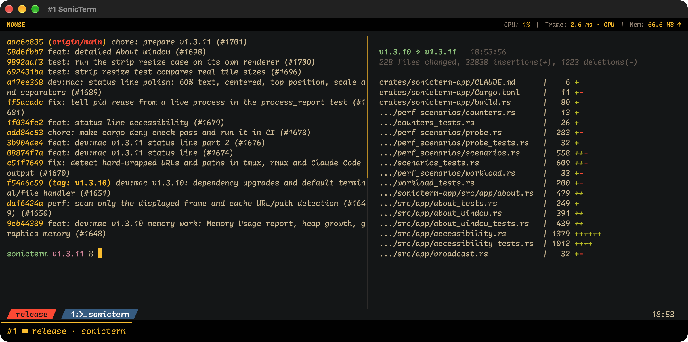
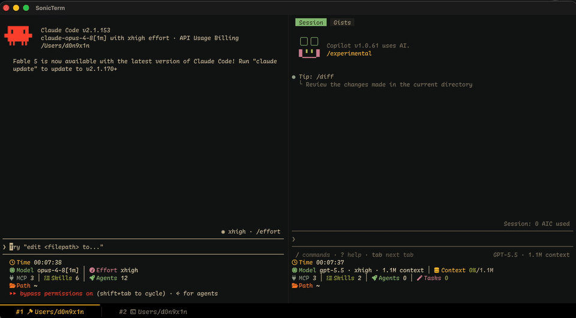

<div align="center">


# SonicTerm

**A fast, native, GPU-accelerated terminal for people who live in the shell — and the agents that work there with them.**

[](https://github.com/D0n9X1n/SonicTerm/actions/workflows/ci.yml)
[](https://github.com/D0n9X1n/SonicTerm/releases/latest)
[](https://github.com/D0n9X1n/SonicTerm/releases)
[](LICENSE)
[](https://github.com/D0n9X1n/SonicTerm/stargazers)

**[Download](https://github.com/D0n9X1n/SonicTerm/releases/latest)** ·
**[Documentation](wiki/Home.md)** · [简体中文文档](wiki/Home-zh-CN.md)

<sub>macOS 15+ (Apple Silicon and Intel) · Windows x64 · Linux x86_64 (.deb, .tar.gz)</sub>

</div>

<p align="center">
  <a href="assets/screenshots/agents-hero.png">
    
  </a>
</p>

<p align="center">
  <b>Your agents, side by side, drawing real pictures.</b><br/>
  Claude Code answers with a rendered Mermaid diagram while a Copilot reviewer and a
  Claude test-writer work in the panes beside it — one SonicTerm window, inside tmux.
</p>

SonicTerm is a native terminal for macOS, Windows, and Linux. It draws every cell,
glyph, and overlay as GPU quads, shows real images inline, and gives you the
comforts of a modern editor — a command palette, split panes, tabs you can drag
between windows, and plain TOML config. There is no Electron shell, no web runtime,
and no preferences pane: everything SonicTerm keeps lives under `~/.sonicterm`.

## Highlights

### Agents in panes, diagrams as pictures

The capture above is one SonicTerm window running tmux. On the left, Claude Code
answers with a Mermaid sequence diagram that
[mermaid-tty](https://github.com/D0n9X1n/mermaid-tty) renders through kitty
graphics, so the picture sits in the chat instead of a wall of box-drawing text.
On the right, [mux-agents](https://github.com/D0n9X1n/mux-agents) runs a Copilot
reviewer and a Claude test-writer in their own panes, with a sidebar showing which
agent is working and what each is doing.

```sh
claude plugin marketplace add D0n9X1n/mermaid-tty
claude plugin install mermaid-tty@mermaid-tty --config theme=default
claude plugin marketplace add D0n9X1n/mux-agents && claude plugin install mux-agents@mux-agents
npm i -g @mermaid-js/mermaid-cli   # pictures; without it diagrams draw as text
```

Outside a multiplexer, pictures need nothing more. Inside tmux, add
`set -g allow-passthrough on` and start Claude Code with mermaid-tty's
`bin/claude-tmux.py` launcher, which forwards its images through tmux to SonicTerm.

### Images, inline

Kitty graphics — direct placement and the Unicode placeholders Claude Code uses —
plus Sixel and iTerm2 images, on every platform. Logos, plots, and heatmaps render
at full resolution right in the scrollback, next to the command that made them.
See [kitty graphics](wiki/Terminal-IO-and-VT.md#kitty-graphics).


### Split panes for AI CLIs and real terminal apps

Every pane owns its own PTY. Run an agent, a reviewer, and a system monitor side by
side, with Nerd Font icons, Powerline glyphs, emoji, CJK, and full-screen TUIs drawn
crisply. Split with `Cmd+D` / `Cmd+Shift+D` (`Alt+D` / `Alt+Shift+D` on Windows and
Linux), zoom a pane, or broadcast input across them.


### A command palette for everything

`Cmd+Shift+P` (`Alt+Shift+P`) searches every action and shows the shortcut your
current keymap binds to it: split and zoom panes, rename tabs and windows, switch
themes, open config or keymaps, toggle chrome, and reload settings — all without
leaving the terminal.


### Nine themes, switched live

Tokyo Night, Catppuccin Mocha, Gruvbox Dark Hard, Nord, Dracula, One Dark,
Monokai Pro, Solarized Dark, and WezTerm ship in the box. Pick one with
**Apply Theme** in the palette and every window repaints at once; themes are
plain TOML you can copy and edit. See [Themes](wiki/Themes.md).


### A status line that knows the terminal

An optional strip at the top or bottom of each window shows what only SonicTerm
knows: mode chips such as `MOUSE` while a program captures the mouse, SonicTerm's
own CPU, frame time and memory, scrollback position, selection size, clipboard
writes, refused input, and missing glyphs. Segments stay hidden until they have
something to say. Turn it on with **Toggle Status Line** or
[`[status_line] enabled = true`](wiki/Configuration.md#status_line).



### Drag tabs between windows

Tabs are not trapped in one window. Drag a busy terminal out into its own window,
work there, then drag it back. The pane and its process move with the tab; the
shell never restarts.


### Broadcast input across panes

Type once, run everywhere: broadcast mirrors your keystrokes to every pane in the
tab (`Cmd+Shift+B` / `Alt+Shift+B`) — handy for mirrored shell commands, paired
agent sessions, and multi-host setup.



### READONLY mode for safe reading

`Cmd+[` (`Alt+[`) blocks terminal input while search, tab switching, and pane
focus keep working, so you can dig through scrollback or a long-running log
without typing into the live shell.


### Click file references

Hold `Cmd` (`Ctrl` on Windows and Linux) to preview a detected local path, then
click to reveal it in its folder — never to execute it. Line numbers stay out of
the filename, and relative paths resolve against that pane's own working
directory. See [local targets](wiki/Usage.md#open-urls-and-local-targets).


## Why SonicTerm?

- **Native and small** — one app per platform, no Electron, no web runtime.
- **GPU first** — wgpu on Metal, D3D12, and Vulkan with an atlas-backed glyph cache.
  Without a GPU (RDP, VMs) it degrades gracefully, with a full software path on Windows.
- **Bounded memory** — grids, captures, PTY queues, and images each enforce their own
  limits, and the **Memory Usage** command opens a copyable report.
  See [Memory](wiki/Memory.md).
- **Config is just files** — `~/.sonicterm/sonicterm.toml`, plus editable `themes/`
  and `keymaps/` examples seeded on first launch.
- **Typography that works out of the box** — the platform's own monospace face, with
  the bundled Symbols Nerd Font Mono for Powerline and Nerd Font icons.
- **A good default terminal** — run commands from launchers (`sonicterm -e htop`),
  and on macOS open executables and `ssh:` links. Nothing changes your defaults until
  you confirm **Set SonicTerm as Default…**.
  See [Choose SonicTerm as the default](wiki/Usage.md#choose-sonicterm-as-the-default).
- **WezTerm-proven behavior** — terminal, font, keymap, and rendering semantics follow
  WezTerm where SonicTerm has absorbed them.

## Documentation

Everything operational lives in the repository's [`wiki/`](wiki/), in
[English](wiki/Home.md) and [简体中文](wiki/Home-zh-CN.md):

| Topic | Page |
| --- | --- |
| Install and everyday use | [Usage](wiki/Usage.md) |
| Preferences and `sonicterm.toml` | [Configuration](wiki/Configuration.md) |
| Keymaps | [Keybindings](wiki/Keybindings.md) |
| Theme authoring | [Themes](wiki/Themes.md) |
| tmux and other multiplexers | [Terminal Multiplexers](wiki/Terminal-Multiplexers.md) |
| Logs and diagnostics | [Logging](wiki/Logging.md) |
| Building packages | [Packaging](wiki/Packaging.md) |

## Thanks, WezTerm

SonicTerm owes a lot to [WezTerm](https://github.com/wezterm/wezterm), its
reference for terminal semantics, font behavior, keymap conventions, and many
rendering edge cases. WezTerm-proven ideas live on in Sonic-owned crates:

- VT and grid behavior in `sonicterm-vt` and `sonicterm-grid`.
- Font fallback, shaping, and rasterization in `sonicterm-font`.
- Box drawing, block glyph, Powerline, Braille, sextant, and octant geometry in
  `sonicterm-block-glyph`.

WezTerm is MIT-licensed; the upstream license for absorbed custom-glyph code is
kept at `crates/sonicterm-block-glyph/LICENSE-WEZTERM`.

## License

SonicTerm is released under the [MIT License](LICENSE).
