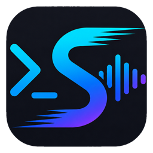
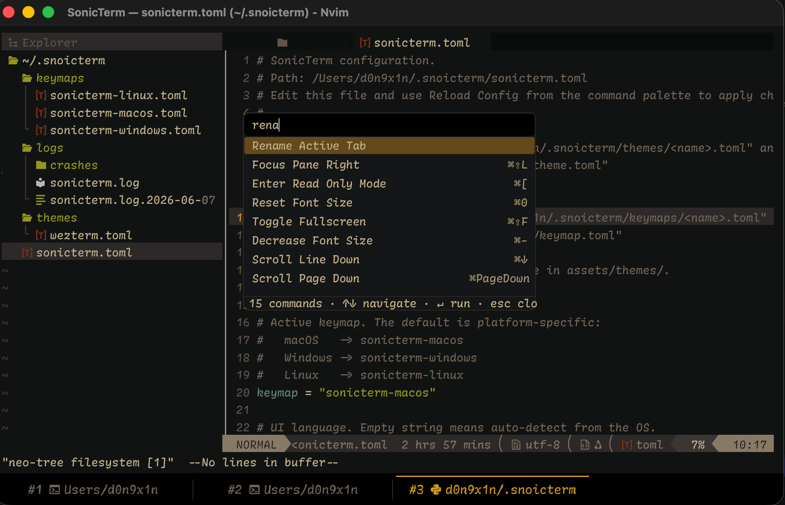
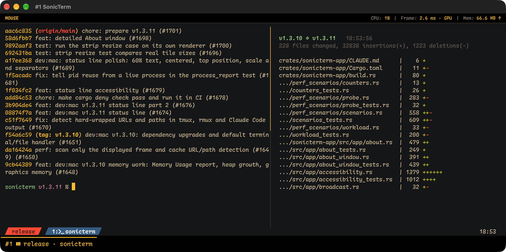
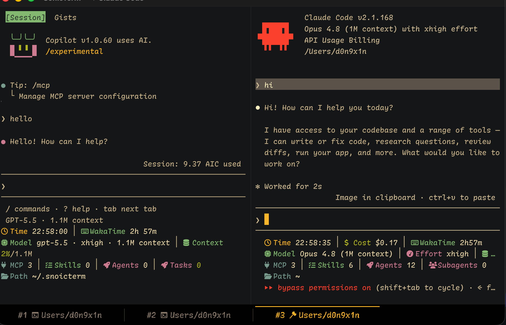
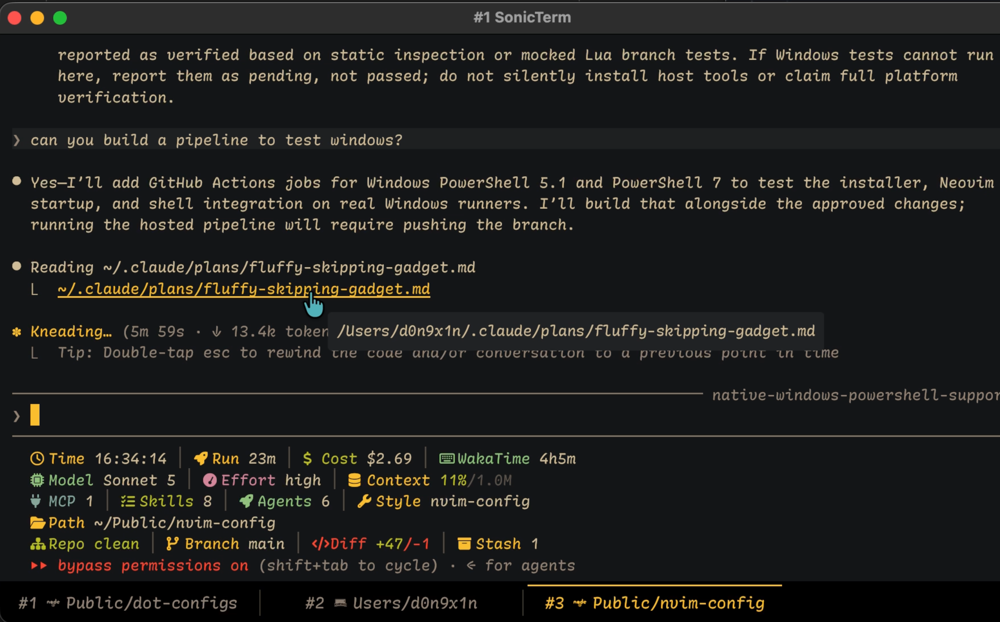
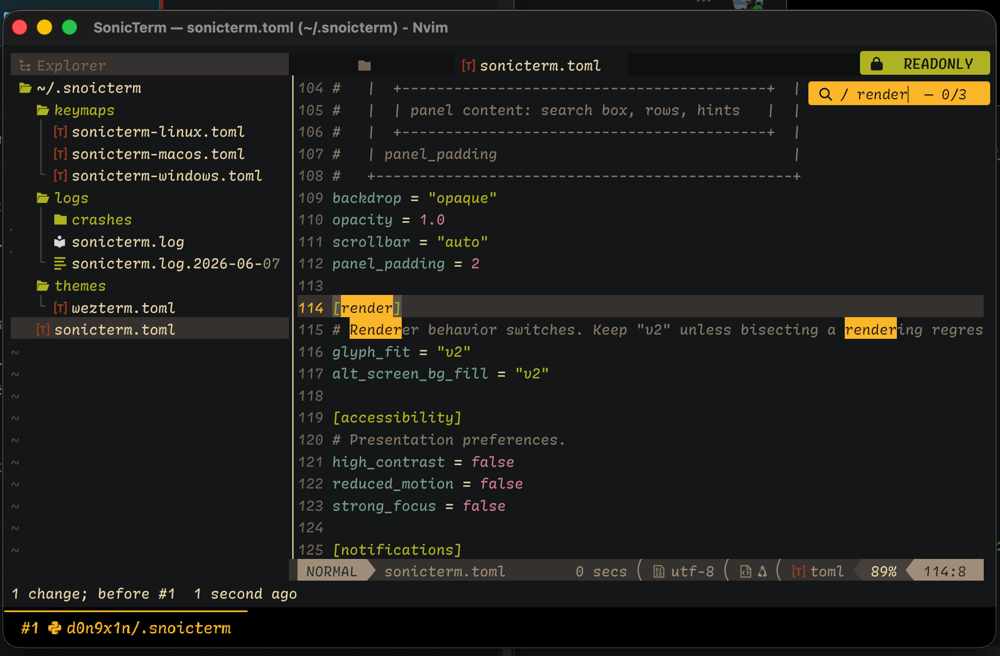
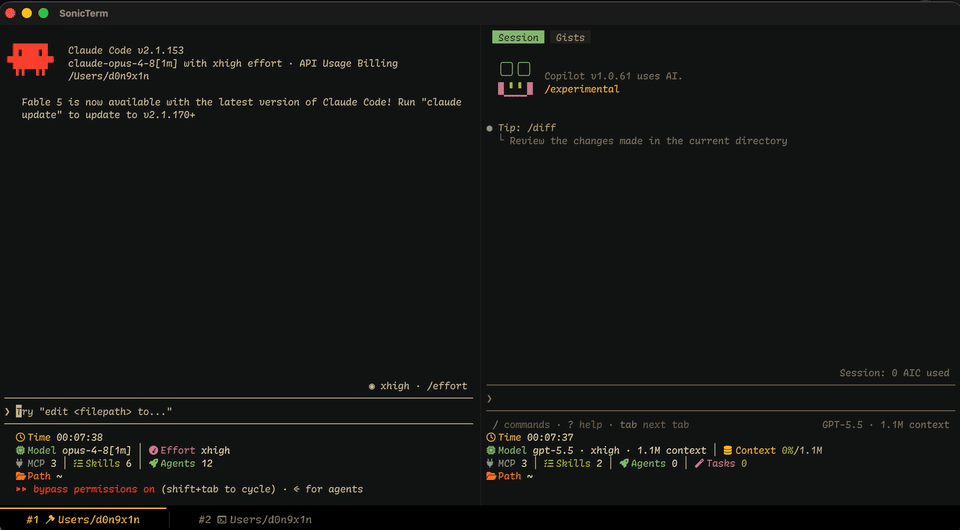
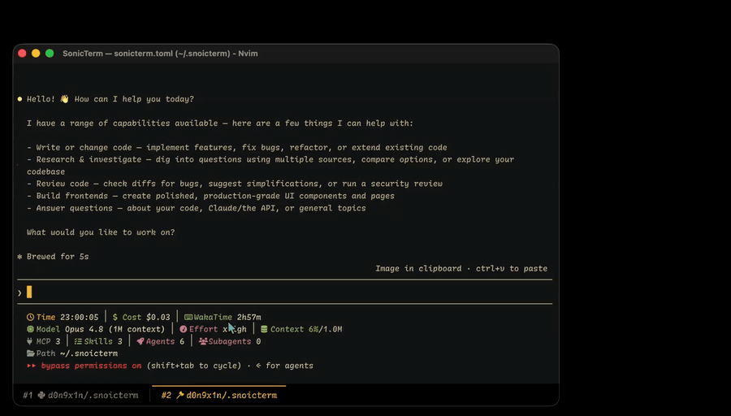

# SonicTerm

**A fast, native, GPU-accelerated terminal for people who live in the shell.**

SonicTerm is a native macOS, Windows, and Linux terminal with the quality-of-life
features you expect from a modern editor: searchable commands, split panes,
draggable tabs, editable TOML config, bundled Nerd-Font-patched typography, and
a renderer that is designed around GPU quads instead of CPU blits.

It aims to feel small, sharp, and quiet: no Electron shell, no heavyweight
runtime, no required GUI preferences pane, and no global dotfile sprawl. User
state lives under one directory: `~/.sonicterm`.

macOS packages include their native libraries and require macOS 15+ on both
Apple Silicon and Intel. See [Packaging](wiki/Packaging.md) for local-build
compatibility and signing details.

Need installation, configuration, keybindings, or theme authoring docs? Read the
[English](wiki/Home.md) or [简体中文](wiki/Home-zh-CN.md) documentation in the
repository-tracked [`wiki/`](wiki/) directory. Each language has its own files. The
README is only the product overview: why SonicTerm exists, what it feels like,
and why you might want to use it.

## Screenshots

### Command palette + editable config

The command palette is the center of the UI: search commands, see the active
keymap shortcut, open config/keymaps, rename tabs, split panes, toggle chrome,
and reload settings without leaving the terminal.

### Status line

An optional strip at the top of each window, or at the bottom, shows what only
SonicTerm knows: mode chips such as `MOUSE` while a program captures the mouse,
SonicTerm's own CPU, frame time and memory, scrollback position, the selection
size, clipboard writes, refused input and missing glyphs. Segments hide until
they have something to say. Turn it on with `[status_line] enabled = true` or
**Toggle Status Line**, and move it, resize its text or choose segments from the
command palette. See [status line settings](wiki/Configuration.md#status_line).

### Split panes built for AI CLIs and real terminal apps

SonicTerm supports multiple panes, per-pane PTYs, tab titles, Nerd Font icons,
Powerline glyphs, emoji, CJK, and terminal apps that draw their own UI.

### File references in terminal messages

Hold Cmd on macOS or Ctrl on Windows/Linux to preview a detected local file,
then click to reveal it in its folder—not execute it or launch an editor.
Relative references use the current pane's trusted shell working directory.
See [local targets](wiki/Usage.md#open-urls-and-local-targets).

*User-provided capture showing a detected file path and its resolved absolute-path
preview. Click/reveal behavior was verified separately in the native app.*

### READONLY mode for safe navigation

READONLY mode blocks terminal input while keeping search, tab switching, and
pane focus available. It is built for safely inspecting scrollback, config, or
long-running output without accidentally typing into the active shell.

### Broadcast input across panes

Broadcast mode sends the same keyboard input to every pane in the current tab,
which is useful for mirrored shell commands, paired AI CLI sessions, and quick
multi-pane setup work.

### Drag tabs between windows

This is SonicTerm's most important workflow feature: tabs are not trapped in one
window. Drag a busy terminal out into its own window, work there, then drag it
back when the context belongs with the original session again.

## Why try it?

- **Native macOS, Windows, and Linux app** — small binaries, no Electron, no web runtime.
- **GPU renderer** — wgpu on Metal, D3D12, and Vulkan, with atlas-backed text and batched
  quads for cells, chrome, selection, cursor, search, and overlays. Glyphs
  rasterize with DirectWrite on Windows (FreeType elsewhere and as fallback).
  Detects the no-GPU case (RDP / VM software rasterizer) and degrades gracefully
  to stay responsive, with a deterministic full-screen software path on Windows.
- **Memory limits and retention reports** — grids, parser captures, PTY queues,
  and image storage enforce their own limits. These per-pane and per-renderer
  limits are not a hard process-wide quota: total memory can grow with the
  number of panes and windows. Stalled image transfers and reclaimed older
  images are reported at the default log level; optional retention reports
  show sampled subsystem usage. The **Memory Usage** palette command opens a
  copyable report of process, renderer, graphics and per-pane memory. See
  [Memory](wiki/Memory.md) for process targets, residual bounds, and accounting
  exclusions.
- **Inline images** — kitty graphics (direct placement and Unicode placeholders,
  as Claude Code draws them), Sixel and iTerm2 images, on macOS, Linux and
  Windows. Mermaid diagrams from the mermaid-tty plugin show as pictures. See
  [Terminal IO and VT](wiki/Terminal-IO-and-VT.md#kitty-graphics).
- **Real pane workflow** — split panes, close/resize behavior, per-pane PTYs,
  pane focus, READ ONLY mode for safe scrollback navigation, quick-select URL
  hints, and search.
- **File references in terminal messages** — hold Cmd on macOS or Ctrl on
  Windows/Linux to preview a detected local path, then click to reveal the file
  in its folder. Source references keep line numbers out of the filename;
  relative paths use that pane's trusted shell working directory, except on the
  alternate screen of full-screen programs such as tmux. See
  [local targets](wiki/Usage.md#open-urls-and-local-targets).
- **Default terminal and file handler** — launchers can run a command directly
  (`sonicterm -e htop`, xdg-terminal-exec, KDE); macOS can open Unix executables
  and `ssh:`/`x-man-page:` links in SonicTerm; double-clicked scripts are still
  typed at the prompt, not run. Installing changes no default: the
  **Set SonicTerm as Default…** palette command does, after confirmation. See
  [Run a command from a launcher](wiki/Usage.md#run-a-command-from-a-launcher) and
  [Choose SonicTerm as the default](wiki/Usage.md#choose-sonicterm-as-the-default).
- **Command palette first** — commands are searchable and display shortcuts from
  your current keymap config. **About SonicTerm** opens a window with the version,
  build commit and date, OS, renderer, font, theme, keymap, config and log paths,
  and a Copy button.
- **Config is just files** — `~/.sonicterm/sonicterm.toml`, plus editable
  `themes/` and `keymaps/` examples seeded on first launch.
- **System typography, bundled icons** — text uses the platform's own monospace
  face (Menlo, Cascadia Mono or Consolas, or fontconfig's `monospace`), and the
  bundled Symbols Nerd Font Mono supplies Powerline and Nerd Font icons out of the box.
- **WezTerm-inspired behavior** — terminal, font, keymap, and rendering details
  follow WezTerm-proven semantics where SonicTerm has absorbed them.

## Documentation lives in `wiki/`

The README intentionally avoids operational details. If you want to install it,
change preferences, edit keybindings, author a theme, inspect logs, or build from
source, use the repository-tracked [English](wiki/Home.md) or
[简体中文](wiki/Home-zh-CN.md) documentation:

| Topic | Documentation page |
| --- | --- |
| Usage and installation | [Usage](wiki/Usage.md) |
| Preferences and `sonicterm.toml` | [Configuration](wiki/Configuration.md) |
| Keymap editing | [Keybindings](wiki/Keybindings.md) |
| Theme authoring | [Themes](wiki/Themes.md) |
| Logs and diagnostics | [Logging](wiki/Logging.md) |

## Thanks, WezTerm

SonicTerm owes a lot to [WezTerm](https://github.com/wezterm/wezterm). WezTerm
is the reference for terminal semantics, font behavior, keymap conventions, and
many rendering edge cases. SonicTerm has absorbed WezTerm-proven ideas into
Sonic-owned crates:

- VT/grid behavior in `sonicterm-vt` and `sonicterm-grid`.
- Font fallback, shaping, and rasterization in `sonicterm-font`.
- Box drawing, block glyph, Powerline, Braille, sextant, and octant geometry in
  `sonicterm-block-glyph`.

WezTerm is MIT-licensed; the upstream license for absorbed custom-glyph code is
kept at `crates/sonicterm-block-glyph/LICENSE-WEZTERM`.

## License

SonicTerm is released under the [MIT License](LICENSE).
