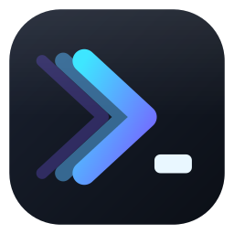
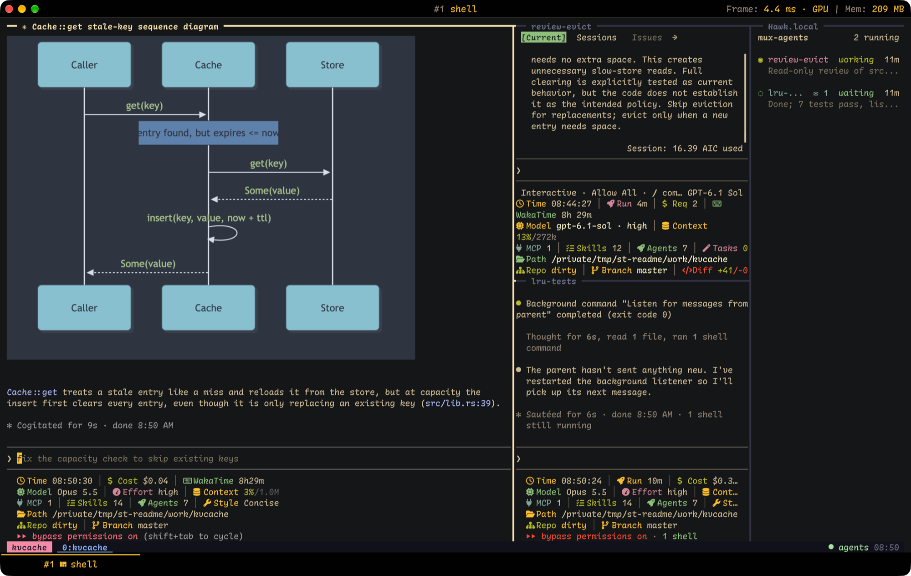
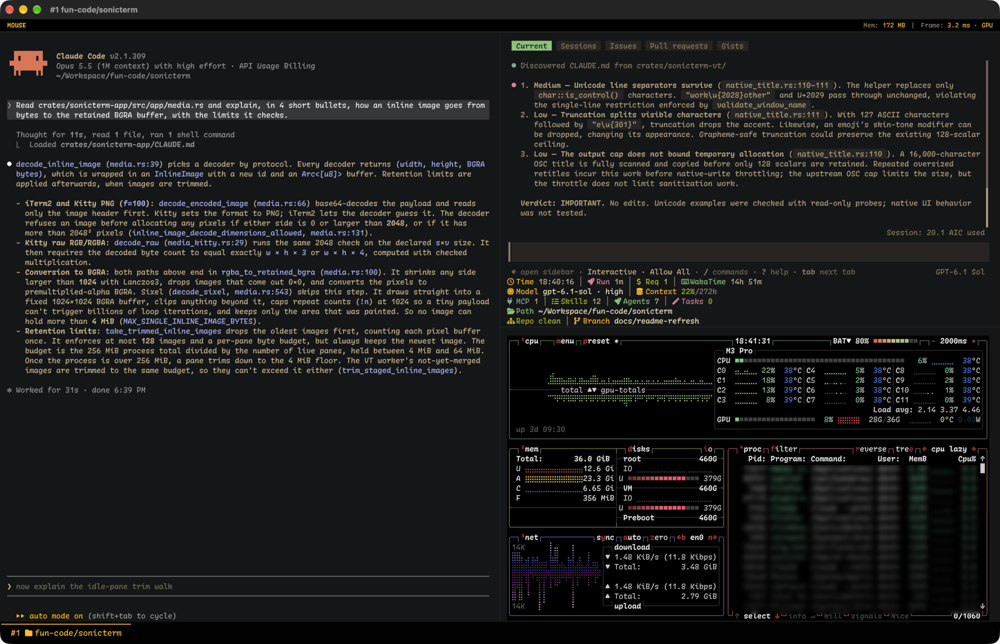
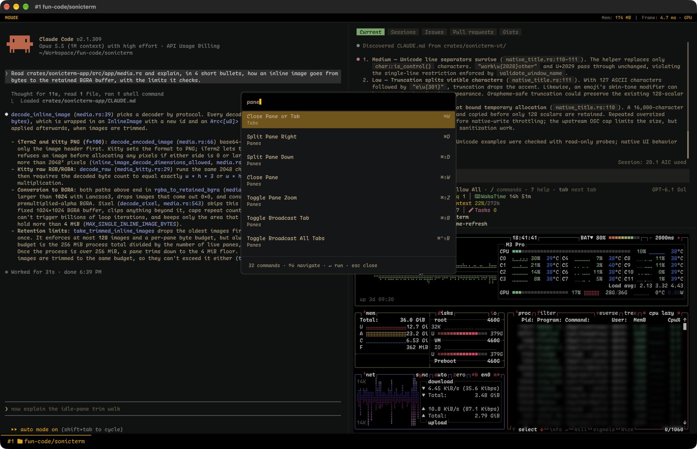
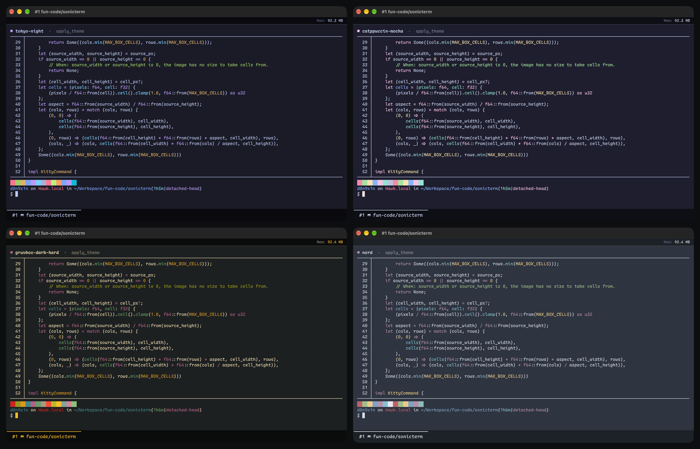
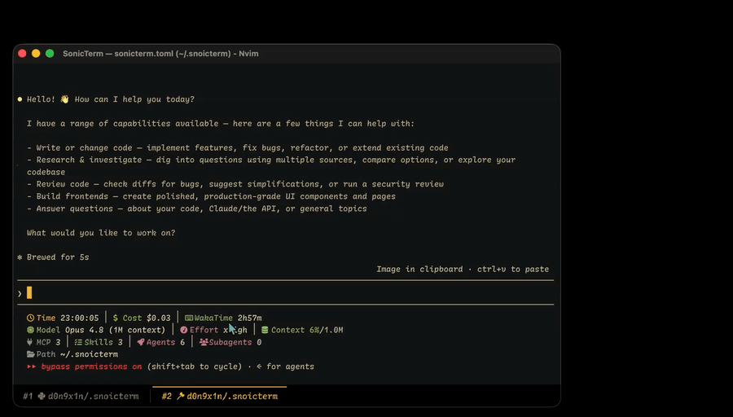
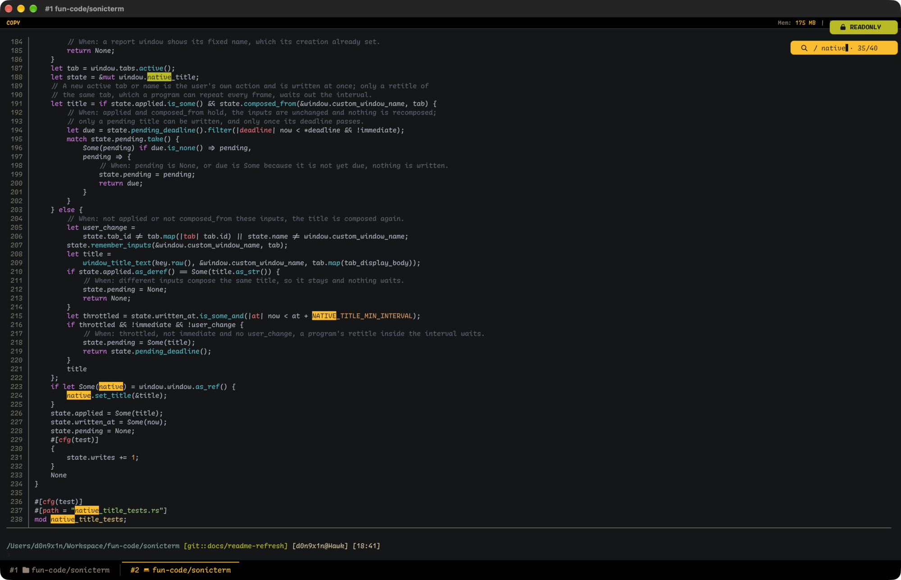
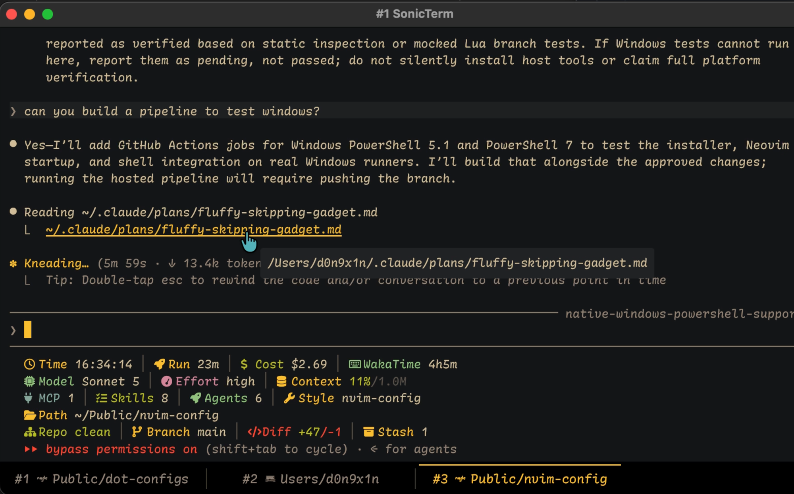
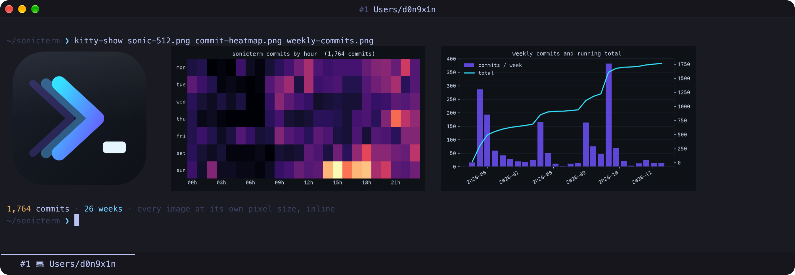

<div align="center">



# SonicTerm

**The native GPU terminal for people who live in the shell —<br/>and the agents that work there with them.**

[](https://github.com/D0n9X1n/SonicTerm/releases/latest) [](https://github.com/D0n9X1n/SonicTerm/releases) [](https://github.com/D0n9X1n/SonicTerm/actions/workflows/ci.yml) [](LICENSE)

**[Download](https://github.com/D0n9X1n/SonicTerm/releases/latest)** · **[Documentation](wiki/Home.md)** · [简体中文](wiki/Home-zh-CN.md)

<sub>macOS 15+ (Apple Silicon and Intel) · Windows x64 · Linux x86_64 (.deb, .tar.gz)</sub>

</div>

<p align="center">
  <a href="assets/screenshots/agents-hero.png">
    
  </a>
  <br/>
  <sub><b>Your agents, side by side, drawing real pictures.</b> Claude Code answers with a rendered Mermaid diagram while a reviewer and a test-writer work in the panes beside it.</sub>
</p>

## Why SonicTerm

- **Native, not a web page.** One small app per platform, every cell, glyph and overlay drawn on the GPU (Metal, D3D12, Vulkan), with a full software path on Windows when there is no GPU.
- **Built for agents.** Kitty, Sixel and iTerm2 images inline, Mermaid diagrams as pictures, agents in split panes, and an [MCP server](wiki/MCP-Server.md) that lets an agent drive the terminal.
- **Modern comforts.** A command palette for every action, tabs you drag between windows, broadcast input, READONLY mode, and clickable file paths.
- **Bounded memory.** Grids, images, captures and PTY queues each keep their own limits; **Memory Usage** opens a copyable report of what each subsystem holds.
- **Config is just files.** Plain TOML in `~/.sonicterm`, thirteen light and dark themes previewed live, no preferences pane.

## A closer look

<table>
  <tr>
    <td width="50%"><a href="assets/screenshots/split-panes.png"></a><br/><sub><b>Split panes</b> — an agent, a reviewer and btop, each with its own PTY.</sub></td>
    <td width="50%"><a href="assets/screenshots/command-palette.png"></a><br/><sub><b>Command palette</b> — every action, with the shortcut your keymap binds.</sub></td>
  </tr>
  <tr>
    <td width="50%"><a href="assets/screenshots/themes.png"></a><br/><sub><b>Thirteen themes</b> — preview each live; every window repaints at once.</sub></td>
    <td width="50%"><a href="assets/screenshots/tab-drag-demo.gif"></a><br/><sub><b>Drag tabs between windows</b> — the shell moves with the tab, never restarts.</sub></td>
  </tr>
  <tr>
    <td width="50%"><a href="assets/screenshots/read-only-search.png"></a><br/><sub><b>READONLY search</b> — dig through scrollback without typing into the shell.</sub></td>
    <td width="50%"><a href="assets/screenshots/file-detection.png"></a><br/><sub><b>Clickable paths</b> — hold <kbd>Cmd</kbd> to preview, click to reveal, never to run.</sub></td>
  </tr>
</table>

<p align="center">
  <a href="assets/screenshots/inline-images.png"></a>
  <br/>
  <sub><b>Real images, inline</b> — each drawn at its own pixel size, right in the scrollback next to the command that made them.</sub>
</p>

## Get started

Download the [latest release](https://github.com/D0n9X1n/SonicTerm/releases/latest) for your platform and open it. Everything SonicTerm keeps lives under `~/.sonicterm`; see [Usage](wiki/Usage.md) to make it your default terminal.

<details>
<summary><b>Set up the agent workspace in the screenshot</b></summary>

[mermaid-tty](https://github.com/D0n9X1n/mermaid-tty) draws Claude Code's Mermaid answers as pictures, and [mux-agents](https://github.com/D0n9X1n/mux-agents) runs helper agents in their own panes:

```sh
claude plugin marketplace add D0n9X1n/mermaid-tty
claude plugin install mermaid-tty@mermaid-tty --config theme=default
claude plugin marketplace add D0n9X1n/mux-agents && claude plugin install mux-agents@mux-agents
npm i -g @mermaid-js/mermaid-cli   # pictures; without it diagrams draw as text
```

Inside tmux, add `set -g allow-passthrough on` and start Claude Code with mermaid-tty's `bin/claude-tmux.py` launcher, which forwards its images through tmux to SonicTerm.

</details>

## Documentation

[Usage](wiki/Usage.md) · [Configuration](wiki/Configuration.md) · [Keybindings](wiki/Keybindings.md) · [Themes](wiki/Themes.md) · [Multiplexers](wiki/Terminal-Multiplexers.md) · [MCP server](wiki/MCP-Server.md) · [Logging](wiki/Logging.md) · [Packaging](wiki/Packaging.md) — also in [简体中文](wiki/Home-zh-CN.md).

## Thanks, WezTerm

SonicTerm uses [WezTerm](https://github.com/wezterm/wezterm) as its reference for terminal semantics, font behavior, keymap conventions and rendering edge cases, and absorbs that proven behavior into its own crates. WezTerm is MIT-licensed; the license for absorbed custom-glyph code is kept at `crates/sonicterm-block-glyph/LICENSE-WEZTERM`.

## License

[MIT](LICENSE)
