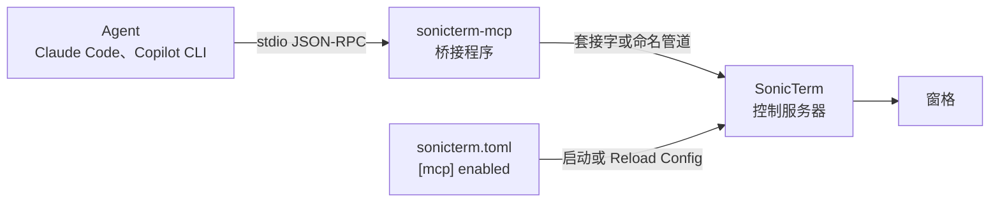

# MCP 服务器

[English](MCP-Server)

SonicTerm 可以运行一个本地 [Model Context Protocol](https://modelcontextprotocol.io)
服务器，让 Claude Code、Copilot CLI 等 agent 读取它的窗格，并在你选择的范围内操作它们。
它默认关闭；关闭时不监听任何东西，也不存在任何端点。

本页说明如何开启或关闭服务器、连接 agent，以及选择 agent 可以控制什么。端点、权限和读取类
工具的上限见 [平台集成](Platform-Integration-zh-CN)。



## 开启或关闭

服务器由 `sonicterm.toml` 的 `[mcp]` 段控制：

```toml
[mcp]
# Local MCP server for agents such as Claude Code and Copilot CLI.
# Nothing listens while this is off.
enabled = false
# Control tools act on: "off" (none), "agent" (panes an agent created),
# or "any" (every pane).
control = "agent"
# Read tools see: "agent" (panes an agent created) or "any" (every pane).
# A config without this line sees only agent-created panes.
read = "agent"
```

| Key | 默认值 | 取值 |
| --- | --- | --- |
| `enabled` | `false` | `true` 运行服务器；`false` 停止服务器。 |
| `control` | `"agent"` | `"off"`、`"agent"` 或 `"any"`；见下文“控制范围”。 |
| `read` | `"agent"` | `"agent"` 或 `"any"`；见下文“读取范围”。 |

开启方法：

1. 在命令面板中运行 **Edit sonicterm.toml**。
2. 在 `[mcp]` 下设置 `enabled = true` 并保存文件。
3. 在命令面板中运行 **Reload Config**，或重启 SonicTerm。

关闭方法：设置 `enabled = false`，保存，然后运行 **Reload Config**。服务器停止，所有连接
结束，端点被删除。

只保存文件不会改变任何东西：SonicTerm 没有文件监视器，只在启动和 **Reload Config** 时读取
`sonicterm.toml`。重载时若 `[mcp]` 未变，服务器和现有连接都保留。每个 key 的完整规则见
[配置](Configuration-zh-CN)。

## 连接 agent

SonicTerm 自身的二进制都是 GUI 程序，因此 agent 改为启动随附的 `sonicterm-mcp` 桥接程序。
它是一个 stdio MCP 服务器：在 stdin 和 stdout 上使用按行分隔的 JSON-RPC，并把每一行在 agent 与
正在运行的 SonicTerm 控制服务器之间双向转发。stdout 只承载 SonicTerm 发出的内容；诊断信息写到
stderr。

| 平台 | `sonicterm-mcp` 路径 |
| --- | --- |
| macOS | `/Applications/SonicTerm.app/Contents/MacOS/sonicterm-mcp` |
| Linux | `sonicterm-mcp`（`.deb` 安装在 `/usr/bin`），或 tarball 中 `sonicterm` 旁边 |
| Windows | `"C:\Program Files\SonicTerm\sonicterm-mcp.exe"` |

在 Claude Code 中注册：

```bash
claude mcp add --transport stdio --scope user sonicterm -- /Applications/SonicTerm.app/Contents/MacOS/sonicterm-mcp
```

Copilot CLI 则在 `~/.copilot/mcp-config.json` 中添加一个 `mcpServers` 条目：

```json
{ "mcpServers": { "sonicterm": { "type": "local", "command": "/Applications/SonicTerm.app/Contents/MacOS/sonicterm-mcp", "args": [], "tools": ["*"] } } }
```

在 Linux 或 Windows 上，把命令换成上表中的路径。

### 桥接程序如何找到 SonicTerm

桥接程序按以下顺序选择端点：

1. `--endpoint <path-or-pipe>`。
2. `SONICTERM_CONTROL`；服务器运行期间，SonicTerm 会在它打开的每个窗格中设置它。
3. 每用户端点目录中唯一存活的端点。没有或多于一个时报错，并列出找到的端点；桥接程序从不在多个
   实例之间猜测。

在 SonicTerm 窗格内启动的 agent 会继承 `SONICTERM_CONTROL` 和 `SONICTERM_PANE_ID`，因此无需任何
参数即可连到该实例，桥接程序会把 `SONICTERM_PANE_ID` 作为默认窗格传递。默认窗格从不构成授权。
窗格的环境在窗格打开时就已确定，因此服务器启动前打开的窗格没有 `SONICTERM_CONTROL`；此时桥接
程序退回到端点目录。

发送任何字节之前，桥接程序会检查服务器以同一用户运行：macOS 和 Linux 上检查对端 uid，Windows 上
检查服务器进程令牌的 SID。用法错误时以 2 退出，找不到端点或无法连接时以 1 退出，任一端关闭时以 0
退出。SonicTerm 关闭连接后，桥接程序会在已发送的内容全部写入 stdout 之后再退出；若 stdout 2 s
内未接收任何内容则以 1 退出。SonicTerm 连接期间，若已积压 4 MiB 且客户端 5 s 内未读取任何内容，
则以 1 结束转发。进度以 stdout 管道或套接字实际接收的字节计：macOS 上客户端的任何读取都算数；
Linux 上管道按页释放空间，套接字按每次 16 KiB 的写入释放空间，客户端每个时段至少要读取相应的量。
像 MCP 客户端那样持续读取的客户端永远不会被断开。`--version`（`-V`）和 `--help`（`-h`）打印后
退出。

## 控制范围

`[mcp] control` 决定控制类工具可以作用于什么；`[mcp] read` 决定读取类工具可以看到什么（见“读取范围”）。

| `control` | 控制类工具可作用于 |
| --- | --- |
| `"off"` | 不允许；只有读取类工具可用 |
| `"agent"`（默认） | agent 创建的窗格，以及在任意窗格旁打开辅助窗格 |
| `"any"` | 所有窗格 |

无论范围如何，READONLY 窗口中的窗格总被拒绝。含有 agent 窗格的标签页在标题前显示紫色圆环标记。
重载时修改 `control` 会丢弃所有已排队的请求。

## 读取范围

`[mcp] read` 决定 `list_panes`、`read_pane` 和 `wait_for` 可以看到哪些窗格。

| `read` | 读取类工具可看到 |
| --- | --- |
| `"agent"` | 只有 agent 创建的窗格；其他窗格以 `out_of_scope` 拒绝，且不出现在 `list_panes` 中 |
| `"any"` | 所有窗格 |

没有 `read` 的配置只读取 agent 创建的窗格，因此除非你允许，agent 无法读取无关的 SSH 或日志窗格。
在 v1.4.4 及之前，缺少该键表示 `"any"`；服务器在没有该键时启动会记录一条警告，并在第一个窗口打开后显示一次通知，
`out_of_scope` 拒绝信息也会说明恢复旧范围所需的那一行。显式的 `read = "any"` 永远不会被改变。
每个 agent 会话都能看到所有 agent 创建的窗格，而不只是它自己创建的。若希望 agent
读取你自己的窗格（例如启动它的那个窗格），请使用 `"any"`。

哪些窗格属于 agent 只由 SonicTerm 自己的记录决定，从不取决于客户端：桥接程序的前导消息会把 agent
所在窗格作为 `self_pane_id` 的默认值，但在 `"agent"` 下无法解锁任何窗格。`run_command` 会在运行中
返回它所执行命令的输出；这由 `control` 决定，而不是 `read`。重载时修改 `read` 会丢弃所有已排队的
请求，并结束正在进行的 `wait_for`。

窗格文本是不可信输入：程序可以打印意在操纵 agent 的文本。服务器告知 agent 从不执行窗格文本中的
指令，但除非 agent 必须操作你自己的窗格，请将 `control` 保持为 `"agent"`。

## 工具

读取类工具是 `list_panes`、`read_pane` 和 `wait_for`。它们的参数、上限和加锁方式见
[平台集成](Platform-Integration-zh-CN)。

控制类工具在事件循环上执行时会再次按 `control` 检查：

| 工具 | 作用 |
| --- | --- |
| `create_pane` | 在某个窗格旁打开辅助窗格：向右或向下拆分，或在其窗口中新开标签页。焦点不移动。给出 `argv` 时直接运行该程序，程序退出后窗格保留，因此可用带 `exit` 的 `wait_for` 和 `read_pane` 读取其结束情况。 |
| `send_text` | 输入文本；程序要求时以括号粘贴方式发送；`submit` 追加回车。至多 64 KiB。 |
| `send_keys` | 发送具名按键（`Enter`、`Tab`、`Escape`、方向键、`Home`、`End`、`PageUp`、`PageDown`、`F1`–`F12`、单个字符），每个可加 `Ctrl+`、`Alt+` 或 `Shift+` 前缀，并按窗格的键盘模式编码。至多 64 个键；有一个未知名称则什么都不发送。 |
| `run_command` | 在窗格的 shell 提示符处运行一条命令并等待结束，返回其输出和 shell 报告的退出码（`completed`，`exit_verified` 表示 SonicTerm 自己的 shell 集成是否为其担保）；若 shell 未运行任何命令就结束了该提示符则返回 `not_started`，若在其输出开始前有他人输入则返回 `interfered`，记录被淘汰或 shell 退出则返回 `lost`，窗格先被关闭则返回 `pane_closed`，超时（默认 60 s，至多 600 s）则返回 `running`。 |
| `close_pane` | 关闭一个窗格；标签页的唯一窗格会关闭该标签页。主窗口的最后一个标签页永不关闭。 |

`run_command` 需要 shell 集成：shell 必须用 OSC 133 `A`、`B`、`C`、`D` 标记提示符，WezTerm、
iTerm2 和 kitty 的 shell 集成脚本都会这样做。若提示符后已有输入的文本、输入队列不为空，或上一条
命令运行期间有人输入，它会拒绝。这项检查只能尽力而为，因为终端无法看到 shell 已读取了什么，所以
请在 agent 创建的窗格上使用 `run_command`，那里只有 agent 输入。

### 等待如何结束

`wait_for` 报告一个 `reason`，`run_command` 报告一个 `state`。下表列出所有取值；客户端遇到未知取值时应按 `timeout`/`running` 处理。

| 取值 | 工具 | 含义 |
| --- | --- | --- |
| `matched` | `wait_for` | 正则匹配了符合条件的行。 |
| `quiet` | `wait_for` | 输出在 `quiet_ms` 内保持安静，且所有行都已扫描。 |
| `exited` | `wait_for` | 窗格的进程已退出（使用 `exit` 时）。 |
| `timeout` | `wait_for` | 先到达超时。 |
| `completed` | `run_command` | 命令已运行并结束；见 `exit_code` 与 `exit_verified`。 |
| `not_started` | `run_command` | shell 未运行任何命令就结束了提示符。 |
| `interfered` | `run_command` | 在命令输出开始前有他人输入。 |
| `lost` | `run_command` | 运行记录先被淘汰，或 shell 先退出。 |
| `running` | `run_command` | 已超时；命令可能仍在运行。 |
| `revoked` | 两者 | 客户端离开，或服务器停止、或 `control`、`read` 发生变化。 |
| `pane_closed` | 两者 | 窗格先被关闭。 |

两个工具还会报告 `output_incomplete`：对 `wait_for` 为 `missed_output || truncated || !scan_complete`（等待期间写入的部分输出未被检查，因此超时不能证明什么）；
对 `run_command` 为 `truncated || output_truncated`（返回的行可能缺少命令的部分输出）。

### 信任退出码

OSC 133 标记与命令自身的输出走同一条数据流，因此窗格中的任何程序都能打印它们。若不加防护，
程序打印一个伪造的 `D;0`，就能让 `run_command` 在它仍在运行时报告成功。有两条规则防范这一点：

- 没有 SonicTerm 自己的 shell 集成时，只有在 `D` 之后出现 shell 的下一个提示符，运行才算完成，
  退出码取该运行最新的 `D`，因此 shell 的真实标记优先于伪造的标记。这只是加固，不是证明：
  连提示符也一并伪造的程序仍能骗过它，所以结果带有 `exit_verified: false`。
- 使用 SonicTerm 的 shell 集成时，每个窗格的 shell 都会在 `SONICTERM_SHELL_TOKEN` 中得到一个新的
  128 位密钥。该集成只读取一次，再将其从环境中移除，使它运行的命令永远不会继承它，并在每个标记后附加
  `sonicterm_token=<密钥>`。SonicTerm 丢弃密钥错误的标记；一旦收到一个正确的标记，便在该窗格的整个
  生命周期内（包括 `RIS` 和切换屏幕之后）丢弃所有不带密钥的标记，因此输出既无法伪造也无法降级它们。
  自身的 `C` 和最新的 `D` 都带有密钥的运行会报告 `exit_verified: true`：退出码由 SonicTerm 的 shell
  集成担保，这比证明命令本身报告了它要弱。
- 只有在有人向窗格输入之前收到正确的标记，密钥才会被信任。没有该集成的 shell 会把密钥留在它运行的
  每个命令的环境中，因此一旦有输入到达窗格，正确的密钥也不再锁定该窗格；其标记按未验证处理，与没有密钥
  时相同。该集成在第一个提示符处锁定，早于你能输入的时刻，因此在缓慢的启动文件仍在加载时输入，会使该
  窗格保持未验证。在新标签页中打开的脚本只键入、不带回车，不运行任何内容，因此不算输入。
- SonicTerm 会移除它继承的任何 `SONICTERM_SHELL_TOKEN`（例如从另一个 SonicTerm 窗格启动时），因此窗格
  中的进程只持有自己的密钥。
- 直接运行某个程序启动的窗格（`-e` 或 `--command`、在 SonicTerm 中打开的链接或可执行文件）不会得到密钥：没有 shell 集成
  能对该程序隐藏密钥，因此它的标记永远不会被验证。

在 shell 的启动文件中加载该集成，**并放在任何会启动程序的行之前**。在它运行之前，密钥一直在 shell 的
环境中，因此启动文件先运行的程序（提示符工具、版本管理器、后台 agent 或终端复用器）会继承它，并可能在当时
或之后伪造经过验证的标记。SonicTerm 无法区分这类程序与 shell，因此 `exit_verified` 的可信程度取决于在该集成
之前运行的启动文件：

```sh
eval "$(sonicterm-mcp --shell-integration zsh)"    # zsh 5.3+，写入 ~/.zshrc
eval "$(sonicterm-mcp --shell-integration bash)"   # bash 4.4+，写入 ~/.bashrc
```

它把自己的钩子加在已有钩子旁边，因此可以与其他 OSC 133 集成并存。但一旦加载，该窗格中嵌套 shell
或 ssh 会话发出的标记都不带密钥，会被丢弃，所以 `run_command` 只能在窗格自己的 shell 中使用。
`list_panes` 与 `read_pane` 以 `shell_integration_state` 报告最新标记的情况：`verified`（带有窗格密钥）、`unverified`
（没有有效密钥，例如来自嵌套 shell、ssh 或打印标记的程序，无论被接受还是被丢弃）或 `none`（尚无标记）。
它是观察到的标记证据，并不能证明当前运行的是哪个程序；旧的布尔字段 `shell_integration` 含义不变（最新提示符标记了输入起点）。
PowerShell 目前还没有 SonicTerm 集成，因此在 Windows 上 `exit_verified` 始终为 `false`。该密钥用于防范
来自文件、远程主机以及从未见过 shell 环境的程序的输出。以你的身份在窗格中运行、能读取 shell 内存的
程序不在防范范围内：它本就拥有 agent 的权限。

## 确认是否生效

- 每个连接都会显示应用内通知 `Agent connected: <name>`，其中是客户端报告的名称。
- 设置 `[logging] level = "info"` 后，日志会记录 `control server started`、
  `control server stopped` 和 `control level changed`。服务器无法启动时，总会在 `mcp`
  target 下记录一条警告。见 [日志](Logging-zh-CN)。
- 在服务器启动后打开的窗格中，`SONICTERM_CONTROL` 保存端点的路径或管道名。
- 桥接程序报告找不到端点时，检查 `enabled = true`，以及保存文件后是否运行了 **Reload Config**。
