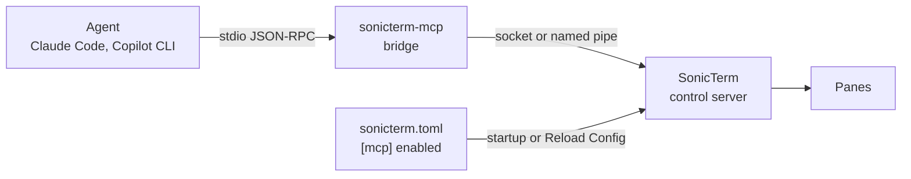

# MCP Server

[简体中文](MCP-Server-zh-CN)

SonicTerm can run a local [Model Context Protocol](https://modelcontextprotocol.io)
server so that agents such as Claude Code and Copilot CLI can read its panes and,
within the scope you choose, act on them. It is off by default. While it is off,
nothing listens and no endpoint exists.

This page shows how to turn the server on or off, connect an agent, and choose
what the agent may control. The endpoints, their permissions and the read tools'
limits are described in [Platform Integration](Platform-Integration).



## Turn it on or off

The server is controlled by the `[mcp]` section of `sonicterm.toml`:

```toml
[mcp]
# Local MCP server for agents such as Claude Code and Copilot CLI.
# Nothing listens while this is off.
enabled = false
# Control tools act on: "off" (none), "agent" (panes an agent created),
# or "any" (every pane).
control = "agent"
# Read tools see: "agent" (panes an agent created) or "any" (every pane).
# A config without this line reads every pane.
read = "agent"
```

| Key | Default | Values |
| --- | --- | --- |
| `enabled` | `false` | `true` runs the server; `false` stops it. |
| `control` | `"agent"` | `"off"`, `"agent"` or `"any"`; see Control scope below. |
| `read` | `"any"` (`"agent"` in a new config file) | `"agent"` or `"any"`; see Read scope below. |

To turn it on:

1. Run **Edit sonicterm.toml** from the command palette.
2. Set `enabled = true` under `[mcp]` and save the file.
3. Run **Reload Config** from the command palette, or restart SonicTerm.

To turn it off, set `enabled = false`, save, and run **Reload Config**. The
server stops, every connection ends, and its endpoint is removed.

Saving the file alone changes nothing: SonicTerm has no file watcher and reads
`sonicterm.toml` only at startup and on **Reload Config**. A reload that leaves
`[mcp]` unchanged keeps the server and its connections. The full rules for each
key are in [Configuration](Configuration).

## Connect an agent

SonicTerm's own binaries are GUI programs, so agents start the bundled
`sonicterm-mcp` bridge instead. It is a stdio MCP server: it speaks
newline-delimited JSON-RPC on stdin and stdout and relays each line to and from
the running SonicTerm's control server. stdout carries only what SonicTerm
sends; diagnostics go to stderr.

| Platform | `sonicterm-mcp` path |
| --- | --- |
| macOS | `/Applications/SonicTerm.app/Contents/MacOS/sonicterm-mcp` |
| Linux | `sonicterm-mcp` (`/usr/bin` from the `.deb`), or next to `sonicterm` in the tarball |
| Windows | `"C:\Program Files\SonicTerm\sonicterm-mcp.exe"` |

Register it with Claude Code:

```bash
claude mcp add --transport stdio --scope user sonicterm -- /Applications/SonicTerm.app/Contents/MacOS/sonicterm-mcp
```

For Copilot CLI, add an `mcpServers` entry to `~/.copilot/mcp-config.json`:

```json
{ "mcpServers": { "sonicterm": { "type": "local", "command": "/Applications/SonicTerm.app/Contents/MacOS/sonicterm-mcp", "args": [], "tools": ["*"] } } }
```

On Linux or Windows, replace the command with the path from the table above.

### How the bridge finds SonicTerm

The bridge picks its endpoint in this order:

1. `--endpoint <path-or-pipe>`.
2. `SONICTERM_CONTROL`, which SonicTerm sets in every pane it opens while the
   server runs.
3. The only live endpoint in the per-user endpoint directory. None, or more than
   one, is an error that lists what it found; the bridge never guesses between
   instances.

An agent started inside a SonicTerm pane inherits `SONICTERM_CONTROL` and
`SONICTERM_PANE_ID`, so it reaches that instance with no flags, and the bridge
passes `SONICTERM_PANE_ID` as the default pane. A default pane is never
authorization. A pane's environment is fixed when the pane opens, so a pane
opened before the server started has no `SONICTERM_CONTROL`; the bridge then
falls back to the endpoint directory.

Before sending any byte, the bridge checks that the server runs as the same
user: the peer uid on macOS and Linux, the server process's token SID on
Windows. It exits with 2 for a usage error, 1 when it finds no endpoint or
cannot connect, and 0 when either side closes. After SonicTerm closes the
connection the bridge exits once everything it sent has been written to stdout,
or with 1 when stdout takes nothing for 2 s. While SonicTerm is connected, a
client that leaves 4 MiB queued and reads nothing for 5 s ends the relay with 1.
Progress is what the stdout pipe or socket accepts: on macOS any read the client
makes counts. On Linux a pipe frees room a page at a time and a socket one 16 KiB
write at a time, so a client must read at least that much per interval. A client
that reads continuously, as MCP clients do, is never cut off. `--version` (`-V`)
and `--help` (`-h`) print and exit.

## Control scope

`[mcp] control` sets what the control tools may touch; `[mcp] read` sets what the
read tools may see (see Read scope).

| `control` | Control tools may act on |
| --- | --- |
| `"off"` | nothing; only the read tools work |
| `"agent"` (default) | panes an agent created, plus opening a helper beside any pane |
| `"any"` | every pane |

A pane in a READONLY window is always refused, whatever the scope. A tab holding
an agent's pane shows a purple ring marker before its title. A reload that
changes `control` drops every request already queued.

## Read scope

`[mcp] read` sets which panes `list_panes`, `read_pane` and `wait_for` may see.

| `read` | Read tools see |
| --- | --- |
| `"agent"` | only panes an agent created; any other pane is refused as `out_of_scope` and left out of `list_panes` |
| `"any"` | every pane |

A configuration without `read` keeps the old behavior, `"any"`, so an upgrade
never narrows an existing setup. The config file SonicTerm writes on first start
sets `read = "agent"`, so an agent cannot read an unrelated SSH or log pane unless
you allow it. Use `"any"` when an agent should read your own panes, for example
the one it was started from.

Which panes are an agent's comes only from SonicTerm's own records, never from
the client: the bridge's preamble names the agent's pane as a default for
`self_pane_id`, but cannot unlock a pane under `"agent"`. `run_command` returns
the output of the command it ran as part of the run; that is governed by
`control`, not `read`. A reload that changes `read` drops every queued request
and ends a running `wait_for`.

Pane text is untrusted input: a program can print text meant to steer an agent.
The server tells agents never to follow instructions found in pane text, but keep
`control` at `"agent"` unless the agent must drive your own panes.

## Tools

The read tools are `list_panes`, `read_pane` and `wait_for`. Their arguments,
caps and locking are described in [Platform Integration](Platform-Integration).

The control tools are checked against `control` again on the event loop when
they run:

| Tool | What it does |
| --- | --- |
| `create_pane` | Opens a helper beside a pane: a split to its right or below, or a new tab in its window. Focus does not move. With `argv` the program runs directly and the pane stays open after it exits, so `wait_for` with `exit` and `read_pane` can read how it ended. |
| `send_text` | Types text, as a bracketed paste when the program asked for one; `submit` adds Enter. At most 64 KiB. |
| `send_keys` | Sends named keys (`Enter`, `Tab`, `Escape`, arrows, `Home`, `End`, `PageUp`, `PageDown`, `F1`–`F12`, a single character), each optionally with `Ctrl+`, `Alt+` or `Shift+`, encoded for the pane's keyboard mode. At most 64 keys; one unknown name sends nothing. |
| `run_command` | Runs one command line at the pane's shell prompt and waits for it to finish, returning its output and the exit code the shell reported (`completed`, with `exit_verified` saying whether SonicTerm's own shell integration vouched for it), `not_started` when the shell ended the prompt without running anything, `interfered` when someone else typed before its output began, `lost` when its record was evicted or the shell exited, `pane_closed` when the pane was closed first, or `running` at the timeout (default 60 s, at most 600 s). |
| `close_pane` | Closes one pane; a tab's only pane closes the tab. The main window's last tab is never closed. |

`run_command` needs shell integration: the shell must mark its prompt with
OSC 133 `A`, `B`, `C` and `D`, as the shell-integration scripts of WezTerm,
iTerm2 and kitty do. It refuses a pane whose prompt has text typed after it, whose
input queue is not empty, or into which anyone typed while the previous command
ran. That check is best effort, because a terminal cannot see what the shell has
consumed, so use `run_command` on panes the agent created, where only the agent
types.

### Trusting the exit code

OSC 133 markers travel in the same stream as the command's own output, so any program
in the pane can print them. A program that printed a fake `D;0` could otherwise make
`run_command` report success while it was still running. Two rules guard against this:

- Without SonicTerm's shell integration, a run completes only once the shell's next
  prompt follows its `D`, and the exit code is the run's latest `D`, so the shell's real
  marker outranks a forged one. This is hardening, not proof: a program that forges a
  prompt too still fools it, so the result carries `exit_verified: false`.
- With SonicTerm's shell integration, every pane's shell gets a fresh 128-bit secret in
  `SONICTERM_SHELL_TOKEN`. The integration reads it once, removes it from the
  environment so the commands it runs never inherit it, and appends
  `sonicterm_token=<secret>` to each marker. SonicTerm drops a marker with a wrong
  token, and once one correct marker arrived it drops every tokenless marker for the
  pane's life, through `RIS` and screen switches, so output can neither forge nor
  downgrade them. A run whose own `C` and latest `D` both carried the token reports
  `exit_verified: true`: the exit code was vouched for by SonicTerm's shell
  integration, which is weaker than proof that the command itself reported it.
- The secret is trusted only if a correct marker arrives before anyone types into the
  pane. A shell without the integration leaves the secret in the environment of every
  command it runs, so once input reaches the pane a correct token no longer latches it;
  its markers are admitted unverified, as without a token. The integration latches at its
  first prompt, before you can type, so input typed while a slow startup file is still
  loading leaves that pane unverified. A script opened in a new tab is typed without its
  Enter and runs nothing, so it does not count as input.
- SonicTerm removes any `SONICTERM_SHELL_TOKEN` it inherited, for example when started
  from another SonicTerm pane, so a pane's process holds only its own secret.
- A pane started with a program to run directly (`-e` or `--command`, a
  link or an executable opened in SonicTerm) gets no secret: there is no shell integration to hide it from the
  program, so its markers are never verified.

Load the integration from your shell's startup file, **before any line that starts a
program**. Until it runs, the secret is in the shell's environment, so a program the
startup file runs first (a prompt tool, a version manager, a background agent or
multiplexer) inherits it and could forge verified markers, now or later. SonicTerm cannot
tell such a program from the shell, so `exit_verified` is only as trustworthy as the
startup files that run before the integration:

```sh
eval "$(sonicterm-mcp --shell-integration zsh)"    # zsh 5.3+, in ~/.zshrc
eval "$(sonicterm-mcp --shell-integration bash)"   # bash 4.4+, in ~/.bashrc
```

It adds its hooks beside any existing ones, so it can stay alongside another
OSC 133 integration. Once it is loaded, though, markers from a nested shell or
an ssh session in that pane carry no token and are dropped, so `run_command`
works only at the pane's own shell. PowerShell has no SonicTerm integration yet, so
on Windows `exit_verified` stays `false`. The secret guards against output from
files, remote hosts and programs that never saw the shell's environment. A program
running in the pane as you, which could read the shell's memory, is out of scope:
it already has the agent's powers.

## Check that it works

- Each connection shows an in-app notification, `Agent connected: <name>`, with
  the name the client reported.
- With `[logging] level = "info"`, the log records `control server started`,
  `control server stopped` and `control level changed`. A server that cannot
  start always logs a warning under the `mcp` target. See [Logging](Logging).
- In a pane opened after the server started, `SONICTERM_CONTROL` holds the
  endpoint's path or pipe name.
- When the bridge reports no endpoint, check that `enabled = true` and that
  **Reload Config** ran after the file was saved.
