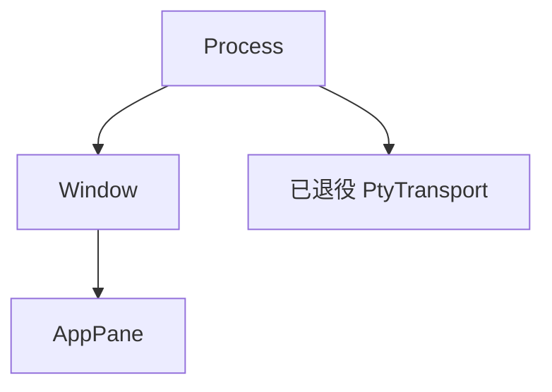

# 内存

[English](Memory)

下表说明每项内存上限及达到上限后的处理。排查进程增长时，按[日志](Logging-zh-CN)比较连续
采样。本页解释各读数统计什么；协议和图集细节见[终端 IO 与 VT](Terminal-IO-and-VT-zh-CN)
与[渲染与字体](Rendering-and-Fonts-zh-CN)。

### 资源上限

| 所有者 | 精确上限 | 达到上限时 |
| --- | --- | --- |
| 网格几何 | 任一轴 ≤ 4,096；单个可见屏幕 ≤ 524,288 个单元格；可见区 + 历史 + 已保存主屏幕 ≤ 1,048,576 个单元格 | 限制尺寸和请求的历史行数 |
| 网格保留存储 | `MAX_GRID_CELLS × size_of::<Cell>()`，当前构建约 24 MiB，由可见区/历史/已保存主屏幕共用；历史行按实际存储的单元格计费，而非按宽度 | 压缩行容量，再以每批 64 行删除最老历史；滚动路径每 512 行摊销检查一次 |
| 单元格组合附加内容 | 每个单元格 64 个 UTF-8 字节 | 不再保留额外零宽数据 |
| OSC 8 注册表 | 16,384 个链接；每个 URI 8 KiB；每个客户端 id 1 KiB；共享字符串与表合计 8 MiB | 回收已无保留单元格引用的条目后接纳；仍无空间则拒绝新链接 |
| 转义序列 | 1 MiB | 一直丢弃到终止符 |
| OSC 0/2/7/8 原始收集器 | 整个负载 16 KiB | 拒绝超长输入；报告保留容量，不增加媒体捕获计数 |
| 媒体负载 | 每个传输 16 MiB | 拒绝，不截断也不局部显示 |
| 媒体捕获暂存 | 进程共 64 MiB；下限 4 MiB；保证 13 个并发下限预留 | 无法暂存时拒绝；连续两次 30 s 采样无进度后取消 |
| 已解码内联图像 | 每窗格 64 MiB 且最多 128 张；256 MiB 进程目标按存活窗格平分；最小 4 MiB 且保留最新一张 | 删除最老图像；在空闲窗格扫描收敛前，受压进程最多可在目标之外为每个存活窗格保留一份 4 MiB 最新图像余量 |
| 编码图像尺寸 | 声明宽高 ≤ 2,048，像素数 ≤ 2,048² | 解码前拒绝 |
| 渲染图像尺寸 | 宽高 ≤ 1,024；BGRA8 ≤ 4 MiB | 缩放 iTerm2/kitty 图像；Sixel 解码进有界缓冲 |
| PTY 输入 | 每窗格另有固定 64 字节待发指针移动槽；UI 队列四条，每条 16 MiB；回复 FIFO 使用含帧头的 64 KiB 内存、≤32 KiB writer 输出、≤32 KiB + 4 B 读取暂存、≤32 KiB 应用回复批次载荷及 <32 KiB 解析器分派载荷（可增长向量可能保留空闲容量） | UI 拒绝时保留原字节；回复溢出到私有临时存储，不等待原生输入容量 |
| 回复溢出磁盘 | 不设固定磁盘配额；已消费前缀保留到 FIFO 文件排空 | 排空、writer 退出或窗格销毁时删除；存储错误显式终止回复交付，但输出与退出观察继续 |
| PTY 输出 | 64 个排队数据块，加一个阻塞中的发送数据块；每个由 64 KiB 读取环形缓冲支持；结构最坏值为 4.0625 MiB。在 64 位目标上每个数据块为 64 B（编译期断言），其中 16 B 是可选的读取时间戳。数据块时间戳存储小计：每个 PTY 的 64 个预留通道槽位为 1,024 B，无论是否打时间戳，另加阻塞发送方的数据块与 VT 工作线程持有的数据块各 16 B，共 1,056 B；随 PTY 释放。PTY 是否为读取打时间戳在其创建时（窗格计数器开启时）决定，并在读取线程的整个生命期内固定，是读取线程持有的一个不可变布尔值；它在布局上的占用不计入该小计 | 阻塞读取线程，由操作系统施加背压 |
| S2 回显监视 | 计数器开启时每个窗格一个：在 64 位 macOS 上测得 232 B，编译期断言 ≤ 256 B（`ECHO_WATCH_MAX_BYTES`），不计入窗格账本；随窗格及其工作线程句柄释放 | 大小固定；重新布防替换记录 |
| S2 回显时间线 | 每个窗口在其重绘状态中内联 104 B，其中 40 B 为已接受 tick 的元数据，64 B 为所有者槽位。每个窗口的所有者自布防起另有：1,640 B 的槽位记录，其 64 个 24 B 事件共 1,536 B（编译期断言），另加 104 B 元数据；以及 4,120 B 的洪流环形缓冲，其 256 个 16 B 条目共 4,096 B（编译期断言），另加 24 B。所有者的取走把至多 4,096 B 的洪流条目（256 × 16 B）复制进记录（32 B 的 `FrozenFlood` 元数据位于其元数据内，由 24 B 的向量头与淘汰元数据组成）并释放环形缓冲；移交构建至多 2,048 B 的事件（64 × 32 B），把它们、复制的条目与 88 B 的 `EchoTimelineV1` 移交给调用方并释放记录，App 不再保留任何内容。除编译期断言的数组外，这些大小是在 64 位 macOS 上测得的，不作保证。所有者提前结束时（重新布防、窗格离开窗口或被退役、窗口关闭）释放其环形缓冲与未冻结的记录；已冻结但尚未移交的记录保留到该窗格重新布防或被退役 | 第 65 个事件设置 `overflow` 并被丢弃；第 257 个洪流条目淘汰最旧的一项并记录其 `loop_seq`；非所有者的布防不记录任何内容 |
| 字形图集 | 每渲染器一个 BGRA8 CPU 图集：缩放 1 时起始为 1024×1024（4 MiB），缩放 2 时为 2048×2048（16 MiB），预热备用渲染器为 256×256（256 KiB），之后按翻倍增长到最大 2048×2048，16 MiB、16,384 个条目；GPU 呈现的渲染器的字形纹理尺寸相同 | 先增长；达到 2048 或条目上限时淘汰最冷的四分之一并重试 |
| 图像图集 | 默认 1×1 占位符；仅媒体活跃时使用 2048×2048 BGRA8 | 填满时跳过较早图像；连续 240 个无媒体帧后，或可渲染媒体最后一次可见 30 秒后（无需组装帧），释放为占位符 |
| Windows 软件帧 | 任一轴 ≤ 16,384；总量 ≤ 160 MiB | 拒绝创建或调整尺寸，并保留旧的有效分配 |
| 窗格命令事件 | 1,024 个事件 | 丢弃最早事件并缩小向量容量 |
| 崩溃事件历史 | 50 条记录；每条自有可变负载最多 4 KiB，其中 target 最多 256 字节；可变保留量合计最多 64 KiB | 格式化时限制大小，并按条数和字节上限淘汰最早记录 |
| Panic 文本 | dump 负载和格式化摘要各最多 4 KiB | 在 UTF-8 边界截断，标记也计入上限 |

媒体捕获暂存和已解码内联图像各自按一个共享池记账：生产解析器在
`CaptureStagingPool::process_default()` 中暂存，生产窗格向
`InlineMediaPool::process_default()` 计费，这正是这些上限覆盖整个进程的原因。
需要捕获被接纳、或需要测量接纳或预算的测试会注入私有池，而不是共用一把锁。

崩溃历史负载保留精确长度的自有字符串，不额外保留字符串空闲容量。固定记录元数据另受记录
数量限制；backtrace、串联 panic hook，以及任意生产端 formatter 内的分配都不在可变保留量
上限内。接纳与负载排除规则见[日志](Logging-zh-CN)。

内联媒体的 256 MiB 被准确称为进程**目标**，不是绝对上限。每个窗格都必须保留最新
图像，而单张已解码图像最多 4 MiB。因此受压时可陈述的总上限为：

```text
256 MiB + 存活窗格数 × 4 MiB
```

只要 `存活窗格数 × 4 MiB` 仍能放进目标内，周期性空闲窗格扫描就会把总量降回
256 MiB 或以下。较大的公式既描述收敛前的边界，也在每窗格一张图像的最低需求本身
超过目标时继续作为上限。

网格约 24 MiB 的数值同样是一个共享上限，不是“回滚 24 MiB 再加可见屏幕”。
`[terminal].scrollback` 设置行数上限；带超链接、组合字符或非默认下划线元数据的行更大，
因此单元格数量或保留字节可能先达到上限。

滚入历史的行以紧凑形式存储。内容完全相同的行存为一段相同单元格的连续区间。其他行若末尾相同
单元格（填充）足够长，则存为截至最后一个不同于填充的单元格为止的内容，再加一个填充单元格和行宽：
该行必须保留至少两个填充列，且至少节省四分之一的存储和 256 B。200 列中 40 个字符的行从
4,800 B 降到 984 B。读取这类行的结果不变；编辑它会恢复完整的行。调整大小时若用不同于填充的
单元格补齐历史行，该行会按新宽度完整存储。滚动会复用旧行释放的缓冲，因此每滚动一行最多分配一次
行存储。

`CSI 3 J` 会释放活动主屏幕历史和多余的历史容器容量，不降低用户请求的历史上限或
实际配置上限。只有这次显式擦除会重置预算检查计数；普通 FIFO 行复用仍保持每 512 次
滚动的检查节奏。历史前缀删除会更新精确淘汰身份和提示符坐标，包括随主屏幕保存的提示符。
缩小列数只修复每行新右边界被截断的宽字符首格，保留紧凑游程和现有容量滞后策略，
不会为检查边界而展开整段历史。

### 所有权模型

`sonicterm-resource` 按所有者与 `ResourceClass` 跟踪计费，不持有载荷内存。
进程内治理器保存所有者树和账本；RAII 预留令牌在析构时释放计费。

生产 GUI 拓扑为：



每个退役 PTY 都有唯一的进程直属 `PtyTransport` 所有者和一个 `ReaperWork` 条目。
传输持有原生载荷、许可、所有者与记账额，直到全部原生阶段完成且 worker 已 join，
或者将它们一起转入 `UnresolvedSink`。退役传输不会让原窗口或窗格所有者保持开放。
`ReaperWork` 在生产中实际计费，但不进入窗格接缝上限，因为计费属于退役传输。

一个 App 所有的管理器最多接纳 256 个任务单元，包括预留、保留任务和 sink 条目。
Windows 使用 20 个 helper 槽位和 2,048 个原生句柄许可；Unix 使用 12 个 helper 槽位和
768 个描述符许可。一个单元在 Windows 预留八个句柄，在 Unix 预留三个描述符。
开始执行时，Windows 单元一次申领五个 helper 槽位，Unix 单元申领一个；重试和运行中的
worker 继续持有整组 grant。计数表示持有的资源，不只是正在运行的线程。

接纳拒绝不会丢弃所有权。无槽位关闭重试一次，再明确采用同步回退；它不享有预留路径的
调用方快速返回保证。sink 条目持有容量直到进程退出，因此 `QueueFull` 可能持续到本次
进程结束。终态释放保留未完成的原生载荷和记账，而不执行不安全的析构。

类型系统还定义了 `SharedFont`、`SharedRaster`、`SharedAtlas`、`LocalPty` 和 mux
所有者种类，但 GUI 不注册这些节点。

所有者 id 单调递增且永不复用。合法父子组合取决于 `ProcessKind`，创建时会检查。
所有者状态从 `Open` 变为 `Closing`，再变为 `Closed`；进入 `Closing` 后不再接纳新子节点
和新预留，最终关闭要求没有存活子节点和记账额。

窗口插入与其所有者注册是同一个操作。共享拓扑完成步骤会注册主窗口和子窗口中的无所有者
窗格，每次 30 s 保留量扫描也会协调它们。标签页转移先准备目标窗格所有者，通过一次原子的
`transfer_many` 移动所有转移窗格的全部现有计费，再替换守卫并关闭已清空的源所有者。即使
解析器锁被占用，进程和分类总量也不变。拒绝时释放临时所有者，完整恢复源标签页、原有计费和
存活 PTY，之后才可能执行源窗口回收。

窗口注册失败时，该窗口仍可在层级记账之外使用。只有没有非零计费的窗格才能进入这种未注册
状态；已计费标签页不能在转移时悄悄丢失记账。只要窗口具有所有者，失败的窗格注册仍可重试。

### 限制执行与窗格绊线

每个接缝（即网格、解析器或 PTY 队列这样的所有权边界）负责执行自己的上限。GUI 治理器的进程和按类别上限为无限，窗口所有者也只用于
跟踪。这样不会再维护一套可能与实际分配代码漂移的进程级限制。

每个 `AppPane` 所有者仍有一个已提交字节绊线。类型化的
`pane_seam_cap_terms()` 清单让每个实际计费的窗格类别恰好出现一次。可见区、历史区与已保存
主屏幕共用同一个网格上限，因此由 `GridVisible` 携带该值，`GridHistory` 与
`GridAlternate` 携带零；`ParserCapture` 同时携带两个解析器上限；PTY 输入的队列上限只计一次：

```text
PANE_SEAM_CAP_SUM_BYTES = sum(pane_seam_cap_terms().bytes)
PANE_COMMITTED_BUDGET_BYTES = 2 × PANE_SEAM_CAP_SUM_BYTES
```

系数 2 为分配器容量、摊销过冲和最新图像余量留出空间。它用于发现某个接缝已经停止
设限或少报保留量，不是正常分配的第二套策略。每次保留量扫描通过失败原子的 `try_resize`
结算已有计费，包括字节和条目反向变化的情况。准入检查最终替换量，而不是中间峰值。
任一维增长都要求祖先开放；纯减少可在关闭期间结算。拒绝采样时保留旧计费，因此总账可能
落后于实际保留量，直到后续采样成功。快照只供观察，不是全局线性化的总量。

### 记账内容

单个窗格报告包含八个互不重叠的接缝：

| 字段 | 所属内存 |
| --- | --- |
| `grid_visible_bytes` | 可见行、提示符存储和稀有单元格属性 |
| `grid_history_bytes` | 保留的回滚行，每行按实际存储的单元格计费（截断行的前缀加一个填充单元格） |
| `grid_alternate_bytes` | 备用屏幕活跃时保存的主屏幕 |
| `parser_bytes` | 传输中的转义序列和媒体捕获缓冲 |
| `hyperlink_bytes` | 驻留的 OSC 8 字符串（每个不同的 URI 一次分配，其下每个客户端 id 一次分配）及查找表 |
| `inline_media_bytes` | 窗格保留的已解码图像像素 |
| `pty_output_bytes` | 排队 PTY 输出固定的环形缓冲内存 |
| `pty_input_bytes` | 排队输入向量 |

`total_bytes` 是八项之和，`largest_seam` 指出最大项。`session retention` 行会对所有
已采样窗格汇总同样字段。

为性能检查点采集的 `memory snapshot` 行包含同样字段，另加四个标注：`checkpoint_index`、
`checkpoint_label`、`checkpoint_attempt` 与 `checkpoint_complete`（没有窗格被锁占用且每个窗格都已采样）。
采集它不会改变周期性采样所做的任何事：不运行保留量处理、回收或裁剪，也不重置采样节奏。在带裁剪钩子的构建中，它还包含 `trimmed`、`trim_source` 与 `trim_seq`。

渲染器内存单独报告，因为它属于窗口而不是窗格：

- `glyph_atlas_bytes`：CPU 字形图集像素容量加上脏矩形列表容量，因此会随图集增长而上升；
- 每个渲染器在 `total=` 之后附加：`glyph_atlas_dim`、`glyph_atlas_packed_pixels`、`glyph_atlas_growths`、`glyph_atlas_evictions`、`glyph_atlas_fit` 和 `glyph_atlas_max_tile`。fit 是 256、512、1024 与 2048 中能放下常驻图块并保留四分之一高度空余的最小值。否则为 `no_headroom`（每个图块都能在 2048 放下，但没有尺寸能留出这四分之一）、`does_not_fit`（某个图块即使在 2048 也放不下）或 `evicted`（图集发生过淘汰，常驻集合已不再是工作集）。`glyph_atlas_growths` 统计渲染器自构建以来的翻倍次数，重置不会清零；
- `image_atlas_bytes`：CPU 内联图像图集容量；
- `row_glyph_cache_bytes` / `row_glyph_cache_items`：缓存的字形记录、下划线段、缺字方框和
  缺失字符的负载，加上跟踪存储（表、行位置向量与固定列表），以及缓存行数。每个渲染器的负载
  不超过 448 MiB，跟踪存储不超过 64 MiB；
- `row_quad_cache_bytes` / `row_quad_cache_items`：哈希表后备存储、缓存背景/装饰
  quad 向量和缓存行数；
- `software_frame_bytes`：Windows CPU/GDI 帧，其它平台为零；
- `row_ink_bytes` / `row_ink_items`：渲染器的 `RowInk` 部分，计入 `renderer_total_bytes`：
  每个可见行一条墨迹记录（该行上次绘制的范围），加上一帧的暂存缓冲。一帧呈现时剪除已关闭窗格与
  已消失行的记录，表内条目不足四分之一时收缩。该分类只报告、不计费，覆盖数值为 144 MiB
  （按桶取整的表条目为最大可见单元数的两倍，加上一帧暂存）；
- 缺失字形记录不是单独报告的分类：每个已呈现行画出方框的窗格行位置一条，最多 64 个不同字符，
  加上该行的键和字体标记，以及一帧暂存的记录。一帧的行位置结算时，若该位置改为显示另一行、窗格
  被释放或字体变化，记录即被剪除，因此每个可见行最多一条。回退通知保存未解析集合与查找失败集合，
  各最多 4,096 个码位；
- `vertex_scratch_bytes` / `vertex_scratch_items`：渲染器的 `UploadStaging` 部分，计入
  `renderer_total_bytes`。它是呈现管线复用的 CPU 顶点组装缓冲，加上字形图集与图像图集两个上传
  各自的脏矩形列表、合并矩形列表和暂存缓冲。顶点缓冲每帧清空后重新填充。一帧之后，若容量超过
  该帧顶点数的四倍且超过 1 MiB，就收缩到用量的两倍；未产生任何顶点的帧会完全释放超过 1 MiB 的
  缓冲。每个上传在一次同步后清空两个矩形列表，并把超过 1,024 个矩形的列表收缩到 64。暂存缓冲
  在一次同步期间至多保存一整张图集；每次 wgpu 同步之后，它按该次同步的最大一次写入遵循顶点缓冲的规则，遮挡窗口裁剪会完全释放它。条目数只统计顶点缓冲：它持有分配时为 1。渲染器
  释放时一并释放全部。该分类记录的覆盖数值 34.5 MiB 是上传包络：两个 16 MiB 暂存缓冲，加上一次
  同步期间矩形列表的 2 个上传 × 2 个列表 × 2 × 16,384 个矩形 × 20 字节。顶点缓冲在其旁实时报告，
  没有固定上限，因为它跟随每帧的顶点数；
- `frame_scratch_bytes` / `frame_scratch_items`：渲染器的 `FrameScratch` 部分，计入
  `renderer_total_bytes`。它保存一次组装填充的逐帧绘制向量（字形、quad、叠加层字形与 quad、图像、
  行范围、下划线、下划线归属、暂存范围、缺字方框、窗格矩形、列边界与行键），在已组装帧之间保留。
  每次归还时，每个向量都先清空，再限制在其上限内：字形与 quad 各 4 MiB；叠加层字形、叠加层 quad、
  图像、行范围、下划线与缺字方框各 1 MiB；窗格矩形与暂存范围各 64 KiB；下划线归属与行键各 256 KiB；
  列边界合计 1 MiB，先丢弃最大的槽位。只有完成的组装才会在容量超过用量四倍且超过 1 MiB 时把向量
  收缩到用量的两倍，并丢弃超出本次峰值的列边界槽位。失败或重试的帧用量低估了整帧，因此保留其已预热
  的容量。该分类的覆盖数值为它们之和，16,384,000 字节。未变化或无操作的帧不取用暂存，也不
  释放任何内容。条目数为持有分配的向量数；帧持有暂存期间该数值为零；
- `chrome_cache_bytes` / `chrome_cache_items`：渲染器的 `ChromeCache` 部分，计入
  `renderer_total_bytes`：64 槽标签标题表与 32 槽界面文本段表（首次使用时分配）、每个保留标题的
  键文本、绘制文本与字形、每个保留界面文本段的一份文本与字形，以及保留的界面调色板颜色字符串。
  标题或文本段只在不超过 256 字节文本与 512 个字形时保留。调色板只在其颜色字符串合计不超过 4 KiB
  时保留；字符串合计更多的主题每次请求都重新派生且从不保留，因此保留的字符串从不超过该余量。该分类的
  覆盖数值 1,626,560 字节是两张表都装满最大条目，再加这 4 KiB。条目数为保留的标题数与文本段数之和。

这些都是主机内存副本。GPU 纹理与缓冲不在其中，因为显卡驱动拥有它们，wgpu 也不提供
大小。行缓存报告按已分配的哈希表与嵌套向量容量计算，而不是按当前长度。普通 clear/retain
后表容量具有粘性；窗格离开渲染器时，SonicTerm 会在同一个事件循环操作中先删除该窗格的
字形行，再删除 quad 行，保留其它窗格的条目并请求压紧表。嵌套负载和条目数会立即下降，
但表分配器可以保留当前 bucket 档位。报告会列出所有可见和预热渲染器。
`live_renderers` 来自独立的进程级计数器；若该计数大于可列出的渲染器集合，说明有一个
仍存活但已无法从窗口拓扑访问的渲染器。

这些字段不是渲染器整个堆的清单。渲染器保存在帧暂存中的逐帧绘制向量会被保留，并在
`frame_scratch` 下报告。帧键元数据、临时帧计划、逐帧窗格视图、逐行与逐段的塑形缓冲以及其它
未列出的主机分配仍不计入 `renderer_total_bytes`；操作系统进程读数还包含已计费分类以外的内存。

搜索打开期间，`SearchState` 会保留已准备好的匹配器，正则模式下包括其编译后的正则表达式；
搜索关闭，或查询、模式、大小写设置改变时，该匹配器会被释放，资源治理器不对这部分内存计费。

在窗格接缝之外，App 的前台探测映射对每个存活窗格最多保存一个条目和一个结果，随窗格一起释放；
worker 线程最多一个，以 `live_fg_probe_workers` 报告。

开启帧计数器时，守卫关联每个窗格日志估计占用 789,248 B：32,768 条分段记录（768 KiB）、64 个放弃条目和
64 个丢失区间，另加日志本身在其 `Arc` 中的 256 B（窗格 id、互斥锁与状态，在 64 位 macOS 上测得）。
每个 App 持有一个估计 525,464 B 的跨度存储：16,384 个跨度（512 KiB）、64 个丢失区间，以及存储在其 `Rc`
中的 152 B（含 `RefCell` 借用状态）。估计值不含注册表向量的容量、每个窗格保留的句柄以及分配器开销。
提取会在交换之前分配一套替换缓冲区，因此被提取的缓冲区与替换缓冲区会同时存在，直到调用方丢弃该次转移。
已关闭窗格的日志在某次提取将其剪除、且其工作线程丢弃自己的句柄之后释放。每次计数收集把 440 B 的跨度记录放在栈上。
这些都不计入任何账本所有者，也不出现在内存采样中。关闭计数器时不分配任何记录缓冲区，也不读取关联时钟、
不获取关联锁，但 `Option` 字段以及更大的保管与来源类型仍占用其布局。harness 的传输原地序列化一次提取的缓冲区，
因此写入旁路文件期间，进程持有提取的缓冲区、App 的替换缓冲区和一个 64 KiB 写入缓冲区，不复制任何记录。

渲染器的保留量不计入任何账本所有者。空闲图像图集被释放时，渲染器的
`retained_amounts().image_atlas` 立即从 16 MiB 降到 4 B；聚合的 `renderer_total_bytes` 在下一次
内存采样（每 30 秒一次）时显示这一下降，每个窗格的 `InlineMediaRetained` 计费保持不变。

字体文件不是被统计的类别。普通字体从磁盘流式读取，不会被整份保留。带有 `SVG ` 或 `COLR`
表的字体，在仍有 FreeType face 或 HarfBuzz blob 使用时，会整份保存一次在共享堆缓冲区中；
其上的 face 与 blob 共享这块缓冲区，而不是由 FreeType 为每个 face 复制彩色表。详见
[渲染与字体](Rendering-and-Fonts-zh-CN)。

### 图形内存

图形内存以两种方式报告，二者回答不同的问题。

**每个渲染器请求的字节数。** 每个渲染器都维护一份图形账本
（`crates/sonicterm-gpu/src/graphics_ledger.rs`），按类别记录它向设备请求了什么：
surface（宽 x 高 x 每像素字节数 x drawable 数量）、保留帧纹理、字形图集纹理、图像图集纹理，
以及呈现管线的顶点、索引与 uniform 缓冲区。账本在这些资源被创建、重建、调整尺寸、裁剪和
丢弃的位置更新，因此遮挡窗口裁剪让账本恰好减少它释放的量，已丢弃渲染器的账本读数为零。
drawable 数量按后端实际采用的帧延迟计算。在 Metal 上它是精确值：wgpu 把延迟限制在 `1..=2`，
并把 `maximumDrawableCount` 设为延迟 + 1（延迟 2 对应 3 个 drawable，延迟 1 对应 2 个）；
在 DX12 上同样精确，DX12 使用延迟 + 1 个后台缓冲区，最多 16 个。其他后端上它是**估计值**，
并标注为估计：Vulkan 会把延迟限制在 surface 的图像数量范围内，而 wgpu 不公开该范围，驱动还
可能创建多于请求数量的图像，因此账本记录延迟 + 1；GL 忽略延迟，因此无论延迟多少，账本都按
双缓冲记录为 2。

每个存活渲染器的账本还按类别保留它已创建与已释放的字节数和资源数，`memory snapshot` 日志行
会报告这些数值。渲染器被丢弃时，会在释放账本之前记录一条 `renderer graphics teardown`，
包含其当前、已创建与已释放的总量，因此已关闭窗口的历史仍保留在日志中。

这些都是**请求**。物理驻留由驱动决定：驱动可能填充、压缩、延迟释放已丢弃的资源，或把
drawable 留在合成器中。账本不统计旧版文本与 quad 管线的实例缓冲区（生产环境中没有渲染器
构建它们），也不统计仅供测试使用的帧回读缓冲区。

**操作系统向进程计入的量。** 每个平台的数值都按其本来含义标注：

| 平台 | 来源 | 数值 |
| --- | --- | --- |
| macOS | `task_info(TASK_VM_INFO)`，修订版 3 及以后 | `ledger_tag_graphics_footprint`（计入物理 footprint 的图形内存）与 `ledger_tag_graphics_nofootprint`（标记给本进程但不计入其 footprint）。它们是内核的账本，不一定与 `footprint` 工具打印的划分相同；IOSurface 映射不在其中任何一项里。 |
| Windows | 渲染器所用 DXGI 适配器上的 `IDXGIAdapter3::QueryVideoMemoryInfo` | `LOCAL`（专用）与 `NON_LOCAL`（共享）当前用量，分别报告。仅当渲染器通过 DX12 呈现时可用；GDI 软件呈现器没有可查询的适配器。wgpu 以 PCI 厂商 id 与设备 id 标识适配器，而它们标识的是 GPU 型号，因此当两个适配器共享这些 id 时，该数值不可用并说明原因，而不是可能报告另一块 GPU 的用量。 |
| Linux | 无 | not available |

macOS 的结构体是手工声明的，因此做了两重检查。头文件在 `#pragma pack(push, 4)` 下声明它，
所以 Rust 声明按四字节打包；其大小（372 字节，`TASK_VM_INFO_COUNT` 为 93）以及读取字段的
偏移量都在编译期与从 SDK 头文件测得的数值进行断言。运行时，只有当内核返回的计数覆盖某个字段的
最后一个字节时才读取它。较旧的内核会让该字段保持 `unsupported`，绝不会给出错误数值或零。

操作系统数值与请求总量之间的差距本身并不意味着缺失了某个资源：驱动填充、延迟释放以及
合成器持有的 surface 都会落在这个差距里。

#### 呈现时驱动持有的内存

在 Metal 上，驱动会在呈现帧期间持有图形内存。以下数值是在一台 Apple M3 Pro 主机上读取
`footprint` 的 "Owned physical footprint (unmapped) (graphics)" 得到的本地诊断读数。探针各行
来自独立的 wgpu 30.0.1 探针，条件为 1600x1280 px、Fifo、帧延迟 2。SonicTerm 各行来自
80x40、使用临时配置的 SonicTerm：

| 呈现期间 | 图形内存 |
| --- | --- |
| 仅清屏并呈现（探针） | 约 107 MB |
| 任何记录了缓冲区复制命令的帧（`queue.write_buffer` 或 `copy_buffer_to_buffer`，任意大小；即使每秒只有一次 1 KB 复制）（探针） | 约 180 MB |
| SonicTerm 在 80x40、临时配置下绘制 | 约 220 MB |
| SonicTerm 空闲窗口，不呈现 | 28 MB |
| 探针停止呈现 5 s 之后 | 不到 4 MB |

SonicTerm 每绘制一帧都会上传顶点数据，因此绘制期间处于较高的数值。在停止呈现 5 s 后读取时，
探针的这部分内存已被释放；释放的具体时机没有测量。呈现继续进行时，最后一次复制之后较高数值是否
保持，也没有测量。在这台主机上，帧延迟 1 和更少的预热窗口都没有降低它，隐藏的预热窗口不占用
物理图形内存。完全不记录复制的帧路径（把顶点数据写入绘制直接读取的映射缓冲区）在探针中保持在
仅清屏的数值，但前提是没有任何帧发生复制：新字形（图集写入）、缓冲区增长或回退都会让复制重新
出现。SonicTerm 不使用这样的路径。

内存占用报告的 `GPU (OS)` 行和 `graphics_os_*` 快照字段读取的是内核的按任务图形账本，而不是
上面的 `footprint` 类别。`GPU requested` 只显示 SonicTerm 请求的量。三者是覆盖范围不同的相关
诊断读数，它们的差值不能衡量驱动持有的内存：在 CI 上，`GPU (OS)` 读数为 14.6-18.1 MB，而
`GPU requested` 为 42-43 MB。CI 的 macOS 运行器是虚拟机，不会重现上面驱动持有的数值。

### 聚合快照

把日志级别设为 `info`，最多每 30 s 得到一条 `memory snapshot`：

```toml
[logging]
level = "info"
```

这是顺序执行的诊断采样，不是可线性化的单一时刻快照。每个窗格的解析器、内联媒体和
PTY 队列分别读取；各窗格、渲染器、共享分配器及操作系统内存也依次采样。
即使 `panes_contended=0`，这些读数也不是同时取得的，采样计费更不是分配时的准入上限。

该行合并：

- 操作系统给出的 `process_private_committed_bytes`、`process_resident_bytes`、
  `process_virtual_bytes` 及其变化量；
- 会话总量和全部八个窗格接缝；
- `panes_total`、`panes_sampled`、`panes_contended`；
- 渲染器总量、角色和 `live_renderers`；
- `live_fg_probe_workers`，即该 App 的前台探测 worker 线程数；
- 一次共享设备分配器读数。

`process_virtual_bytes` 是保留地址空间，不是实际占用。GPU 进程可能保留数百 GB 地址空间，
但并未常驻同等内存。应把 resident/private 数据与 `session_total_bytes`、
`renderer_total_bytes` 对照。

没有数值时会明确说明原因：

| 取值 | 含义 |
| --- | --- |
| `unsupported` | 平台或后端不提供该数据 |
| `unavailable` | 没有可比较的上一次采样 |
| `panes_contended=N` | N 个窗格因解析器或内联图像锁被占用而跳过，会话总量不完整 |
| `allocator_state=none` | 没有渲染器，因此没有查询分配器 |

macOS 的私有/已提交内存为 `unsupported`；SonicTerm 会报告常驻与虚拟内存，
但不会拿虚构值替代 `phys_footprint`。Windows 的私有/已提交内存是 `PrivateUsage`，
常驻内存是 `WorkingSetSize`。Linux 与其它没有进程内存采样器的平台会把三项操作系统
数据都报告为 `unsupported`；窗格、渲染器和分配器记账仍会运行。

分配器按共享设备/上下文只采样一次，来源优先为主渲染器，否则使用确定性的可见或
预热回退。所有窗口（包括通过新建窗口打开的窗口）都经由该设备渲染，因此这一次读数
覆盖全部窗口。可测量报告包含：

```text
allocator_allocated_bytes
allocator_reserved_bytes
allocator_allocations
allocator_blocks
allocator_largest_block_bytes
```

软件适配器在 wgpu 30 中使用 `MemoryHints::MemoryUsage`，硬件适配器使用
`MemoryHints::Performance`。D3D12 上，软件策略把初始分配器块从设备 128 MiB / 主机 64 MiB 改为
设备 8 MiB / 主机 4 MiB。这些只是放置与块大小提示，不是分配上限；
更大的资源仍可分配。

### 内存占用报告

命令面板中的 **内存占用** 命令（`show_memory_usage`，默认未绑定）会打开报告窗口；
已打开时则聚焦并刷新它。报告是一个没有 PTY 的窗格中的纯文本，可以像终端输出一样
选择、搜索、滚动和复制，键入内容不会到达任何 shell。报告是某一时刻的采样，不会自动
刷新。操作系统数值会比统计数值稍晚到达；若到达时报告窗格中有选区、有可能开始选区的
鼠标按下或拖动，或处于 READONLY 模式，显示的文本保持不变，新数值在松开按键且没有选区、
选区清除或 READONLY 结束后才出现，因此建立或复制选区时选区不会被清除。
按 `R` 总会显示一次新的采样。

| 部分 | 内容 |
| --- | --- |
| `PROCESS (from the OS)` | 平台自带监视器显示的数值及其峰值，另有常驻、私有提交与虚拟内存数值。macOS 报告 physical footprint 与 lifetime peak footprint；Windows 报告 private commit 与 peak commit；Linux 报告常驻集（`VmRSS`）与峰值 RSS（`VmHWM`）。平台不提供的数值显示 `not available`，绝不显示 `0`。`GPU (OS)` 以数值本来的名称显示操作系统的图形内存（macOS 内核图形账本、Windows DXGI 专用与共享用量），或说明没有适用的查询；`GPU requested` 是所有渲染器请求的总量，并标注为请求（见[图形内存](#图形内存)）。 |
| `ACCOUNTED BY SONICTERM` | SonicTerm 自行统计的渲染器与窗格总量，与 `memory snapshot` 日志行来自同一采样周期。 |
| `DIFFERENCE` | 操作系统 footprint 减去 SonicTerm 统计的容量，带符号且不截断。它是诊断值而非对账：分配器空闲、GPU 内存、字体和未跟踪的分配都会计入这里，各数值也可能重叠。 |
| `SAMPLE` | 已测量的窗格数，以及因锁被占用而跳过的窗格数（`busy, skipped`），因此不完整的总量不会被当成整个会话。 |
| `WINDOWS / RENDERERS` | 每个窗口渲染器的各部分（字形图集的尺寸、条目数与 fit、行缓存、临时缓冲），报告窗口自身的渲染器，以及预热渲染器。每个渲染器下的 `GPU requested` 按类别列出其请求的 GPU 字节数与资源数：surface、帧纹理、字形图集、图像图集与呈现缓冲区。 |
| `PANES` | 按标签页标题列出每个窗格，分为网格可见区、历史、备用屏、解析器、超链接、内联媒体以及 PTY 输出与输入。各窗格行之和等于窗格总量。 |
| `THREADS` | 线程数量与名称。线程共享进程内存，自身不持有内存。 |
| `CHILD PROCESSES` | 每个窗格的 shell 及其后代进程，并给出各自的操作系统数值（`footprint`、`private` 或 `RSS`），每个窗格最多 64 个后代。它们是独立进程，不计入 SonicTerm 的 footprint。已离开 shell 进程树的进程（例如守护化的 tmux server）不会列出，WSL 与远程进程也不可见。 |

统计数值在 UI 线程上读取，遵循与日志行相同的 `try_lock` 规则。操作系统数值、线程列表与
进程遍历在 `sonicterm-memory-report` 线程上运行；在它返回前，窗口显示统计数值和
`sampling the OS figures...`。同一时间最多只有一次遍历：刷新会取消正在进行的遍历（它在
每个窗格 shell 之前以及进程之间检查取消），并在其返回后启动最新一次刷新的遍历，中间的刷新
会被丢弃。在 macOS 和 Linux 上，子进程列表边读边解析，读到 64 个进程的上限即停止。
Windows 读取一份全系统进程快照（查找父进程需要它），每个窗格最多从中取 64 个子进程。窗格 shell 在遍历前后都会与其窗格创建时
记录的启动时间核对：启动时间不同则报告其已退出，无法读取启动时间则报告
`not available (shell identity unverified)`，因此被复用的 pid 不会被当成该窗格的 shell。标签页标题
和进程名在进入报告前会去除控制字符。报告窗格固定保留 10,000 行历史，不受
`[terminal] scrollback` 影响；全部复制复制的是渲染出的文本，而不是折行后的网格。按键与
窗口行为见[快捷键](Keybindings-zh-CN)和[运行时生命周期](Runtime-Lifecycle-zh-CN)。

### 遮挡窗口裁剪

原生遮挡持续 30 秒的窗口会交还其渲染器能够重建的内容。保留量处理每 30 秒对每个窗口检查一次，
因此裁剪发生在遮挡后 30–60 秒，没有自己的计时器或唤醒。它在记账和快照之前运行，并且不受任何日志
门控限制，因此在默认日志级别下同样发生。已在本次遮挡期间裁剪过的窗口、已停放的窗口、设备已停止或
拒绝工作的窗口，以及预热备用窗口都会被跳过。仅后端报告的遮挡不会开始 30 秒计时。

裁剪在设备门控内释放：保留的帧纹理，在 GPU 呈现器上降为 1×1（软件呈现器的帧纹理本来就是 1×1）；
两个呈现缓冲，恢复到初始的 4,096 个 quad，以及顶点暂存；行字形、行 quad 与行墨迹缓存；两个图集上传
的暂存缓冲和矩形列表；持有的帧暂存（已借出的会在租约归还时丢弃）；标签标题与文本段表，保留调色板；
以及在没有可见媒体时已提升的图像图集。它保留字形图集及其 GPU 纹理、待处理的图集重试及其淘汰状态、
Windows 软件帧和预编辑缓存。拒绝该工作的设备不发生任何变化。下一帧是完整的首帧，其余内容按正常
路径重新增长；恢复可见会清除裁剪标记。

渲染器部分只报告、不进入账本，因此裁剪会降低同一次处理快照中的 `renderer_total_bytes`，从不改变
窗格的记账。每个渲染器条目还报告 `renderer_trimmed` 与 `renderer_gpu_released_requested_bytes`：裁剪交还的帧纹理和
呈现缓冲，是请求大小而非常驻量，且不计入总量。

窗口可见时呈现缓冲也会收缩：每个 600 次绘制（包括空绘制）的窗口结束时，如果容量超过该窗口峰值用量的四倍且超过
初始的 4,096 个 quad，两个缓冲都会按峰值两倍向上取 2 的幂重建，不低于 4,096 个 quad。

### 详细保留量与回收

设置 `debug` 后可查看按窗格和按渲染器的行：

```toml
[logging]
level = "debug"
```

30 s 扫描使用 `try_lock`，绝不等待窗格解析器或内联图像锁。注册、协调、记账、停滞捕获取消和空闲
媒体回收在所有日志级别下都会运行，只有日志输出受级别控制。仅用于采样的唤醒不会请求重绘。

两种回收会移除用户可见内容，因此即使在默认 `warn` 级别也写入
`memory::reclaimed` 日志目标：

```sh
grep 'memory::reclaimed' ~/.sonicterm/logs/sonicterm.log*
```

| 消息 | 含义 |
| --- | --- |
| `cancelled a media capture that stopped receiving` | 连续两个 30 s 周期没有字节到达；已释放暂存，该图像不会显示 |
| `discarded inline images from idle panes` | 从仍持有较少窗格时期份额的窗格中删除了较早图像 |

单个偏大快照不能证明持续增长。应比较连续多次采样。`grid_history_bytes` 上升指向回滚；
`inline_media_bytes` 上升指向图像；`parser_bytes` 连续多次保持较高说明有传输尚未结束。
`panes_contended` 非零表示聚合值低估了会话。

### 代码位置

| 主题 | 主要路径 |
| --- | --- |
| 治理器、账本、预留 | `crates/sonicterm-resource/src/{ledger,owner,reservation}.rs` |
| 资源契约与所有者种类 | `crates/sonicterm-types/src/resource.rs` |
| 窗格限制与所有者注册 | `crates/sonicterm-app/src/app/{mod,owners}.rs` |
| 窗格测量、记账、回收 | `crates/sonicterm-app/src/app/retention.rs` |
| 聚合快照 | `crates/sonicterm-app/src/app/memory_snapshot.rs` |
| 内存占用报告模型、渲染与 action 路由 | `crates/sonicterm-app/src/app/memory_report.rs` |
| 内存占用报告窗口、刷新与操作系统采样线程 | `crates/sonicterm-app/src/app/memory_report_window.rs` |
| 操作系统 footprint、峰值、线程与子进程遍历 | `crates/sonicterm-logging/src/process_report.rs` |
| 操作系统图形内存数值（macOS 内核账本、Windows DXGI 用量） | `crates/sonicterm-logging/src/graphics_memory.rs` |
| 每个渲染器按类别请求的 GPU 字节数 | `crates/sonicterm-gpu/src/graphics_ledger.rs` |
| 内联媒体上限 | `crates/sonicterm-app/src/app/media.rs` |
| 网格与超链接上限 | `crates/sonicterm-grid/src/{grid,hyperlink}.rs` |
| 解析器捕获上限 | `crates/sonicterm-vt/src/vt.rs`、`crates/sonicterm-vt/src/vt/staging.rs` |
| PTY 队列上限 | `crates/sonicterm-io/src/pty.rs` |
| 渲染器保留量与分配器报告 | `crates/sonicterm-gpu/src/core.rs` |
| 守卫关联记录（仅帧计数器） | `crates/sonicterm-app/src/app/guard_correlation.rs` |
