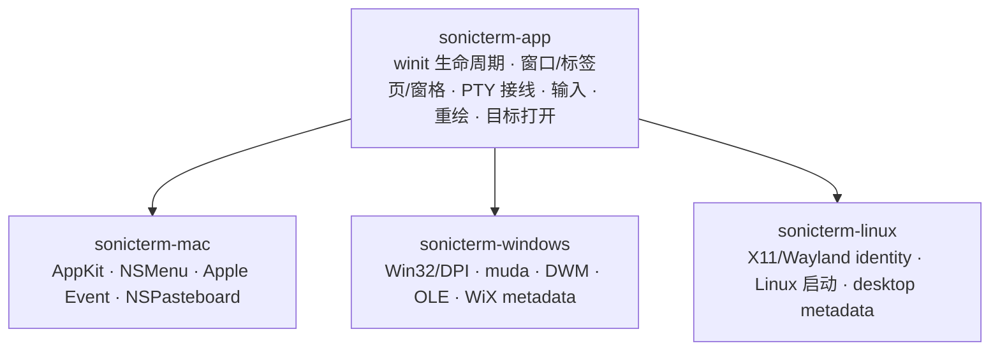
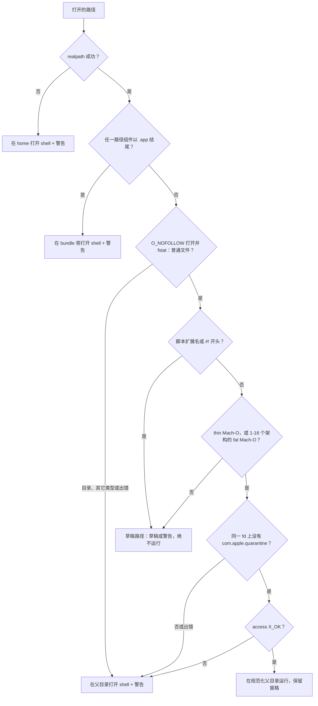
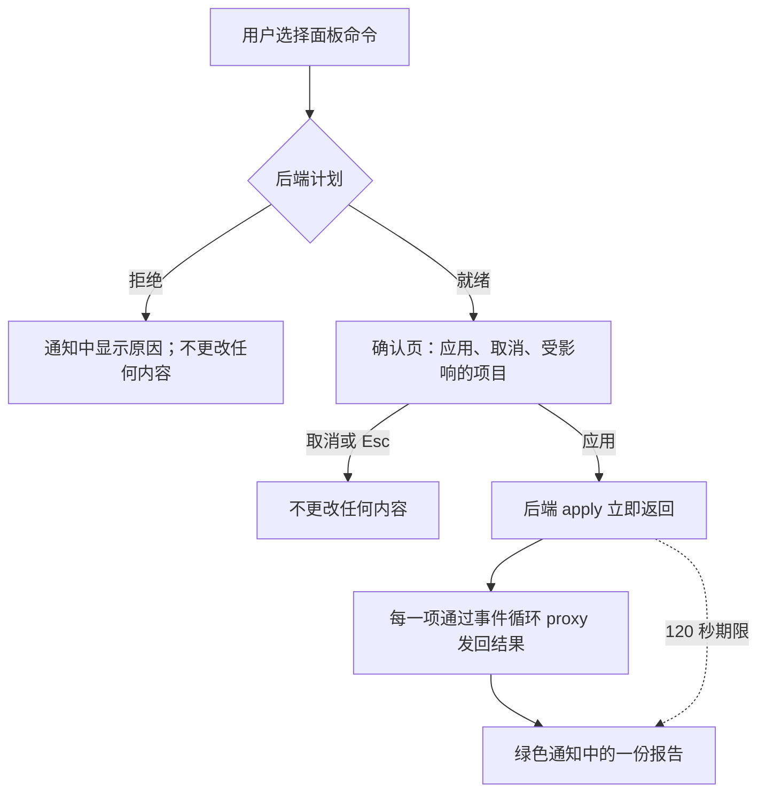

# 平台集成

[English](Platform-Integration)

本页说明 macOS、Windows 与 Linux 的差异，平台矩阵可供快速对照。构建包见
[打包](Packaging-zh-CN)，验证步骤见[开发与发布](Development-and-Release-zh-CN)，发布步骤见[发布流程](Release-Process-zh-CN)。

## 共享职责与原生职责

不需要 AppKit、Win32、X11 或 Wayland handle 的行为应放在 `sonicterm-app` 或更低层。
平台 crate 只负责必须使用原生主线程对象、平台 ABI、桌面 identity 或安装器 metadata 的工作。
终端解析位于 `sonicterm-vt`；本地 PTY/ConPTY 封装在
`sonicterm-io::PtyHandle` 后；渲染位于 `sonicterm-gpu`。

三个二进制共用诊断、配置、日志、资源、状态机和 shell 启动流程；准确顺序见
[运行时生命周期](Runtime-Lifecycle-zh-CN)。用户状态位于 `~/.sonicterm`；打包资源由
`sonicterm-cfg::assets` 查找。

终端输入法几何属于共享 app：每个窗口发送活动窗格的物理光标矩形，只加一次窗格原点和
内容内边距。去重键包含窗格身份、物理位置和物理尺寸，不仅是行列。命令面板和搜索框保留
各自的输入锚点。

## 原生目标打开

路径扫描和可操作性探测属于跨平台 app。有限队列 worker 会在原生调用前再次核对完全相同的
目标类型和操作，并阻止特殊文件。macOS 和 Linux 会解析符号链接并对解析后的目标操作。
在 Windows 上，解析指向网络共享的链接，或打开映射网络驱动器上的路径，都会连接该服务器，
因此探测会持有路径每一部分的句柄，而不是检查路径字符串。它只用 `QueryDosDeviceW` 解析一次
盘符；这是命名空间查询，既不访问文件系统也不访问网络。只有当盘符恰好指向
`\Device\HarddiskVolume<N>` 卷、且其根目录报告为本地磁盘时，才会遍历该驱动器；之后通过
NT 设备路径打开根目录，不再经由盘符。其后的每一部分都相对于父目录已持有的句柄按单个名称
打开，不跟随该处的链接，并在检查或原生操作结束前一直保持打开且不共享删除权限，因此已持有
的部分无法被重命名或删除，最后一部分之上已持有的文件夹也无法被改成链接。每一部分都以读取
权限（文件夹为列出内容）打开；读取被拒绝时改用执行权限（文件夹为遍历），从不请求写入或删除
权限。用户既不能读取也不能执行的部分，或被其他程序以不共享读取的方式占用的部分，都会被拒绝；
检查进行期间，其他程序无法重命名或删除已持有的部分。Windows 只在本地
固定磁盘之间跟随符号链接或目录联接，目标须为 NT 盘符路径或相对于链接所在文件夹的路径。
映射网络驱动器、`subst` 驱动器、光驱和 RAM 盘、挂载到盘符的动态磁盘卷或卷影副本上的路径，
以及经过以 GUID 挂载卷的文件夹的
路径都会被拒绝；UNC 和设备目标、位于可移动驱动器上的链接、云文件占位符等其他
reparse point、目标类型与链接自身文件夹标志不符的链接，以及需要超过 31 次链接跳转的路径
也会被拒绝；31 是 Windows 为指向完整路径的链接记录的上限。遍历从不沿链接离开本地固定磁盘，
也从不打开远端卷；未指向任何驱动器的盘符上的路径会被拒绝，而不是报告为不存在。调用时会再次遍历整条链接链，并在持有每一部分期间把遍历得到的无链接路径
（而非屏幕上显示的文本）交给 shell，因此经由链接到达的文件会在其真实文件夹中被选中。保证
到此为止：之后由 shell、资源管理器和文件的处理程序自行打开该路径，最后一部分仍可能被原地
更改，shell 调用返回后不再持有任何句柄。用户自己登录会话中的进程可以重新定义盘符并直接
访问网络，因此不在保护范围内。
普通文件无论扩展名、执行权限或内容如何，都只被选中。
候选按最短优先探测，因此存在的去掉正文标点的较短路径（如 `main.rs`）优先于带标点的较长
字面候选（如 `main.rs,`）；只有较短路径不存在时才会打开字面候选。

路径与 URL 检测是各操作系统共用的一个组件，因为 Windows 窗格也可能显示 POSIX 路径，例如在
WSL shell 中。`crates/sonicterm-cfg/src/url_scan.rs` 实现 POSIX 与 Windows 两种路径语法，
不含操作系统条件编译，其测试在每个主机上运行；`PathStyle::native()` 是它唯一读取构建目标的地方。
按操作系统区分的文件负责原生探测、在文件管理器中显示与打开（`sonicterm-app` 中的
`path_target/{unix,macos,linux,windows}.rs`），以及 URI 分发（`sonicterm-cfg` 中的
`url_open/{macos,linux,windows}.rs`）。app 使用 `PathStyle::native()` 选择语法，因此 Windows
构建会用 Windows 语法扫描每个窗格，包括运行 WSL shell 的窗格。

| 平台 | 调用边界 |
| --- | --- |
| macOS | 目录使用固定 `/usr/bin/open --`；文件使用 `/usr/bin/open -R --` 选中而不打开 |
| Windows | 目录使用 `ShellExecuteExW`；文件使用 `SHOpenFolderAndSelectItems`，均在专用 COM apartment 中执行 |
| Linux | 目录使用 desktop portal，仅不可用时回退到固定 `xdg-open`；文件使用 `org.freedesktop.FileManager1.ShowItems`，不回退到打开文件 |

选中文件不会调用其关联应用或执行内容。macOS 应用或软件包目录使用 Finder 选择，而不启动。
Portal 明确拒绝不等于 portal 不可用，因此不会触发 fallback。

Windows 上，目录导航和非文件 URI 走同一条调用边界：由拥有独立 COM apartment
的 worker 线程直接调用 `ShellExecuteExW`，不经过任何命令解释器，也不会对参数字符串重新
分词。URI 以单个 NUL 结尾的 UTF-16 字符串传入，并且环境变量替换保持关闭，因此 `%20`、`%USERNAME%`
这类以百分号分隔的文本会按验证后的原样交给 handler，不会按进程环境展开。

## macOS

### AppKit 生命周期与菜单

共享的 macOS `App::do_resumed` 路径通过 winit 的
`set_allows_automatic_window_tabbing(false)` 在菜单 hook 和原生窗口创建前关闭进程级
自动标签页。二进制保留普通启动和 smoke 的 window-ready callback，将初始 NSWindow 的
`setTabbingMode: 2` 设为禁用。进程级设置与每窗口模式是两层控制；终端标签页仍由 SonicTerm 管理。

原生 smoke 在创建窗口前读回进程级属性。这证明设置已到达 AppKit，不证明每个窗口原生
标签栏的显示效果。

NSMenu 只能在 winit 创建 AppKit 事件循环后安装。Objective-C target 接收菜单 selector，
把菜单 tag 转换为共享 `Action`，再通过 event-loop proxy 唤醒循环。需要 NSWindow 的工作
在一次性 window-ready callback 中执行，此时 handle 已有效。

### 显示链接

在 macOS 14 及更高版本上，每个注册的窗口（主窗口、新终端窗口和拖出的窗口）从其 AppKit 视图取得
`NSView.displayLink`。链接以 common modes 加入主 run loop，创建时处于暂停状态，只在该窗口有按显示
链接计节奏的流式帧待准入时运行（[渲染模式](Rendering-Modes-zh-CN#按窗口归属的帧调度)）。它的
Objective-C target 只持有窗口 id、event-loop proxy 的副本和窗口的链接代际；链接触发时，target 通过
proxy 发送 `UserEvent::DisplayLinkTick`，从不访问 App。丢弃窗口的句柄会使链接失效并释放其 target。

低于 macOS 14 时，`available!(macos = 14.0)` 为 false，因此不安装链接，窗口保持计时器路径；
SonicTerm 不使用 `CVDisplayLink`。Windows 和 Linux 不安装链接。原生检查在
`crates/sonicterm-app/tests/display_link_native.rs` 中于进程主线程上的真实 `NSView` 运行，该测试没有
libtest 框架；它不断言显示器会触发 tick。

### 文件与链接打开事件

App bundle 声明两个 Shell 角色、`LSHandlerRank=Alternate` 的文档类型（shell 脚本与
`public.unix-executable`），并声明 `ssh` 和 `x-man-page` URL scheme。进程级 observer
接收 `NSApplicationWillFinishLaunchingNotification` 后安装两个 Apple Event handler：
文件用 `kAEOpenDocuments`，链接用 `kAEGetURL`（class 与 id 均为 `'GURL'`，因为
`objc2-core-services` 0.3 未导出，所以在本地定义）。两个 handler 都只把请求放入共享
启动队列；窗口与 PTY 仍由事件循环线程创建。冷启动打开多个文件时会保持顺序且不额外创建
空白标签页，之后的事件向正在运行的应用追加标签页。相对路径以进程启动时的工作目录为准。
这是 Finder 的**打开方式**和链接集成，不是全局默认终端选择器。

打开文件绝不会执行脚本。`executable_classify.rs` 按以下顺序判断每个文件：

运行时会记录该描述符的 device 与 inode。spawn 之前，应用再次确认该路径仍是普通文件、
不是符号链接，且 identity 相同；否则窗格显示“Not run: <name> changed before it could
start.”，不会启动任何进程。macOS 没有 `fexecve`，所以该检查与 `execve` 之间仍有一个
很窄的窗口。SonicTerm 绝不添加执行权限、不移除 quarantine，也不通过 shell 或 `open`
重试。

链接由 `sonicterm_cfg::launch_url` 解析：先按原始分隔符拆分 URI 结构，每个组件只做一次
百分号解码，解码后的文本必须匹配逐字段语法。有效链接以绝对路径在 `$HOME` 中运行
`/usr/bin/ssh` 或 `/usr/bin/man`，不保留窗格。被拒绝的链接或缺失的客户端不会单独打开
标签页，只排队一条提示；冷启动时该提示等待第一个窗口，第一个窗口仍会打开普通 shell
标签页。不声明 `telnet`：macOS 不自带 `/usr/bin/telnet`，用户可写前缀中的客户端不被信任。

### 标签页交接

macOS 的操作系统交接后端把序列化 `TabPayload` 写入 general NSPasteboard，类型为
`com.sonic-terminal.tab.v1`。`sonicterm-mac` 仅在进程启动时、`MacShell::run` 之前检查
一次该 payload；若内容有效，就从 pasteboard 删除并作为 pending input 交给 shell。
已经运行的 peer 再次变为 active 时不会重新检查。因此接收端仅支持启动时读取，而且该
后端不会创建 `NSDraggingSession`，也没有原生光标预览。写入 pasteboard 返回
`NotAcknowledged`，所以源标签页继续保留，app 会走常规的进程内 tear-out 路径。同进程
移动使用共享的进程内标签页转移路径。

### App 资源

Bundle 从 `Contents/Resources/assets` 读取运行时资源。内置的 Symbols Nerd Font Mono
仅保存在 `assets/fonts`，通过 `ATSApplicationFontsPath=assets/fonts` 让
AppKit/CoreText 解析同一份文件。正文字体使用系统自带的 Menlo。安装包在 `Contents/Frameworks` 中包含 Cairo 的非系统
动态库依赖，使用 bundle 内相对加载路径，并附带许可证和来源清单。最低 macOS 版本反映
可执行文件/库的实际部署目标，而不只是打包主机架构。验证方式见[打包](Packaging-zh-CN)。

### 辅助功能

每个终端窗口在窗口仍隐藏、首次显示之前，于 winit 的 view 上安装一个 accesskit 适配器；内存占用
报告窗口没有适配器。VoiceOver 通过 NSAccessibility 访问它。适配器只为该 view 增加辅助功能方法，
而该 view 同时是输入法文本输入客户端和标签页拖动的来源；这两条路径都不变。VoiceOver 连接之前
适配器不构建任何内容。状态栏公开的内容见[用法](Usage-zh-CN)。

## Windows

### 进程与 HWND 生命周期

winit 创建 HWND 前，`sonicterm-windows` 会请求
`DPI_AWARENESS_CONTEXT_PER_MONITOR_AWARE_V2`。这个进程级设置早于事件循环构造，因此保留，
不假设 winit 较晚的设置在所有启动路径上都等价。Release 构建使用 Windows GUI subsystem，
不会打开控制台窗口。一次性 window-ready callback 收到有效 HWND 后应用 DWM backdrop
并安装原生 `muda` 菜单。窗口移动、snap layout 和最小化/最大化/关闭控件仍由 Windows
原生 chrome 管理。

菜单把 `muda` 事件转换为共享 action。DWM 可请求 Mica、Acrylic 或 Tabbed material，
并可回退为 opaque。强制软件渲染使用不透明窗口，因为 GDI presenter 无法合成透明效果。

### CLI 与脚本文件注册

`sonicterm-windows.exe` 通过 `std::env::args_os()` 读取参数，使用与 Linux 共用的启动器
语法（`crates/sonicterm-app/src/launch_cli.rs`；选项见[用法](Usage-zh-CN)）。它另外接受
不创建窗口的 `--refresh-shell-associations`，以及私有的 `--tear-out-payload`：重复时取最后
一个值，且不能与其它任何模式组合。

未知选项和多余参数都是用法错误，退出码为 `2`。SonicTerm 注册或启动的命令行都不会传入
这类参数：MSI ProgID 运行 `--open-script "%1"`，自定义操作运行
`--refresh-shell-associations`，快捷方式不带参数，标签页拆出和发布 smoke 只传
`--tear-out-payload` 与 `--runtime-smoke`。该程序属于 GUI 子系统，没有自己的控制台，所以只有
在 `AttachConsole(ATTACH_PARENT_PROCESS)` 成功后才输出用法和 `--help`；用法错误总会写入日志。

`--open-script <PATH>` 是无损的。启动逻辑会相对进程最初工作目录解析相对参数，并在
`WindowsShell::run` 前入队，因此冷启动直接打开脚本标签页，不会先创建 HOME 标签页。
没有 `--dir` 的命令启动（`-e`）从进程工作目录开始；普通 shell 仍使用 `%USERPROFILE%`，
因为安装程序的快捷方式会在安装目录中启动进程。批处理文件不能作为命令运行（见
[用法](Usage-zh-CN)）。每次启动都是一个拥有独立窗口的新进程。

`--refresh-shell-associations` 不创建窗口，只广播 `SHCNE_ASSOCCHANGED`。MSI 为 `.ps1`、
`.cmd`、`.bat` 和 `.sh` 注册 SonicTerm ProgID、Default Apps capabilities 和
`OpenWithProgids`，不会写扩展名默认值或 `UserChoice`。这是文件处理程序集成，不是 Windows
全局**默认终端应用**协议。

### OLE 标签页拖放

Windows 后端在 UI 线程初始化 OLE，并实现 COM `IDataObject`、`IDropSource` 和
`IDropTarget`。它注册私有 `com.sonic-terminal.tab.v1` clipboard format
（`CF_SONIC_TAB`），使用 `DoDragDrop` 和 `RegisterDragDrop`。UTF-8 标签页 JSON 在清零的
可移动全局内存中拥有自己的 NUL 结束符；`GlobalSize` 表示分配容量而非 payload 长度，
因此分配器填充字节不会改变同进程 payload 匹配。

已安装的后端明确声明是否拥有原生 drop target。共享窗口设置在主窗口、新窗口、拆出窗口及
隐藏预热 HWND 创建前，仅为自定义所有者关闭 winit 默认 target。没有自定义后端时，保留
winit 默认文件拖放。隐藏预热窗口直到启用时才注册自定义 target。注册失败会在启动 shell 或
转移窗格前放弃隐藏目标；拆出失败会恢复源窗口。成功注册后保留窗口直到撤销注册；后端退出时
先释放剩余 target，再销毁 OLE guard。

文件拖放通过共享队列携带注册目标的 `WindowId`；稍后的焦点变化不会重定向它，已关闭目标
会丢弃其拖放。重叠标签栏只在实际接收的原生窗口内命中。同进程标签页移动还要求活动手势及
完全匹配的 payload；稳定的源 `WindowId`/`TabId` 仍是权威。来自其它进程或格式错误的标签页
payload 会被拒绝，不确认移动：目前不支持跨进程转移存活 PTY。OLE 返回 `MOVE` 却没有
已解析的本地结果时，会取消而不是虚构目标。

默认 Windows runtime smoke 安装生产 OLE 后端，要求主窗口、预热启用子窗口及新建子窗口共三对
成功注册/撤销，且没有残留注册或失败。原生单元测试使用真实隐藏 HWND 和 COM 数据对象，
覆盖所有权、Unicode 文件路径、精确目标、重复注册拒绝及清理。直接 COM 调用证明解码与路由，
不证明物理拖放手势的交付。

### 系统字体回退

DirectWrite/GDI 桥向 analysis source 传入完整 UTF-16。映射位置、剩余文本及 locale 长度
都按 UTF-16 代码单元计算，不按 Rust 字符数量计算。返回零长度、越界或拆分代理项对的映射
范围时，整个原生回退请求失败，包含此前已积累的候选。调用方报告失败并继续其余已配置的
字体查找源。成功请求返回按顺序去重的候选字体列表，不是逐字符分配；已加载字体和 BMP
行为保留原有路径。

### PTY 与软件呈现

Windows 二进制只负责 GUI 胶水，不负责终端解析或 ConPTY。本地进程 hosting 仍封装在
`sonicterm-io::PtyHandle` 后。

Windows 上启用软件渲染降级时，`sonicterm-gpu` 在
`crates/sonicterm-gpu/src/software_frame.rs` 中合成 CPU BGRA 帧。仅在 Windows 编译的
`software_windows.rs` 桥接层通过 GDI 呈现完整帧；这条路径不把保留式 GPU 损伤区域
作为第二套呈现策略。`crates/sonicterm-windows/src/software_presenter.rs` 负责配置决策，
不负责帧合成或原生 blit。

### 辅助功能

讲述人与 NVDA 通过 UI Automation（`WM_GETOBJECT`）访问每个终端窗口的 accesskit 适配器。适配器在
窗口首次显示之前安装，并且与呈现器无关，因此在 wgpu 与 GDI 软件路径上表现相同。

## Linux

### X11 与 Wayland identity

发布 crate 是 `sonicterm-linux`，可执行文件名为 `sonicterm`。winit 使用 X11 或 Wayland。
Desktop entry、AppStream component、hicolor icon、Wayland application id 和 X11 class
统一为 `com.d0n9x1n.SonicTerm`；X11 instance name 为 `sonicterm`。统一 identity 可让
launcher activation、任务分组和 compositor identity 对齐。

Linux 没有 SonicTerm 原生菜单、桌面通知 bridge、前台进程标题 adapter、原生 material
backdrop 或跨进程标签页拖放。Linux shell 会在共享 app runner 上安装纯平台收敛器。
启动和每次显式重载都会在配置被存储或应用前经过同一个接缝：Mica、Acrylic 与 Tabbed
会变为 opaque 并记录一次 warning；已经为 opaque 的输入保持不变且不写 warning。
预热、新建和拆出窗口因此都会使用同一已收敛值。macOS 与 Windows 安装 identity 行为，
保留各自支持的 backdrop 策略。共享窗格、标签页、窗口和进程内标签页移动仍可使用。

### Shell、字体与资源

自动 shell 选择按顺序采用第一个可执行候选：`$SHELL`、`getpwuid_r` 返回的当前用户
passwd shell、最后 `/bin/sh`。显式 shell 配置优先。

便携包使用 executable 相邻的 `assets/`；Debian 安装使用
`/usr/share/sonicterm/assets`。启动时会检查内置的 Symbols Nerd Font Mono，把字体目录在原生
Fontconfig discovery 前传给 `FontStack`，并在字体重载时继续保留。除非 `[font] family`
指定了另一个已安装的字体族，正文字体使用 fontconfig 的 `monospace`。原生 fallback 仍可用。

### 终端启动器

`sonicterm` 通过共用的启动器语法读取 `std::env::args_os()`，因此非 Unicode 参数不会导致
panic。用法错误会把用法打印到标准错误，记录一条写明参数位置和规则的 `warn`，并以 `2`
退出；`--help` 以 `0` 退出。每次启动都是一个拥有新窗口的新进程，没有单实例 IPC。没有
`--dir` 时，第一个标签页从进程工作目录开始，否则使用 `$HOME`，这正是 KIO 和 Debian
启动器预期的行为。后续标签页沿用原规则：活动窗格的 OSC 7 目录，否则 `$HOME`。

`-e`、`--command` 和 `--` 通过 `PtyHandle::spawn_command` 直接运行程序，绝不经过 shell：

- 不含 `/` 的名称在 SonicTerm 自己的 `PATH` 中查找，只使用绝对路径条目。路径按原样
  使用；相对路径相对启动目录解析。
- 目标必须是通过 `access(X_OK)` 的普通文件，并以 `#!` 或平台原生可执行文件 magic
  （Linux 为 ELF，macOS 为 Mach-O）开头。内核以 `ENOEXEC` 拒绝的文件会被 libc 的
  `execvp` 交给 `/bin/sh` 重试；预先拒绝这类文件，可确保这条 shell 路径不会运行。
- 程序启动时工作目录必须存在；不会退回到 `$HOME`。
- 失败时仍打开标签页，把原因写入该标签页自己的网格，显示通知，且不启动任何其它进程。

终端桌面条目 `com.d0n9x1n.SonicTerm.desktop` 保持 `Exec=sonicterm`，不带字段代码：KDE
会把 `-e cmd` 追加到原始 `Exec` 后，xdg-terminal-exec 会去掉字段代码。它声明
`X-TerminalArgExec=-e`、`X-ExecArg=-e`（xdg-terminal-exec 兼容模式读取）、
`X-TerminalArgTitle=-T`、`X-TerminalArgDir=--dir=` 和 `X-TerminalArgHold=--hold`。

第二个隐藏条目 `com.d0n9x1n.SonicTerm.open-script.desktop`（`NoDisplay=true`）为
`application/x-shellscript` 和 `text/x-shellscript` 运行 `sonicterm --open-script %f`。
因此文件关联只会在提示符处输入草稿，绝不执行脚本。

哪些启动器能调用 SonicTerm：

| 启动器 | 如何选择 SonicTerm |
| --- | --- |
| xdg-terminal-exec | 用户在 `xdg-terminals.list` 中列出 `com.d0n9x1n.SonicTerm.desktop`。 |
| GLib ≥ 2.75 的 `Terminal=true` 应用 | 经由 GLib 优先尝试的 xdg-terminal-exec。GLib 从不尝试 `x-terminal-emulator`。 |
| KDE | 用户在默认应用程序中选择 SonicTerm（`TerminalService`），或设置 `TerminalApplication=sonicterm`。KIO 追加 `-e`，并在目标目录中启动进程。 |
| Debian `x-terminal-emulator` | 仅在用户注册 alternative 之后；见[打包](Packaging-zh-CN)。 |

安装不会改变上述任何默认设置。

### 运行时 smoke 边界

三个发行二进制都接受隐藏的 `--runtime-smoke` 模式。平台提供真实 shell 命令（macOS/Linux
使用 `/bin/sh`，Windows 使用 `cmd.exe`）；共享 runner 要求原生窗口、渲染器/设备、在实时
grid 中观察到非字面 PTY marker，并在之后完成一次原生呈现。默认场景随后使用生产默认预热池
创建并报告一个隐藏渲染器，通过标签页拆出采用完全相同的窗口，呈现子窗口，再关闭它、清除可能补充的
备用项，并要求 `live_renderer_count` 回到创建窗口前的基线。预热生命周期失败使用稳定退出码
`16`。

Windows 默认运行仍要求三次 OLE 注册及对应撤销；提前执行的 frame-validation 运行要求恰好
一对主窗口注册/撤销。设备恢复要求恰好两对可见窗口注册/撤销；隐藏备用窗口不会被采用或注册。
每种场景都要求 App 清理后没有原生失败或仍然存活的注册，并让 OLE guard 存活至后端释放完成。

smoke 会拆出一个临时的第二标签页，让原主窗口的 shell 及其 marker 历史在预热子窗口销毁后保留。
故障阶段统计实时 grid 与 scrollback 中包含 marker 的行；重复读取旧 marker 不能证明存活。
它们比较所有窗口的实际呈现调用与已确认帧总数，并要求实际尝试过渲染，且至少 250 毫秒没有呈现。
每个故障最多等待 5 秒；销毁钩子另有 5 秒轮询上限。应用的 watchdog 在 30 秒后请求退出；runner
强制执行 45 秒的外层硬期限。15 秒的差额留给已排队的 watchdog 事件、有界销毁轮询及清理。
这些是配置的期限，不是已测量的耗时。

预热生命周期之后，默认运行会检查每个打开的窗口是否与主窗口共享同一设备代次，然后驱动渲染器
隐藏文档的 GPU 故障钩子。隔离故障之后，主窗口必须再完成一次原生呈现。通过
`force_rebuild_for_scale` 注入的保留资源故障，必须使设备被记录为 `Unusable`、没有窗口呈现，
并在实时 grid 中观察到一个重新执行的 PTY marker。代次检查与这两个阶段失败时退出码为 `17`。
随后的设备销毁必须产生丢失记录和另一个重新执行的 marker，否则退出码为 `18`。

另一个独立进程用 `scripts/native-smoke-runner.py --scenario frame-validation` 启动，从可用
设备开始，在第一次主窗口呈现之后启用持续的帧验证故障。启用只创建有效的 probe：此时不发送
marker，也不开始静默观察区间。只有观察到一次实际故障渲染使设备变为 `Unusable` 后，smoke
才重新记录 marker 行数基线、再次发送 shell 命令，并开始新的 250 毫秒无呈现观察区间。
确认停止前输出的 marker 不能满足证明；等待故障渲染的时间也不能抵扣静默观察时间。独立的
5 秒期限始终从启用故障时起算，确认停止不会延长它。两个呈现计数仍与最初故障前的基线比较。
停止后缺少新 marker 或故障隔离检查失败时退出码为 `17`。runner 会为该次运行设置
`SONICTERM_RUNTIME_SMOKE_SCENARIO=frame-validation`，普通运行则移除继承的该值。应用收到未知的
环境变量值时，会在事件循环启动前以退出码 `10` 失败；runner 收到未知的 `--scenario` 参数时，
作为调用错误返回退出码 `2`，不启动子进程。

第三个进程选择 `--scenario device-recovery`。它先在两个可见窗口中呈现新执行的 shell marker，
同时保留一个预热渲染器，然后销毁共享设备，要求只请求一次替换、三个渲染器共同提交同一个新代次。
两个原 PTY 必须始终存活，并在该代次上呈现新的 marker。旧代次事件必须已被观察到且未导致再次
重建；随后释放子窗口与备用渲染器，恢复渲染器计数，最终 shell 关闭也必须完成原生清理。恢复检查
失败返回 `19`。默认与 frame-validation 场景禁用恢复，使停止设备的断言不能依赖替换 context 通过。

自动化会传入彼此分开的临时 `config/` 与 `logs/` 根目录，且不会替换 `HOME`。
`scripts/native-smoke-runner.py` 会移除继承的 `NO_COLOR`、保存 stdout/stderr 与日志工件、
执行 45 秒外层期限，在 POSIX 上终止子进程所属的进程组；离开此组的后代不在该期限的约束内。
PR 和 release gate 用带原生进程期限的独立步骤，在已构建的 macOS、Windows 二进制以及 X11 与
Wayland 上的两种 Linux 包布局中运行三个场景。[打包](Packaging-zh-CN)说明 Linux 的场景参数和
隔离证据路径。其它阶段成功但原生 PTY 清理未完成时退出码为 `20`；更早的故障、设备丢失或恢复失败
保留原退出码。

### 辅助功能

Orca 通过 D-Bus 上的 AT-SPI 访问每个终端窗口的 accesskit 适配器，在 X11 与 Wayland 上相同。适配器
运行在桌面 portal 已在使用的 `async-io` 执行器上，因此不会引入 tokio 运行时。会话中没有辅助功能
总线时，适配器保持休眠，SonicTerm 照常运行。

## 程序进度与通知

`[notifications] taskbar_progress` 开启时，`OSC 9;4` 进度会同步到各平台的进度显示位置。
各平台的范围不同：

| 平台 | 显示位置 | 范围 | 显示内容 |
| --- | --- | --- | --- |
| Windows | `ITaskbarList3` 任务栏按钮 | 每个窗口：该窗口活动标签页中获得焦点的窗格 | 正常、错误（红色）、不确定、暂停（黄色）、无 |
| macOS | `NSDockTile` 徽标 | 整个应用 | `56%`、错误为 `!`、不确定为 `…`、暂停为 `‖`；只有文字，因为 AppKit 没有自定义图块视图就无法显示程序坞进度条 |
| Linux | 针对 `application://com.d0n9x1n.SonicTerm.desktop` 的 `com.canonical.Unity.LauncherEntry.Update` | 整个应用 | `progress`、`progress-visible`，错误时 `urgent`；不确定时隐藏进度条。实现了它的程序坞会显示（KDE Plasma、Dash to Dock、Ubuntu Dock）；没有监听者时没有可见效果 |

在两个整个应用范围的位置上，显示的是任意终端窗口中任意窗格最近更新的有效报告。
该窗格结束报告或关闭后，显示次近的报告；没有报告或没有终端窗口时清除。
重新加载关闭此选项会立即清除所有位置，退出时也会在应用结束前清除。

每个位置只有一个最新值槽位，从不排队；每 250 ms 最多发送一次，并在时间段结束时发送最后的值，
因此最终状态总会送达。位置的上次发送时刻在清除后仍保留，所以清除后紧接着设置的值同样要等满间隔。Windows 和 macOS 在事件循环上发送。Linux 把值交给一个专用线程，
该线程在第一次报告时启动，被唤醒时读取槽位，只发送最新值；退出时它发送最后一次清除，
并在确认停止之前释放它持有的一切，包括 D-Bus 连接。退出最多等待该确认 500 ms，
之后分离该线程并记录日志。即使已确认，也从不 join 该线程，因为它的线程局部析构只在线程退出时运行。

程序通知（OSC 9 文本、OSC 777 `notify`）同一时间只显示一个提示。文本先经过共享的程序文本清理，
然后标题限制为 256 字节、正文限制为 1 024 字节，各自在字素边界处从中间省略。
每条程序通知（包括 OSC 777）都以指明窗格所在标签页的来源标记 `⟨标签页 3⟩` 开头，然后是标题和正文：
`⟨标签页 3⟩ CI: green`；OSC 9 没有标题，则为 `⟨标签页 3⟩ build done`。清理会把程序文本中的
`⟨` `⟩` `<` `>` 替换掉，因此程序无法伪造该标记，也无法冒充 SonicTerm 自己的消息；
Windows 桌面通知的标题以同一标记开头。一批输出中的多条通知里，显示清理后仍有文本的第一条，
其余计数；清理后没有文本的通知既不显示也不计数。提示显示期间来自同一窗格的通知，
或在提示出现后 1 秒内来自任意窗格的通知，不会打开新提示，而是增加该提示的 `+N` 计数，
最多显示到 99。只保留计数，从不保留被合并的文本；提示过期后不会重放任何内容。
合并的计数（包括第一批本身已带的计数）以 debug 级别记录，从不记录文本。通知还会为后台标签页设置 `alerts` 段的 `notify` 标记。

## 默认处理程序命令

面板命令 `Action::SetDefaultHandlers` 是唯一会更改系统默认程序的路径；安装、启动和配置重载
都不会触及它。每个二进制通过 shell 的 `with_default_handlers` 安装自己的后端，只有该命令会调用它。

报告把每一项列为 `changed`、`opened`、`denied`、`cancelled`、`failed (<detail>)` 或 `pending`。
期限内没有结果的项目为 pending，绝不算作 changed；该次运行之后到达的结果会被忽略。

- **macOS**（`crates/sonicterm-mac/src/default_handlers.rs`）。计划从正在运行的 bundle 自身的
  `Info.plist` 读取 `CFBundleDocumentTypes` 内容类型和 `CFBundleURLTypes` scheme，因此只列出 bundle
  实际声明的内容。只有当主 bundle 是标识符为 `com.d0n9x1n.sonicterm` 的 `.app`、位于可写卷、不在任何
  `AppTranslocation` 路径下、且被 `URLsForApplicationsWithBundleIdentifier:` 列出时才继续，否则拒绝。
  挂载的 DMG 和被转移的副本都从只读卷运行（`statfs` 的 `MNT_RDONLY`），因此不需要私有 API。
  应用时在主线程用已检查的 bundle URL 调用 `setDefaultApplicationAtURL:toOpenContentType:` 和
  `setDefaultApplicationAtURL:toOpenURLsWithScheme:`；`UTType` 在运行时解析。每个完成 block 映射其
  `NSError`：无错误为 changed，`NSCocoaErrorDomain` 3072 和 `NSOSStatusErrorDomain` -128 为 cancelled，
  -54 和 -5000 为 denied，其它错误为 failed 并附 domain 和 code。拒绝同意提示时返回哪些 code 没有文档；
  这一映射是假设。新版 setter 不接受 role 参数，因此它为 `public.unix-executable` 记录的 role
  需用被忽略的 `shell_role_handler_for_unix_executables` 测试手动检查。
- **Linux**（`crates/sonicterm-linux/src/default_handlers.rs`）。计划依次在
  `$XDG_DATA_HOME/applications` 和每个 `$XDG_DATA_DIRS/applications` 中查找 open-script 条目，读取其
  `MimeType`，并从 `PATH` 的绝对路径项中把 `xdg-mime` 解析为绝对路径的可执行文件。应用时在工作线程上
  不经 shell 运行 `xdg-mime default com.d0n9x1n.SonicTerm.open-script.desktop <types>`，再对每个类型运行
  `xdg-mime query default <type>`。每次运行都位于自己的进程组；到 10 秒期限时先杀死整个进程组，再回收
  子进程。只有读回结果指向该条目时，该类型才算 changed。不会写入 `xdg-terminals.list`、`kdeglobals`
  或 alternative。
- **Windows**（`crates/sonicterm-windows/src/default_handlers.rs`）。应用时在工作线程的 COM apartment 中
  通过 `ShellExecuteExW` 打开 `ms-settings:defaultapps?registeredAppMachine=SonicTerm`（即
  `wix/main.wxs` 中 HKLM `RegisteredApplications` 的名称），失败则打开 `ms-settings:defaultapps`。
  按应用的链接能否打开 SonicTerm 自己的页面取决于 Windows 版本，尚未验证。后端不写入任何注册表值，
  也从不触及 `UserChoice`。

## 平台矩阵

| 能力 | macOS | Windows | Linux |
| --- | --- | --- | --- |
| 窗口后端 | winit + AppKit hook | winit + Win32 hook | winit + X11 或 Wayland |
| 本地 PTY | portable-pty Unix PTY | portable-pty ConPTY | portable-pty Unix PTY |
| 默认字形光栅器 | FreeType | DirectWrite，FreeType fallback | FreeType |
| 字体发现 | CoreText | DirectWrite/GDI | 打包字体目录 + Fontconfig |
| 标签页操作系统交接 | NSPasteboard 发布，无 `NSDraggingSession` | OLE/COM 拖放 | 仅进程内 |
| 原生菜单 | NSMenu | `muda` | 不可用；保留应用内操作 |
| Backdrop | AppKit blur/config | DWM Mica/Acrylic/Tabbed | opaque |
| 软件呈现 | wgpu adapter 路径 | CPU BGRA + GDI | wgpu Vulkan/lavapipe 或选中的平台 adapter |
| 安装包格式 | 各架构 `.dmg` 中的 `.app` | x64 WiX `.msi` | x86_64 `.deb` 与 `.tar.gz` |
| 签名 | ad-hoc bundle 签名 | 未签名 | 未签名 |
| 默认处理程序命令 | 对声明的类型和 scheme 调用 `NSWorkspace` setter | 打开“设置 › 默认应用” | 对 shell 脚本 MIME 类型运行 `xdg-mime` |
| 辅助功能 | accesskit 经 NSAccessibility（VoiceOver） | accesskit 经 UI Automation（讲述人、NVDA） | accesskit 经 AT-SPI（Orca）；无辅助功能总线时休眠 |

## 源码索引

| 边界 | 主要路径 |
| --- | --- |
| 共享平台 shell | `crates/sonicterm-app/src/shell.rs` |
| 路径与 URL 检测（各操作系统共用） | `crates/sonicterm-cfg/src/url_scan.rs`、`crates/sonicterm-app/src/app/path_target.rs` |
| 安全原生目标打开 | `crates/sonicterm-app/src/app/path_target.rs`、`crates/sonicterm-app/src/app/path_target/{unix,macos,linux,windows}.rs`、`crates/sonicterm-cfg/src/url_open/{macos,linux,windows}.rs` |
| macOS 入口/菜单/打开文档与链接/标签页交接 | `crates/sonicterm-mac/src/{main,menubar,open_documents,open_urls,executable_classify,os_drag_mac,tab_drag_os}.rs` |
| 终端链接语法 | `crates/sonicterm-cfg/src/launch_url.rs` |
| macOS 显示链接 | `crates/sonicterm-app/src/app/display_link.rs` |
| Windows 入口/CLI/菜单/backdrop/标签页拖放 | `crates/sonicterm-windows/src/{main,cli,startup,menubar,backdrop,os_drag_win,tab_drag_os}.rs` |
| Windows 软件呈现 | `crates/sonicterm-gpu/src/{software_frame,software_windows}.rs`、`crates/sonicterm-windows/src/software_presenter.rs` |
| Linux 入口与 identity | `crates/sonicterm-linux/src/main.rs`、`crates/sonicterm-linux/resources/` |
| 启动器语法与启动队列 | `crates/sonicterm-app/src/{launch_cli,launch_queue}.rs`、`crates/sonicterm-app/src/app/{pane_launch,pane_exit}.rs` |
| 直接命令启动与程序解析 | `crates/sonicterm-io/src/{pty,command_resolve}.rs` |
| 资源查找 | `crates/sonicterm-cfg/src/assets.rs` |
