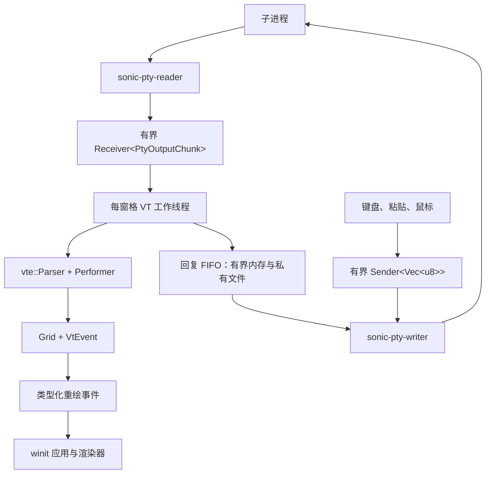
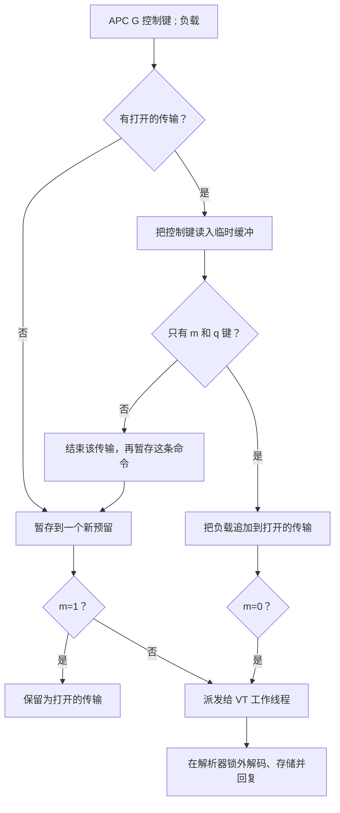

# 终端 IO 与 VT

[English](Terminal-IO-and-VT)

PTY（伪终端）在 SonicTerm 与子程序之间传递字节，解析器把返回字节变成网格单元格与
终端事件。本页说明这条路径和支持的协议；绘制见[渲染与字体](Rendering-and-Fonts-zh-CN)，
资源上限见[内存](Memory-zh-CN)。

### 范围

本地 PTY、解析器、网格、键盘、粘贴、鼠标追踪、选择与复制路径属于跨平台应用行为。
SonicTerm 没有内置的远程会话传输：`ssh` 等远程 shell 作为普通程序运行在本地 PTY 中。

### 字节与线程流



读取线程把可复用的 64 KiB `BytesMut` 环形缓冲拆成引用计数的 `bytes::Bytes`
视图。输出通道最多保留 64 个数据块。通道满时读取线程等待，由操作系统 PTY
施加背压，不会继续增长。排队视图最多可固定 64 个不同的环形缓冲，即 4 MiB；
实测普通 shell 工作负载只固定一个 64 KiB 环形缓冲。

终端输入不阻塞。通道最多保存四条 `Vec<u8>` 消息，每条最多 16 MiB。消息过大、
队列已满或写入端断开时，会返回带类型的 `PtyInputError`，其中携带被拒绝的字节，
仅供调用方报告其长度；被拒绝的输入从不重试。

每条被接受的用户输入消息在非阻塞发送外的短暂提交锁内获得一个序号（模 2^20），因此序号
顺序就是通道顺序。writer 只在用户输入消息 flush 成功后才计为完成（在两个平台上 flush 都不做任何事：Unix 的 writer 是普通文件，
固定版本的 Windows writer 的 `flush` 立即返回，因此逐条 flush 不增加系统调用）；解析器回复从不改动序号。
每个序号的提交时间存放在八个槽位之一。`PtyHandle::input_progress()` 不加锁读取这些原子量，
返回 `Idle`、最早未完成的写入（`Oldest`，含其提交时间以及前面是否有回复）、读取与完成竞争时的
`Raced`，或 writer 停止后的 `Terminal`。writer 每次退出时都在提交锁内记录原因，因此之后的
提交不会在未记录的情况下成功：原生 `write_all` 或 `flush` 错误为 `Failed`，最后一次完成之后
提交的每条写入都报告为丢失；取消和主动关闭为 `Stopped`。状态栏的 `input` 段读取这一进度。

显示中的状态栏列出 `out` 时，VT worker 把每个收到的数据块长度加到窗格的输出字节计数器上，在刷新记账
旁做一次 `Relaxed` 加法；否则只做一次 `Relaxed` 读取。计数器随窗格跨窗口移动。

生产解析器在产生回复的分派后让出执行。VT worker 在解析器与副作用锁外，
把回复提交到独立 FIFO：先使用 64 KiB 内存，溢出后写入私有、自动删除的临时文件。一次分派
暂存小于 32 KiB：颜色请求上限 4 KiB，OSC 21 上限 16 KiB 且最多 526 个作答字段，其回复小于 28.2 KB。完整分派按最多 32 KiB 合并，并在每个
输出批次结束时刷新；小回复无需每次查询都写文件。提交可能执行同步文件 IO，但不等待
原生输入容量，因此先输出有限查询突发、再读取回复的子进程仍能推进。

现有原生 writer 在 UI 输入与总计最多 32 KiB 的完整回复提交之间选择；长度帧保证键盘字节
不会插入回复内部。每轮回复之后，已就绪的 UI 输入优先获得一次写入机会。两条流各自保持
字节顺序，但不承诺不同生产者之间的顺序。每个窗格未消费的溢出字节上限为 16 MiB
（`SPILL_BUDGET_BYTES`）：超出上限的回复单独以 `ReplyBudgetExceeded` 错误拒绝、计数并丢弃，暂存区
仍可接收后续回复。这对应持续查询却从不读取输入的程序；有限突发（例如程序读取前产生
512 条满长回复）仍可容纳。已消费前缀至少 1 MiB 且至少占文件一半时，未消费记录移到文件开头，
因此文件始终小于预算的两倍加一条记录，每次提交的代价是一次记录写入加摊销的复制。
提交仍在 VT worker 上进行：预算限制的是一次提交可写入或复制的字节数，而不是耗时，因此文件系统停顿
仍会让该窗格的 VT worker 停顿；单独的 IO 线程会为每个窗格增加线程，并打乱失败报告顺序。
原生文件系统配额错误属于存储失败，而不是预算拒绝。
排空和 writer 退出会删除文件；窗格销毁立即拒绝新提交。原生 writer 负责最终清理，在事件循环
线程之外等待正在进行的存储操作返回。
磁盘耗尽、暂存读写失败及原生 write/flush 错误均显式报告，不保证这些故障下无损交付。
回复失败不会停止输出解析、重绘合并或子进程退出观察。UI 输入保留非阻塞拒绝行为。
独立解析器的通道式 `advance` API 仍为非阻塞；生产路径使用 `advance_with_replies` 并继续消费剩余字节。

VT 工作线程会先合并输出，再请求一帧。连续 3 ms 没有新数据时刷新尾批次；批次达到
128 KiB 或等待 8 ms 也会刷新。所有窗格构造路径都使用同一个宿主事件处理器。推进解析器
和快照模式时持有该窗格的解析器锁；剪贴板与命令分发、内联媒体解码或缩放以及常驻存储更新
都在释放该锁后执行。线程在短暂加锁时复制当前 `WindowId`，释放锁后，若该窗格没有
未处理的输出事件，发送 `UserEvent::PaneOutput`。工作线程不调用 AppKit、Win32 或 winit 窗口方法。

### 本地 PTY 契约

`PtyHandle` 拥有子进程、PTY 主端、读写线程、有界通道、已选 shell 路径和尺寸调整
回调。

回调返回 `anyhow::Result<()>`。它把原生调用和最后一次成功应用的 `(cols, rows)`
放在同一把锁后面，因此原生尺寸调整是串行的，缓存记录的是最后一次成功的原生调用：

- 列数或行数为零时，在原生调用之前、也在缓存变化之前，以 `InvalidInput` 错误
  拒绝该请求。
- 与最后一次*已应用*尺寸相同的请求会被跳过，避免多余的 SIGWINCH 或 ConPTY 重排。
- 只有原生调用成功才会缓存该尺寸。因此失败的请求不会被当作重复请求去重：下一次
  相同的请求会再次到达原生调用，而最后一次成功的尺寸仍保留在缓存中。
- 第一次请求一定会到达原生调用。缓存初始为空，不会用 spawn 时的尺寸预填，因此
  没有任何值能与它匹配。

GUI 先调整网格，且在原生调用失败时不回滚：窗格保留用户请求的几何尺寸，只有子进程
看到的尺寸会滞后。`sonicterm-app` 通过 `PaneState::resize_pty` 报告失败，每一轮
连续失败只告警一次——第一次失败会记录窗格 id、请求的列数与行数以及错误，后续失败
保持静默，直到一次成功的尺寸调整清除该闩锁。告警抑制绝不会抑制一次尺寸调整尝试：
只有无效尺寸和成功的重复请求不会到达原生调用，而这两者都由 IO 边界决定，与告警
闩锁无关。`Parser::resize_terminal`（见下文）保留的提示符行在其后的原生调用失败时依然保留，不做任何撤销。

未配置 `[terminal].shell` 时：

- Windows 依次尝试 PowerShell 7（`pwsh.exe`，包括注册安装和 Microsoft Store
  安装）、Windows PowerShell、`cmd.exe`。
- Unix 依次使用可执行的 `$SHELL`、当前用户 passwd 记录中的可执行 shell、`/bin/sh`。
- macOS 正常运行时，zsh/tcsh/csh 使用 `-l`，bash/fish 使用 `--login`。
  干净端到端测试模式则关闭配置文件和启动横幅。

Windows PowerShell 正常启动时，还会在受支持的 PowerShell 7 主机中加载内嵌、仅当前进程
生效的目录链接集成。它保留自定义格式和显式命令；干净端到端启动不会安装该集成。
参见[使用说明](Usage-zh-CN#powershell-目录链接)。

若提供了有效的显式工作目录，子进程从该目录启动；否则在可用时使用 `HOME`。
SonicTerm 设置：

```text
TERM=xterm-256color
COLORTERM=truecolor
TERM_PROGRAM=<配置的 term_program>
TERM_PROGRAM_VERSION=<与终端身份匹配的版本>
```

`TERM_PROGRAM=SonicTerm` 时使用工作区包版本。`TERM_PROGRAM=WezTerm` 时固定报告
与已实现能力匹配的 WezTerm 版本 `20230712-072601`。

生产窗格移除使用 `App::retire_pane`。`PtyHandle::into_teardown` 发布关闭状态并转移
原生资源所有权，不执行原生等待。有预留的窗格交给 App 唯一的回收驱动线程；无预留的
窗格重试接纳一次，再采用有日志、有计数的同步回退。测试夹具直接析构也保留有界内联清理。
活跃窗格在窗口之间移动时，PTY 与预留一同转移，不发生退役。

拥有资源的载荷取消原生 IO、终止子进程、关闭 PTY，并限时回收进程。读写线程退出和子进程
回收的期限是 500 ms。Unix 会终止子进程会话，并在回收主进程前重新
核对后代，避免向已复用的进程号或会话号发信号。成员检查会跳过无需发信号的僵尸进程：
Linux 读取 `/proc` 状态，macOS 读取内核进程状态；macOS 状态无法读取时保留该成员。
最后一次有界发信号/等待之后，重新检查会话成员以确认完成；仍有成员时，错误会包含观测到的
进程 ID。macOS 上还会给出每个成员的父进程 ID、进程组、内核状态、退出中标志和命令（生成错误时
读取，不能证明亲缘关系），以及列出它的最近一轮的 kill 结果：内核接受 SIGKILL 时为 `ok`，被拒绝
时为 errno（如 `EPERM`），发信号前的复查跳过该成员时为 `skipped-recheck`，只有最终检查才发现它
时为 `unlisted`。最后的 `group_kill` 字段以同样形式给出会话进程组 SIGKILL 的结果。
Windows 先等待读写线程退出，再并行排空克隆的 ConPTY 读取端并关闭主端。关闭与排空各有
2 s 等待预算，取消 worker 共用 500 ms 期限。原生资源在 worker 真正启动前留在恢复槽中；
排空线程启动被拒绝时，主端仍被持有并可重试。重试不会重复启动取消或排空工作。
每次 join 先检查线程确实退出，而不是只依赖完成消息或通道断开。未结束的 worker 继续持有
句柄与许可。

只有全部原生阶段成功且所有已启动 worker 已 join 才算整体完成。终止失败会让主进程保持
未回收状态。最终仍未完成的载荷将传输所有者与记账保留在进程 sink 中。预留关闭把这些等待
移出 App 线程，同步回退则不会。Windows 清理覆盖仍附着的客户端，不保证终止已分离后代或
拒绝关闭通知的自定义客户端。`ClosePseudoConsole` 返回本身不能证明所有外部客户端均已
退出。关闭开始时仍在启动的客户端，其清理尚未得到验证；未完成的原生资源继续被持有，
并阻止干净会话标记。[运行时生命周期](Runtime-Lifecycle-zh-CN) 说明退出结算与干净会话标记。

主端输入 writer 由同一个内部接缝构建，因此窗格关闭时子进程收到哪些字节只由一处决定。
Unix 上 SonicTerm 通过主端描述符的 close-on-exec 副本写入，关闭该副本是静默的：销毁
writer 不会新增任何合成输入。普通终端输入和解析器生成的应答不受影响——这一收窄很重要，
因为应答是终端自身产生的合法输入。而 `portable-pty` 自带的 Unix writer 在析构时，只要
线路规程报告了 `VEOF`，就会写入一个换行和该 `VEOF`，因此拆除过程会向子进程投递一次
用户未请求的换行和 Ctrl+D。Unix 主端若不提供描述符，则返回错误，而不是回退到那个会注入
字节的 writer。Windows 仍使用 `portable-pty` 的 writer，其 ConPTY 析构不会向子进程
写入任何内容。

该副本与主端共享同一个打开文件描述，因此 `O_NONBLOCK` 等文件状态标志保持共享，此处
也不会修改它们；而 `FD_CLOEXEC` 是每个描述符独立的标志，只设置在该副本上。副本的生命期
是独立的：主端释放后它仍能继续投递，关闭它也不影响其他副本继续可用。显式用户输入不受
影响：用户输入的 Ctrl+D 仍然会结束一个规范模式 shell。

### VT 解析器与协议

`sonicterm-vt::Parser` 包装 `vte::Parser` 与 SonicTerm `Performer`。`Performer`
拥有 `Grid` 和终端属性。状态机处于基态时，会批量插入可打印 ASCII，
直到遇到转义或控制字节。

当前协议支持：

- 光标移动、保存/恢复、插入/删除字符与行、擦除、DECSTBM、反向索引、自动换行、
  光标可见性，以及 DECSCUSR 光标形状与是否闪烁（`CSI Ps SP q`：1/2 方块、3/4 下划线、
  5/6 竖线，奇数闪烁、偶数常亮；0 或 RIS 恢复配置的光标；绘制活动窗格的请求）；
- SGR 样式、索引色、真彩色、下划线样式与颜色，以及按背景色擦除；
- 主屏幕与备用屏幕、应用光标键、括号粘贴、焦点报告，以及 kitty 键盘标志的
  set/push/pop/query；
- OSC 0/2 标题、OSC 1 标签页名称、来自 OSC 7、OSC 9;9 与 OSC 1337 `CurrentDir` 的带主机校验的工作目录、
  OSC 8 超链接、OSC 52 与 OSC 1337 `Copy=:` 剪贴板写入、
  OSC 4/10/11/12/17/19 颜色查询与设置、OSC 21 kitty 颜色协议、OSC 22 指针形状、OSC 104/110/111/112/117/119 颜色重置、OSC 133 提示符标记、OSC 9;4 进度、OSC 1337 `SetUserVar` 用户变量、OSC 7501 程序状态，以及 OSC 9 / OSC 777 / OSC 99 通知。
  OSC 99 遵循 kitty 协议：标题和正文可一次发送，也可在同一 `i` id 下分块发送，可为纯文本或
  base64（`e=1`，可在任意位置分割，末尾填充可省略）；同时最多保留八个未完成通知，总计 16 KiB，
  任一分块被拒绝或取消时全部丢弃，因此不会有被截断的通知完成；同一窗格以相同 id
  发送的后续通知替换已显示的通知；`o=unfocused` 只在该窗格不是已聚焦窗口的活动窗格时显示，
  `o=invisible` 只在它未被绘制时显示（位于其他标签页、被缩放隐藏，或窗口被遮挡或最小化）；`p=?` 查询的
  回复为 `p=title,body:o=always,unfocused,invisible`，其他部分（关闭、图标、按钮）一律忽略；
- DSR、DA、XTVERSION、DECRQSS SGR、DECRQM、配色方案（DSR 996、模式 2031）、单元格尺寸
  （`CSI 16 t`）、调色板和 kitty 键盘回复（见[主机报告](#主机报告)）；
- iTerm2 与 Sixel 媒体事件，以及带 Unicode 占位符的 kitty 图形协议子集；
- 同步输出（DEC 2026）。

同步输出：`CSI ? 2026 h` 开始一次更新，`CSI ? 2026 l` 结束它。RIS 也会结束更新；
离开备用屏幕不会。重复的 `h` 保留它已开始的那次更新，因此不能延长自身的时限。更新
进行期间，窗格的工作线程继续解析但不发送输出事件，显示该窗格的窗口也不呈现帧，直到
更新结束或经过 150 ms。有两项限制：尚未被成功帧显示的重置会释放该窗格，即使新的更新在该帧之前
已经开始；无论哪些窗格保持窗口，窗口从一段保持中首个被保持的帧起最多保持 150 ms。首帧、可见性变化、设备恢复、表面尺寸改变和表面恢复仍会呈现
当前网格。DECRQM `CSI ? 2026 $ p` 的回复是 `CSI ? 2026 ; Ps $ y`：更新进行中时 `Ps`
为 1，否则为 2。在 Windows 上，ConPTY 可能移动或丢弃这些括号，
保持只作用于到达解析器的括号。

### 剪贴板写入（OSC 52、OSC 1337 `Copy=:`）

原始收集器负责 `52;` 与 `1337;Copy=:`（键名不区分 ASCII 大小写）。kinds 字段最多 16 字节；
更长的会被吞掉直到终止符。编码后的负载以至多 64 KiB 的块经由解析器的 `ClipboardInbox`
传递，该类型不可 `Clone`，其 `Debug` 只打印长度；解析器只发出不带负载的
`VtEvent::ClipboardStream { stream, phase }` 事件（`Data`、`End { kinds, query }`、`Abort`）。
只有 BEL 或 ST 之后写入才会提交。CAN、SUB、无关的 ESC 或 60 s 内没有终止符会中止该流，
释放已排队的块并吞掉该 OSC 的剩余部分。流打开之后 `osc52` 或 `osc52_read` 发生变化（即使又变回
同一策略）也会结束该流。VT 工作线程在解析下一段就绪输出之前先应用这两条规则，因此在过期时或之后、
或在策略变化之后读到的终止符绝不会提交。终止符本身也会读取时钟，因此在解析其所在块期间过期的流不会
写入任何内容；写入会把其流打开时的策略代次一直带到提交点，因此在解析终止符期间发生的策略变化仍会丢弃它。

窗格的 VT worker 在解析器锁之外解码：严格的 Base64 字母表、末尾填充可选、块之间最多携带
3 个字符，并在流开始时读取 `[terminal] clipboard_write_limit_bytes` 上限。每个缓冲区在分配
之前都从进程剪贴板暂存预算中预留（见 [内存](Memory-zh-CN)），写入在投递到事件循环之前先取得
一个程序槽位（最多 8 个），清空也不例外。`[terminal] osc52 = "ask"` 时，VT worker 改为给完整的
写入发放一张与读取共用闸门的同意票据（每个窗格一个待问写入，每进程 8 张票据，否则以繁忙拒绝）；
票据持有写入、其租约与程序槽位，遵循下文读取票据的重新校验规则，页面标题为
`允许标签页 N 的窗格 M 写入剪贴板?`。“允许”把写入交给剪贴板 worker 的排序域；“拒绝”、Escape、
点击页面之外或过期都会丢弃它，且从不向程序回送任何内容。`"deny"` 时事件循环拒绝写入，`"ask"`
时拒绝任何未经批准的写入。每个写入都把接纳时的绑定带到其提交点：其流或事务打开时的策略代次，已批准的
写入还包括其窗格、PTY、所在窗口、命令、“允许”时窗口的 READONLY 状态以及其票据的 120 秒有效期。对
`osc52` 或 `osc52_read` 的任何修改都会丢弃尚未提交的所有程序写入；已批准的写入在其窗格关闭或移动、
PTY 或命令变化、窗口进入 READONLY，或其票据有效期在剪贴板 worker 处理它之前结束时也会被丢弃。
被丢弃的写入不改变任何内容，也不回复任何内容。在 Linux 与 Windows 上，事件循环把写入投递给
唯一的剪贴板 worker 线程，由它在系统调用之前立即检查该绑定（Windows 上在同一次剪贴板占用之内，读取
将被替换的值之后、`EmptyClipboard` 之前）；该调用即提交点，X11 选区所有者在提供数据期间保留租约。程序写入与用户复制共用 worker 的队列，严格按
事件循环处理它们的顺序执行，因此后来的用户复制总是生效。同一窗格的 OSC 52 与 OSC 5522 写入按它们在线路上到达的顺序投递，因此程序最后发送的写入就是剪贴板上留下的内容。只有在队列为空且复制不超过 512 KiB 时，
事件循环才自己写入用户复制；worker 上最多排队 4 个用户复制，再多一个会以复制失败提示拒绝并保留
选区；复制模式中被拒绝的复制在同一窗格仍为活动窗格时回到复制模式并保留选区。批次的状态栏摘要会等待 worker 的结果。macOS 没有 worker，因为尚未证明可以在其他线程使用
`NSPasteboard`：超过 512 KiB 的程序写入被拒绝；用户复制无论大小都留在事件循环线程上，因为设上限会拒绝用户常复制的大段选区。

| 形式 | SonicTerm |
| --- | --- |
| `c`、`s`、`0`–`9`、空 kinds | 标准剪贴板 |
| `p` | Linux PRIMARY；macOS 与 Windows 上丢弃 |
| `cp` | 平台支持的所有目标；X11 依次写入两个选区，并非原子操作。写入失败时可能只有 CLIPBOARD 改变，PRIMARY 保持不变。 |
| 未知字母 | 忽略；没有已知字母的 kinds 字段被丢弃 |
| `52;c`（无数据）、`52;c;` | 清空剪贴板 |
| Base64 填充 | 可选，但出现的填充必须补全最后一组（拒绝 `aG=`）；任何其他字节使写入作废 |
| 非 UTF-8 负载 | macOS 与 X11（包括 PRIMARY）逐字节保留；Windows 将无效序列替换为 U+FFFD |
| `?`（任意 kinds） | 读取：`osc52_read = "allow"` 时以剪贴板文本应答，形如 `ESC ] 52 ; <标签> ; <b64> ESC \`；`ask`、`deny` 与上限见下文 |
| `1337;Copy=:<b64>` | `c` 写入；空值或 `?` 不写入任何内容 |
| `1337;Copy=;<b64>` | 不支持 |

与参考终端的有意差异：没有 PRIMARY 的平台丢弃 `p`（kitty）；仅 Windows 将无效 UTF-8 字节替换为 U+FFFD
（Ghostty 与 kitty 保留原始字节，WezTerm 拒绝）；上限默认 64 MiB、至多 512 MiB，只保存在内存中、
从不落盘（kitty：512 MB 并可溢出到磁盘）；Windows 只重新写入不超过 512 KiB UTF-16 的写入；
不支持 WezTerm 的 `Copy=;` 写法（WezTerm 解析它但从不执行）。OSC 5522 见下文
[Kitty 剪贴板协议](#kitty-剪贴板协议osc-5522)。

无论请求以什么结束，每个读取应答都以 ST 结尾。单个字母为 `c`、`s` 或 `p` 时原样回显，其他单个
字母回 `c`（Ghostty；kitty 对 `s` 回 `c`）；更长的字段按其指明的每个目标各回一次，`c` 在 `p`
之前（kitty），两者都未指明时回 `c`。`p` 在 Linux 上读取 PRIMARY，其他平台上得到空应答。
`osc52_read = "deny"` 静默丢弃读取（Ghostty 与 WezTerm；kitty 发送空应答）。WezTerm 在任何策略下
都忽略读取。

否则，窗格的 VT worker 在投递任何事件之前先为读取取得一张票据：每个窗格一张，每个进程 8 张。
超出任一上限的读取立即在普通的解析器应答路径上得到空应答；空应答不携带剪贴板字节。票据记录窗格、
其 PTY、所在窗口、最近一次提示符或命令边界，以及策略代次。关闭窗格、把窗格移到另一个窗口（或移走
再移回）、其标签页在窗口中的位置发生任何变化（重新排列，或在它之前关闭或插入标签页；同意页面以位置指明
标签页）、提示符开始、命令开始或结束、
重置（RIS）、PTY 改变、READONLY，以及对 `osc52` 或
`osc52_read` 的任何修改，都会静默取消票据。在系统读取开始之前、以及每次尝试投递应答之前，都会再次
检查票据。

`"ask"` 下票据等待同意页面，即命令面板的确认页面，标题为 `允许标签页 N 的窗格 M 读取剪贴板?`，
含“允许”与“拒绝”两行。它以位置指明标签页与窗格，从不使用程序设置的标题，并默认高亮“拒绝”。它只在
容纳该窗格的窗口中打开，且只在该窗口位于最前、命令面板关闭时打开：从不前置窗口、移动焦点，也不复用
或替换已打开的面板；在此之前票据继续等待。同一时间只打开一个页面；其他窗格的读取按顺序等待。
“允许”只批准该页面的票据，且只在该页面自己的面板会话、在显示它的窗口中生效；之后关闭面板不影响
批准。“拒绝”、Escape、点击页面之外或 120 秒内未作答，都会关闭页面并发送空应答，与被拒绝的提示一致。
页面被关闭或被其他面板页面替换、移到另一个窗口，或发生上文的任何取消，票据都静默结束（OSC 5522
写入除外，见下文）。已批准或
`"allow"` 下的读取在一次性的读取线程上进行，每次只读一个，从不在事件循环上读取。一次读取至多返回
8 MiB 的 UTF-8 文本（`cp` 每个目标 4 MiB）；更大的值、失败的读取或没有剪贴板所有者时得到空应答。
不是有效 UTF-8 的文本变为 U+FFFD。每个目标在 macOS 与 Windows 上有 2 秒，在 Linux 上有 7 秒。
超过截止时间的读取得到空应答，但其票据与其占用的应答预算一直保留到系统调用返回；在此期间其他读取
不读取剪贴板，直接得到空应答。系统调用在截止时间当时或之后才返回的读取同样得到空应答，无论事件循环
多快取到其结果。

| 平台 | 上限 |
| --- | --- |
| Windows | `OpenClipboard` 重试 10 次，间隔 10 ms；`GlobalSize` 在 `GlobalLock` 之前判定过大的 `CF_UNICODETEXT` |
| Linux（X11、XWayland） | 以 `ConvertSelection` 请求 `UTF8_STRING`，被拒后改试 `STRING`，两次共用 2 秒应答时限；接受上限内格式为 8 的 `UTF8_STRING`、`STRING` 或 `text/plain;charset=utf-8` 值；接受格式为 32 的大小在上限内的 `INCR` 传输，大小在删除声明之前检查（删除即请求第一个分块），每块 2 秒、总计 5 秒，每个事件之前都检查截止时间，繁忙的所有者无法延长它；没有 X 服务器时得到空应答 |
| macOS | `NSPasteboardTypeString`；与任何粘贴一样，AppKit 在 SonicTerm 能测量之前就持有整个值，复制进 SonicTerm 时超过上限即拒绝 |

一次请求的应答（所有目标合在一起）是一条至多约 10.7 MiB 的消息。它只发往发出请求的窗格的 PTY，
经由写入线程的单槽敏感通道：从不经过应答缓冲区或其磁盘溢出、广播窗格或日志，日志只记录长度和结果。
写入线程的准入锁繁忙时，投递在之后的三个事件循环轮次中重试，每次都重新检查票据；槽已满、写入线程已
停止或最后一次重试失败时丢弃应答，程序得不到应答，与 WezTerm 一致。读取应答与窗格的其他应答之间
不保证顺序。

### Kitty 剪贴板协议（OSC 5522）

原始收集器接管 `5522;`，并保存整个数据包直到 BEL 或 ST，前缀之后的线上字节至多 1 MiB；CAN、SUB
或无关的 ESC 会整体丢弃它。4 KiB 内没有 `;` 的元数据被视为截断，数据包被丢弃。有效数据包的编码
载荷保存在解析器的 kitty 收件箱中，解析器为每个数据包发出一个不带载荷的 `VtEvent::KittyClipboard`。OSC 52 与 OSC 5522 收件箱合计达到 1 MiB 时，解析器结束当前段，使 worker 在更多数据包排队之前先取走它们。
超过上限的数据包只依据完整、有效的元数据分类，取其最后一个 `type`：`wdata` 或 `walias` 以
`EFBIG` 结束打开的写入，其他类型则被丢弃。

每个窗格的 VT 工作线程在解析器锁之外最多保持一个打开的写入（`kitty_clipboard_tx.rs`）：

| 数据包 | SonicTerm |
| --- | --- |
| 不含 `=` 的记录、缺失或未知的 `type` | 丢弃，不回复，即使写入已打开 |
| `mime`/`name`/`pw` 的 Base64 无效，`mime`/`name` 超过 256 字节 | 写入已打开时的 `wdata`/`walias`：`EINVAL`；否则丢弃 |
| `type=write` | 静默替换已打开的写入；在 `osc52 = "deny"` 下立即回复 `EPERM` |
| `type=wdata:mime=…` | 每种类型一个严格的 Base64 流；带填充的组结束其数据包并重新开始该流，因此同一数据包中其后的数据，或未用位不为零的填充组，回复 `EINVAL`；切换类型会结束上一个流；重复的类型会重新开始其区域 |
| `type=walias:mime=…` | 按顺序记录别名；空的 `mime` 回复 `EINVAL` |
| 不含 `mime` 的 `type=wdata` | 提交 |
| `type=read` | 按下文提供；载荷不是 UTF-8 的严格 Base64 时丢弃，不回复 |
| DECSET/DECRST `?5522`、DECRQM `?5522` | 每个窗格保存该模式，DECRST 和 RIS 会将其复位；DECRQM 回复 `1` 或 `2`；模式设置时，粘贴发送粘贴事件（见下文）而不是文本 |

每个缓冲区在增长前都从剪贴板暂存预算中预留，事务上限为写入打开时读取的
`clipboard_write_limit_bytes`：超过它时写入在分配前以 `EFBIG` 结束；预算不足时以 `EBUSY` 结束。
最多保留 64 种 MIME 类型和 64 个别名，之后的被忽略。出现任何错误后，直到下一个 `write` 之前的
数据包都被忽略。状态回复回显打开写入的 `write` 中经过清理的 id 和 `loc=primary`，并使用被回复
数据包的结束符。

提交时，别名按顺序应用于所有暂存的表示，然后每个名称映射到一种原生格式（见
[平台集成](Platform-Integration-zh-CN)）：`text/plain`、带 `;name=value` 参数的 `text/plain`、`UTF8_STRING`、`TEXT` 和 `STRING` 是文本。参数名为 RFC 2045 词元；值可以是词元或允许反斜杠转义的引号字符串。缺少赋值、引号未闭合或非法控制字符都会使名称无效；`text/html`、`image/png` 和 `text/uri-list` 是常见类型；其他至多 255 字节、符合
RFC 6838 `type/subtype` 的名称是自定义类型。不是 MIME 名称或平台无法保存的名称会被省略，与 Ghostty
相同。每种格式只保留一次，以第一个名称为准，因此将 `text/plain` 指向其他类型的别名仍能得到文本。
未暂存任何内容的提交会清空剪贴板。所有名称都被省略，或在 Linux 以外使用 `loc=primary` 时，回复 `ENOSYS`。只有文本时走下文的文本路径。保留了其他类型时，它们与其余表示组成一个
提供：其缓冲区和每种类型的一份原生副本在投递前从暂存预算中预留（放不下时回复 `EBUSY`），在接触剪贴板
之前先暂存所有原生缓冲区，再以一次操作全部发布。暂存或发布失败回复 `EIO`，暂存失败时保留原剪贴板；
`DONE` 表示所有保留的表示都已发布。提交时会再次检查 `osc52` 策略：`deny` 回复
`EPERM`，`ask` 打开与 OSC 52 写入相同的同意页面，在那里被拒绝则回复 `EPERM`。随后写入沿 OSC 52
写入路径进入剪贴板工作线程，事件循环在来源窗格的 PTY 上回复 `DONE`、`EIO`（系统调用失败）或
`EPERM`。剪贴板工作线程停止时仍持有的写入回复 `EIO`。需要同意的写入若未得到回答就结束（页面丢失、
窗格移动、策略变化），回复 `EPERM`。每个状态只在发出写入的同一 PTY 与命令仍占有该窗格时发送；PTY 或
命令已变化、或窗格已关闭时不发送任何内容，因为另一个程序会把它当作输入读取。因绑定变化而在提交点被
丢弃的写入不回复任何内容。被省略的表示在提交时释放。

在 X11 上，CLIPBOARD 与 PRIMARY 使用相同的 MIME 映射：每个非文本类型使用同名原子，四个文本目标共享原字节；能用 Latin-1 表示的文本还以该编码提供 `STRING`。
每进程接纳 256 个数据原子名称。`TARGETS` 列出可用目标，`TIMESTAMP` 为粘贴事件标识该份提供。
每份提供通过 `INCR` 最多同时服务八个请求者，每块不超过 256 KiB，限时五秒。失去选区后停止接纳新请求，
但已接纳的传输会继续；未失去选区时一小时后过期。仅有原生 Wayland 时没有剪贴板后端；XWayland 走 X11 路径。

打开的写入在最后一个数据包之后 30 秒或打开之后 10 分钟以 `EBUSY` 结束；策略变为 `deny`，或
写入打开之后 `osc52`/`osc52_read` 有任何变化（快速地先 `deny` 再 `allow` 也算）时以 `EPERM`
结束。VT 工作线程在解析每段就绪输出之前先检查这两种情况，因此在截止时间当时或之后读到的提交绝不会
提交；即使子进程没有任何输出，它也会为这两种情况醒来，因为配置重载在发布新的策略代次之后会唤醒每个
工作线程。提交时会再次检查时钟和打开时的策略代次，因此在解析提交期间过期或策略发生变化的写入会回复
`EBUSY` 或 `EPERM`，已投递的写入会把打开时的策略代次一直带到提交点。RIS 和窗格退役会静默释放它。

读取的载荷是 MIME 类型的 Base64 列表；`.` 表示请求类型列表。至多接受 16 个数据类型。读取遵循
`osc52_read`，并使用与 OSC 52 读取相同的同意票据：`deny`、同一窗格已有读取进行中、页面被拒绝或过期时
回复 `EPERM`；进程闸门已满、队列压力或应答预算已满时回复 `EBUSY`。不是 UTF-8 严格
Base64 的载荷最先检查，检查不分配内存，即使在 `deny` 或预算已满时也丢弃且不回复。随后 `deny` 最先决定
有效的读取，因此在预算不足或缺少 PRIMARY 本会给出其他回复时仍回复 `EPERM`。只请求类型列表的读取不读取内容，
因此在 `ask` 下跳过同意页面，除非有覆盖其密码的禁止授权（见下文）。批准的读取在一次性读取线程上运行，并作为一条消息经由敏感应答通道送达，
从不进入应答缓冲：`OK`，类型列表作为一个 `mime=Lg==` 的 `DATA` 包（类型以空格连接并以换行结尾，至多
64 个名称、4096 字节，因此放得进一个包，为空时省略载荷），每个提供的类型分成至多 4096 原始字节的
`DATA` 块，每个包都重复 id 和 MIME，最后是 `DONE`。`text/plain` 及写入别名（`UTF8_STRING`、`TEXT`、`STRING`）按文本读取；其他类型经系统层读取
（见 [平台集成](Platform-Integration-zh-CN)）：Windows 上 HTML 去掉外层只留片段，PNG 和自定义类型逐字节
提供，`text/uri-list` 来自文件和 URL 项。剪贴板没有的类型被省略，协议将其理解为不可用。每个类型以
8 MiB 上限读取，并且只有在整个应答保持在 12 MiB 以内时才提供，此检查在任何缓冲增长之前进行；否则该
类型被省略。只有当已构建的应答仍给该任务的 21 MiB 预留留出下一个类型的最坏情况（8 MiB 原始字节，加上
其转换结果或扩到 12 MiB 的应答）时，才会读取下一个类型，因此应答超过约 1 MiB 后，之后的类型都不读取而
直接省略。位置不可用（Linux 以外的 `loc=primary`）或平台无法列出类型时回复
`ENOSYS`；系统读取失败或超时，或类型列举失败，回复 `EIO`；剪贴板为空时回复 `OK` 后接 `DONE`。
应答的写入方接纳在所有重试中都处于争用状态，或写入方拒绝它时，应答被丢弃；若能接纳，程序会收到一个
`EBUSY` 包，绝不会收到不完整的 `OK` 序列。

类型列表只列出名称，不读取任何内容：Windows 使用 `EnumClipboardFormats`，macOS 使用通用剪贴板的
`types`，X11 使用所有者的 `TARGETS`（在 2 秒选择等待之内）。至多检查 64 个系统名称；X11 原样列出有效的 MIME 原子名，并将文本别名映射为 `text/plain`。其他平台的文本、HTML、
RTF、文件和图像类型映射为对应的 MIME 名称，形如 MIME 的名称去掉参数后保留（因此以 MIME 名称注册的
Windows 格式以该名称列出），macOS 上统一类型有首选 MIME 名称的类型以该名称列出，因此 SonicTerm 发布
的动态类型以其 MIME 名称列出。没有 MIME 名称的私有和协议类型（其他 `dyn.*` 类型、`TARGETS`、未命名
格式）绝不会列出。

在 `ask` 下，若程序以非空的 `name` 和 `pw` 表明身份，读取或写入的确认页会在“拒绝”之后增加“始终”和
“禁止”两行，并在单独的“程序提供的名称”行中显示该名称（至多 64 个字符，控制字符被替换）。“始终”允许
本次及之后的请求，“禁止”以 `EPERM` 拒绝本次及之后的请求，两者都不再弹出确认页。授权按窗格、其 PTY
实例、所有者纪元和 RIS 计数、操作、位置和 `pw` 区分，从不使用名称；没有 `name` 的 `pw` 视为没有密码，
因此不会查找或创建授权。每个窗格至多保留 16 条授权，超出时淘汰最旧的一条。RIS、关闭窗格、将其移到另一
窗口或把其标签页移到另一个位置、新的 PTY 以及 `osc52`/`osc52_read` 的任何变化都会撤销其授权，`deny`
从不查询授权。由授权批准的
读取在投递时仍会重新校验，因此之后的 `deny` 或转移不会发送任何内容。授权、名称和密码绝不会出现在日志或
`Debug` 输出中。

粘贴事件（DECSET 5522）。粘贴先选定窗格，再读取剪贴板：源窗格，以及现有广播准入接受的接收窗格。程序
设置了模式 5522 的窗格收到粘贴事件而不是粘贴内容；但在 `osc52_read = "deny"` 下，所有窗格都收到文本。
VT 工作线程连同复位计数一起发布该模式，因此粘贴从不获取解析器锁。只有其余窗格才读取剪贴板，所以只含
图像的剪贴板内容仍能送达设置了模式的窗格；打开的搜索和复制的文件仍按原方式路由，只针对这些窗格。每个
设置了模式的窗格经敏感应答通道收到各自的事件：`OK`、作为一个 `mime=Lg==` 的 `DATA` 包的类型列表，然后
是 `DONE`；每个包都以 ST 结尾、不带 `id`，并带有相同的 `pw`，即用操作系统 CSPRNG 的 16 字节生成的
一次性密码的 Base64。类型列表遵循上文规则，平台无法列出类型时为空。写入方拒绝事件时，该事件连同该窗格
的这次粘贴一起被丢弃，不会重试。

只有在窗格的写入方接纳事件之后，才会创建该事件的授权；每个窗格只保留其最近一次粘贴的授权。授权绑定
窗格、其 PTY 实例、所有者纪元和 RIS 计数、其模式 5522 状态和复位计数、策略代次、位置，以及用户所粘贴
内容的版本：

| 平台 | 内容版本 |
| --- | --- |
| macOS | 通用剪贴板的 `changeCount` |
| Windows | `GetClipboardSequenceNumber`；0（无剪贴板访问权限）视为没有版本 |
| Linux（X11、XWayland） | 选择所有者的窗口及其对 `TIMESTAMP` 的回答，在 2 秒选择等待之内；所有者在转换之前和回答之后各读一次，且不得改变；没有所有者、所有者改变、没有回答，或回答不是一个非零、格式为 32 的 `INTEGER` 项，都视为没有版本 |

粘贴在手势发生时于事件循环上绑定该内容。在 macOS 和 Windows 上，手势在此处读取版本，因为两者都只是
读取计数器，不打开任何东西；授权要求捕获在列出类型之前和之后读取、且期间未变的版本与之相等。X11 的版本
需要一次往返，因此手势不读取版本：只有当捕获在手势时开始、没有其他捕获在运行或等待、没有 SonicTerm
剪贴板写入在进行中，且在捕获完成前 SonicTerm 没有开始任何剪贴板写入时，捕获的第一次采样才代表所粘贴的
内容。其他 X11 程序在手势与第一次采样之间复制的内容，不经往返无法察觉。没有版本、版本在列出类型期间变化、
内容不是手势时绑定的那一份，或没有密码时，事件仍会发送，但不产生授权。该窗格在该位置发出的、
携带该密码和非空 `name` 的第一个 OSC 5522 读取，在事件循环上原子地消耗该授权。只有在接收方未变化且
处于 60 秒之内时，它才不经确认页获得批准；否则走正常的同意流程。该批准一直绑定接收方和内容，直到送达：
读取线程在系统读取之前和之后都比较内容版本，接收方在读取开始前和送达前都会被检查。内容变化、读取被接受
之后的 DECRST 5522 或 RIS，或接收方的任何其他变化，都会丢弃已读取的内容，因此授权绝不会送出之后的内容；
只要窗格及其命令未变，该读取随后等待普通的回答（`ask` 下为确认页）。会话授权的“始终”或“禁止”仍然优先
决定。重放、没有 `name` 的读取以及来自其他窗格的读取都找不到授权。
DECRST 5522、RIS、移到另一窗口或另一标签页位置、新的 PTY、`osc52`/`osc52_read` 的任何变化以及
60 秒都会撤销授权；空闲的授权在 60 秒结束时被清除。事件的类型列表和版本读取在一次性的捕获线程上运行，
从不在事件循环上运行：粘贴在手势发生时确定接收方及其身份，捕获完成后才发送各个事件，且只发给仍保持该
身份（相同的 PTY、窗口、标签页位置、模式 5522 状态和策略）并仍接受输入的接收方。每次粘贴为其每个窗格
取一个新的粘贴代次，因此对某窗格的较新粘贴会取代该窗格仍在进行的捕获：较早的事件发出但不产生授权。
同一时间只运行一次捕获，限时为读取的截止时间（2 秒，Linux 上 7 秒），至多 4 次粘贴等待；超过截止时间、
有捕获已超过截止时间，或已有 4 次在等待时，事件立即发出，类型列表为空且不产生授权。每次捕获记录其
完成时间，因此在截止时间当时或之后完成的结果，即使在截止计时器之前处理，也按同样方式回复。一次性密码绝不会出现在日志或 `Debug`
输出中。

有意的差异：每个数据包至多 1 MiB（Ghostty 8 MiB；kitty 为 256 KiB，完整数据包除外）；没有平台
可保存的表示的提交回复 `ENOSYS`；采用 Ghostty 的元数据、MIME 和别名上限（kitty 没有）；存在空闲
和绝对超时（两个参考终端都不超时）；RIS 会中止打开的写入（两个参考终端只清除授权）；读取至多接受 16 个数据类型
（Ghostty 4 个，kitty 全部），每个类型至多 8 MiB、整个应答至多 12 MiB（kitty 没有上限），同一窗格已有
读取时回复 `EPERM`（与 kitty 相同），进程闸门已满时回复 `EBUSY`。在 `osc52_read = "deny"` 下，设置了
模式 5522 的粘贴仍是普通文本（Ghostty 和 kitty 先发送事件再拒绝读取，粘贴因此丢失）。一次性授权还绑定
剪贴板内容版本，并在 60 秒后过期（两个参考终端都不把它绑定到内容）。WezTerm 没有实现粘贴事件。

### 主机报告

herdr 等程序在启动时向终端查询自身信息，并等待每个回复。SonicTerm 的回复如下：

| 请求 | 回复 |
| --- | --- |
| DECRQM `CSI ? Ps $ p` | `CSI ? Ps ; Pm $ y`：模式 1、7、47、67、1000、1002、1003、1004、1005、1006、1015、1016、1047、1049、2004、2026、2031、5522 和 9001 设置时 `Pm` 为 1，重置时为 2（1000/1002/1003 仅在它是当前选中的跟踪模式时读作已设置，1005/1006/1015/1016 仅在它是当前选中的报告格式时读作已设置）；其他所有模式（包括 25）回复 0（不识别），探测这些模式的程序会立即回退。同时询问多个模式的请求不回复。 |
| DSR 996 `CSI ? 996 n` | 深色主题回复 `CSI ? 997 ; 1 n`，浅色主题回复 `; 2 n`，依据主题的 `appearance`。 |
| DEC 模式 2031 | 程序设置该模式后，每次主题变化只要改变了可读取的颜色（前景、背景、光标、选区背景和前景、光标文字、16 个主题色）或配色方案，就发送同样的 `CSI ? 997 ; Ps n` 报告；方案不变时也会发送，使收到报告后重新读取颜色的程序拿到新调色板。重新加载、主题选择器的预览和最终选择都会触发；报告经窗格的回复通道发送。它比较的是主题默认值，因此即使程序的覆盖色让查询看不到变化的默认值，也会发送报告。SonicTerm 不跟随系统的浅色/深色外观，因此只有主题变化时才会发送报告。 |
| `OSC 4 ; N ; ?` | `OSC 4 ; N ; rgb:rrrr/gggg/bbbb`，结束符与请求相同：程序设置过的颜色；否则 0..=15 来自主题，16..=255 来自 xterm 6×6×6 色立方和灰阶，与渲染器绘制使用的是同一张表。 |
| `OSC 10/11/12/17/19 ; ?` | `OSC 1x ; rgb:rrrr/gggg/bbbb`，结束符与请求相同：程序设置过的前景、背景、光标、选区背景或选区前景色，否则为主题色；两者都没有的光标读作前景色。后续每个 `?` 询问下一个颜色，因此 `OSC 10 ; ? ; ?` 回答 10 和 11；13-16 和 18 不回答。 |
| `OSC 21 ; key=? ; …` | `OSC 21 ; key=rgb:rr/gg/bb ; …`，按请求顺序，结束符与请求相同；见下文的 kitty 颜色协议。 |
| `OSC 22 ; ? name , …` | `OSC 22 ; answer , …`，按请求顺序，结束符与请求相同；见下文的指针形状。 |
| `CSI 16 t` | `CSI 6 ; 高 ; 宽 t`，单元格尺寸，以整数物理像素计；窗口报告单元格尺寸之前不回复。其他窗口操作一律忽略。 |

程序可以设置和重置自己窗格的颜色：

- `OSC 4 ; N ; spec` 设置调色板第 N 项（0..=255），一条消息可以携带多对。`OSC 10`、`11`、`12`
  设置默认前景、背景和光标色；后续每个值指向下一个动态颜色，因此 `OSC 10 ; #fff ; ?` 设置前景并
  询问背景，空值只前进到下一个颜色（`OSC 10 ; ; ?` 询问背景）。`OSC 17` 和 `19` 设置选区背景和前景色；
  OSC 13-16 和 18 被接受并忽略。
- 颜色规格可以是每通道 1 到 4 位十六进制的 `rgb:r/g/b`、取值 0 到 1 的 `rgbi:` 强度、`#rgb`、
  `#rrggbb`、`#rrrgggbbb`、`#rrrrggggbbbb`、不带 `#` 的 3 位或 6 位十六进制，或任意大小写的
  X11 颜色名。
- 一条消息中的请求按顺序生效。无效的 OSC 4 颜色对、OSC 104 索引或动态颜色值会被跳过，其余照常生效；
  空的 OSC 4 字段保留其位置，因此 `OSC 4 ; 1 ; ; 2 ; #fff` 跳过 (1, 空) 这一对并设置第 2 项。OSC 4 和 104
  的索引按 kitty 的方式读取：允许两侧空白、`+` 号、前导零以及数字之间的单个下划线，取值必须在 0..=255。
  OSC 编号本身也可以带前导零或 `+`（`OSC 010 ; ?`），回复使用不带前导零的编号。编号在 `;` 之前最多读取
  9 个字符（前导零和符号都计入）；更长的写法整体忽略。
- `OSC 104 ; N ; …` 重置列出的调色板项；不带参数的 `OSC 104`，或只列出空白项时，重置全部；
  列出的索引全部无效时不做任何改变。`OSC 110`、`111`、`112`、`117`、`119` 在没有参数或第一个参数不是 `?` 时
  重置前景、背景、光标、选区背景和选区前景色；之后的参数被忽略，因此 `OSC 110 ; x ; ?` 会重置。第一个参数为
  `?` 时改为询问该颜色，与 kitty 一样使用请求本身的编号回复（`OSC 110 ; ?` 回复 `OSC 110 ; rgb:…`）。
  不照搬 kitty 对后续参数的链式处理。OSC 113-116 和 118 被接受并忽略。
- 程序的颜色覆盖在主题之上：重新加载、主题选择器的预览、取消和最终选择只改变下面的主题默认值；
  程序设置的颜色即使等于当前默认值，也会遮住之后的主题变化。RIS 清除调色板颜色，保留前景、背景、光标、选区和光标文字颜色。
- 程序自己的设置和重置不发送模式 2031 报告，因此收到报告就重新设置颜色的程序不会陷入循环；
  RIS 会关闭模式 2031，同样不发送报告。DSR 996 仍回答主题的外观。
- 颜色只作用于设置它的窗格：其单元格、空白区域、反显和暗淡文字、下划线、删除线和光标。标签栏、窗格外的
  窗口内边距、分隔条和 macOS 标题栏带保持主题色，因此分屏中的窗格可以不同。这是与 Ghostty 的有意差异：
  Ghostty 会重新着色其单一表面的窗口。OSC 4 与 10-12 的回复始终是 16 位 `rgb:rrrr/gggg/bbbb`
  形式（Ghostty 的默认）；没有 8 位回复选项。
- 背景不透明度低于 1 时，程序的背景以同样的不透明度替换其窗格内的主题背景，完整帧和局部帧、GDI 和 wgpu
  都是如此，因此窗格以配置的不透明度显示程序的颜色。
- 设置为当前已绘制颜色的值仍会保留，因此会遮住之后的主题变化，但不会重绘窗口；只有已绘制颜色的变化才会
  重绘，每条消息一次。
- 在 Windows 上，解析器只能收到 ConPTY 转发的内容；ConPTY 是否原样转发这些颜色序列及其回复尚未验证。
- 在活动窗格中，选区高亮和复制模式的选区使用该窗格的选区背景色，以主题高亮的 50% 不透明度绘制。只有程序
  设置了选区前景色后，选区（鼠标选区或复制模式的选区）中的字形笔画才使用它；在此之前字形保持自己的颜色，因此
  现有主题外观不变，彩色字形和图片始终保持自己的颜色。只有选中单元格内的笔画改变颜色：跨越选区边缘的连字、
  宽字形或伸出单元格的字形在边缘处、即高亮开始的像素行或列处被切开，未选中的部分保持原色和原有的绘制顺序，
  仍位于与其重叠的后续字形之下。块状光标单元格内的笔画使用光标文字颜色，优先于选区
  前景色；跨越该单元格边缘的字形同样在边缘处被切开，因此光标下连字已选中的另一半保持选区前景色。选区被裁剪在所属窗格内，不会给相邻窗格的字形重新着色，即使它们伸入选区；命令面板和搜索框始终使用
  主题的选区颜色。颜色变化会重绘
  整个窗口。有意差异：WezTerm 和 kitty 用其配置的选区前景色绘制选中文字，而这里主题的 `selection_fg` 只用于
  上述输入框，`OSC 19 ; ?` 仍回答它。Ghostty 解析 OSC 17/19/117/119 但不执行。

kitty 颜色协议 `OSC 21 ; key=value ; …` 按顺序读取每个以 `;` 分隔的字段，并以一条
`OSC 21 ; key=value ; …` 回复作答，结束符与请求相同；只有数据包询问了颜色，或以任何形式写了未知键时才发送：

| 键 | `key=?` | `key=spec` | `key=` 或单独的 `key` |
| --- | --- | --- | --- |
| 调色板 `0`-`255`（数字，与 kitty 一样允许前导零） | 当前生效的颜色项 | 设置该项 | 重置为主题色 |
| `foreground`、`background`、`cursor` | 当前生效的颜色；`cursor` 回答与 OSC 12 相同的值 | 设置该颜色 | 重置为主题色 |
| `selection_background`、`selection_foreground`、`cursor_text` | 当前生效的颜色，与 OSC 17 和 19 共用同一状态 | 设置该颜色 | 重置为主题色 |
| `visual_bell`、`transparent_background_color1`-`8` | `key=`（不保存） | 忽略 | 忽略 |
| 其他任何键，包括 `256` 和 `second_transparent_background` | `unknown=` 加上该键的无填充 base64 | 同左 | 同左 |

- 颜色以 8 位 `rgb:rr/gg/bb` 回答，没有值的颜色回答 `key=`。设置会去掉 `@opacity` 后缀，接受上面的
  所有颜色规格；无效规格或空字段被跳过。读取前先移除可打印 ASCII 以外的字节；值会去掉两端空格，键不会。
- OSC 21 以外的颜色请求最多 4 KiB 线上字节，C0 控制字符也计入。更长的消息会被整条丢弃，直到它自己的结束符
  （BEL、`ESC \` 或开始另一个序列的 ESC），因此其任何部分都不会生效或被打印。CAN 或 SUB 会中止它。C1 OSC
  和 ST 字节不是颜色请求的边界。
- 一个数据包最多 16 KiB，最多 526 个计数字段：查询、设置和重置（包括未保存的键所忽略的那些）以及命名未知键的字段；更长的数据包，或出现第 527 个
  这类字段的数据包，不改变也不回答任何内容。最大回复小于 28.2 KB，因此是一次回复通道提交。
- 有意差异：kitty 接受 256 KiB 和任意数量的字段，而 16 KiB 让每条回复都能放进一次 32 KiB 提交。
  空值会重置颜色，与 Ghostty 相同；kitty 则设为“无”或其空颜色。未知键按 kitty 的方式回答，Ghostty
  会跳过；Ghostty 的 `second_transparent_background` 在这里与 kitty 一样是未知键。值会去掉空格，与
  Ghostty 相同。`selection_*` 和 `cursor_text` 键是 kitty 独有的扩展，与 OSC 17 和 19 共用状态；与 kitty
  一样，`cursor_text` 只能在这里设置。视觉响铃和透明背景颜色可以识别，但不保存。WezTerm 不实现 OSC 21。

#### 指针形状（OSC 22）

`OSC 22 ; [op] name , name , …` 设置窗格上显示的指针形状，遵循 kitty 的协议：

- 主屏幕和备用屏幕各有一个最多 16 项的栈；每一项是一个形状或“未设置”。RIS 清空两个栈。
- 没有操作符或使用 `=` 时，依次把每个名称写入栈顶，栈为空时先压入一项；空名称（`OSC 22 ;`
  或单独的 `OSC 22`）写入“未设置”。`>` 压入每个已知名称，栈满时先移除栈底一项；空名称和
  未知名称被跳过。`<` 弹出一项，忽略其后的名称。未知名称或超过 32 字节的名称不改变任何内容。
- 窗格的形状是当前屏幕的栈顶。栈为空或栈顶未设置时，鼠标跟踪（1000、1002 或 1003）开启时为
  `default`，否则为 `text`。跟踪模式只改变这一后备值，因此显式形状不受影响；切换屏幕时形状
  变为另一屏幕的形状。
- `?` 用于查询，按顺序回答每个名称：可接受的名称回答 `1`；`__current__` 回答栈顶的 CSS 名称，
  栈顶未设置或栈为空时回答 `0`；`__default__` 回答 `text`；`__grabbed__` 回答 `default`；
  其他名称回答 `0`。查询不改变任何状态。
- 一个数据包最多 4 KiB，只读取前 64 个名称；更长的数据包，或被 CAN、SUB 或不构成 ST 的
  ESC 截断的数据包，整条丢弃。最长回复为 903 字节，是一次回复通道提交。

接受 34 个 W3C 名称（`default`、`context-menu`、`help`、`pointer`、`progress`、`wait`、
`cell`、`crosshair`、`text`、`vertical-text`、`alias`、`copy`、`move`、`no-drop`、
`not-allowed`、`grab`、`grabbing`、`all-scroll`、`col-resize`、`row-resize`、`n-resize`、
`e-resize`、`s-resize`、`w-resize`、`ne-resize`、`nw-resize`、`se-resize`、`sw-resize`、
`ew-resize`、`ns-resize`、`nesw-resize`、`nwse-resize`、`zoom-in`、`zoom-out`），每个都显示为
窗口系统中同名的光标；平台没有该光标时使用 winit 的后备光标。同时接受以下别名：

| 形状 | 别名 |
| --- | --- |
| `default` | `left_ptr`、`arrow` |
| `help` | `question_arrow`、`whats_this` |
| `pointer` | `hand`、`hand2`、`pointing_hand` |
| `progress` | `left_ptr_watch`、`half-busy` |
| `wait` | `watch`、`clock` |
| `cell` | `plus` |
| `crosshair` | `cross`、`tcross` |
| `text` | `xterm`、`ibeam`、`beam` |
| `alias` | `dnd-link` |
| `copy` | `dnd-copy` |
| `move` | `fleur`、`dnd-move`、`pointer-move` |
| `no-drop` | `dnd-no-drop` |
| `not-allowed` | `crossed_circle`、`forbidden` |
| `grab` | `hand1`、`openhand` |
| `grabbing` | `closedhand`、`dnd-none` |
| `n-resize`、`e-resize`、`s-resize`、`w-resize` | `top_side`、`right_side`、`bottom_side`、`left_side` |
| `ne-resize`、`nw-resize`、`se-resize`、`sw-resize` | `top_right_corner`、`top_left_corner`、`bottom_right_corner`、`bottom_left_corner` |
| `ew-resize` | `sb_h_double_arrow`、`split_h` |
| `ns-resize` | `sb_v_double_arrow`、`split_v` |
| `nesw-resize` | `size_bdiag`、`size-bdiag` |
| `nwse-resize` | `size_fdiag`、`size-fdiag` |
| `zoom-in`、`zoom-out` | `zoom_in`、`zoom_out` |

指针所在的窗口在一个地方决定原生光标，每轮事件循环决定一次，只在结果变化时写入；其他窗口都不
写入，因为 Windows 为整个线程设置同一个光标，离开的或无关的窗口写入会替换指针所在窗口的图标。
指针进入窗口，或在其客户区内移动时，该窗口成为指针所在的窗口；捕获中的拖动在指针离开后仍会把客户区外的
移动报告给源窗口，这些移动继续驱动拖动，但不会取得光标。
所有者可能已过时的窗口（其命令面板关闭、指针离开、滚动条拖动结束、尺寸、缩放或焦点改变）会先按指针当前位置
重新判定分隔条、滚动条和标题栏区域边缘。SonicTerm 自己的所有者优先：打开的命令面板（箭头）、悬停或拖动的分隔条（列或行调整大小）、滚动条、按下或
拖动的标签页（箭头）、标题栏区域的调整大小边缘、按住修饰键悬停的链接（手形）以及本地选区
拖动（I 形）。否则显示指针下终端窗格的形状；窗格之外以及报告窗口（关于、内存使用）的窗格上
显示箭头。窗格的形状不经解析器锁读取，因此
指针静止时程序的改变也会显示，释放所有者后无需移动指针即可恢复窗格的形状。

有意差异：

- 与 kitty 相同，跟踪模式从不覆盖显式形状；Ghostty 每次跟踪变化都会替换它。栈为空或栈顶
  未设置时，结果与 Ghostty 相同。
- kitty 和 Ghostty 对两个别名的解释不同；SonicTerm 按各自所指的 X11 光标字形处理：`cross` 是
  `crosshair`（与 Ghostty 相同；kitty 读作 `cell`），`fleur` 是 `move`（与 kitty 相同；Ghostty
  读作 `all-scroll`）。
- `__default__` 始终为 `text`，`__grabbed__` 始终为 `default`：SonicTerm 没有指针形状设置。
- 一个数据包最多读取 64 个名称；kitty 没有限制。回复使用请求的结束符；kitty 始终使用 ST。
- WezTerm 不实现 OSC 22。
- 在 Windows 上，ConPTY 是否转发 OSC 22 及其回复尚未验证。

鼠标报告可使用全部五种 xterm 编码，包括 SGR 像素（模式 1016）；见[鼠标跟踪与选区](#鼠标跟踪与选区)。

在 Windows 上，窗格中的程序写入 ConPTY 伪控制台。ConPTY 先解释这些输出，
再把它自己生成的版本交给 SonicTerm，所以解析器只能收到 ConPTY 转发的内容。

Windows 发行版在 `sonicterm-windows.exe` 旁边的 `conpty` 文件夹中附带微软
`Microsoft.Windows.Console.ConPTY` 1.25.260930003 包的运行时 `conpty.dll` 和
`OpenConsole.exe`，以及其 `LICENSE` 与 `NOTICE.md`。打开第一个窗格之前，
SonicTerm 按固定值核对这两个文件的大小和 SHA-256 摘要，在进程运行期间保持该文件夹
和两个文件处于打开状态，使它们无法被替换或删除，并从该绝对路径加载 `conpty.dll`。
`conpty` 文件夹存在但无效时，窗格启动失败，绝不退回系统 ConPTY。文件夹不存在时
（例如源码构建），除非 DLL 搜索路径上有 `conpty.dll`，portable-pty 使用系统自带的
ConPTY。日志以 `Windows console runtime selected` 记录所选结果：`kind="packaged"`
及版本，或 `kind="development-discovery"`。`SONICTERM_REQUIRE_CONPTY=1` 使文件夹
缺失成为错误；Windows CI 与发布冒烟测试设置该变量，用
`RUST_LOG=warn,sonicterm_io::conpty_runtime=info` 启用该记录（默认 `warn` 级别会隐藏它），
并要求出现 `packaged` 记录。
源码构建可用 `python scripts/setup-windows-conpty.py --destination target/debug`
放置同样的文件。

转发情况由真实 ConPTY 协议夹具取证，Windows 上由 `windows-conpty-forms` gate 步骤运行。
两个 `#[ignore]` 测试二进制 `windows_conpty_protocol_forms`（传输行，位于 `sonicterm-io`）
和 `windows_conpty_app_smoke`（应用行，位于 `sonicterm-app`）各自把可执行文件复制到旁边放有
运行时的 `packaged` 文件夹和没有运行时的 `system` 文件夹，并在关闭时会结束其进程的 job
object 中把每个副本作为宿主运行。packaged 宿主带 `SONICTERM_REQUIRE_CONPTY=1` 运行；
system 宿主不带该变量运行，且必须显示未加载 `conpty.dll` 并出现 `development-discovery`
记录。每个宿主通过伪控制台把同一可执行文件作为子进程启动；子进程在 `@@BEGIN` 与 `@@END`
哨兵之间打印每个用例，并以十六进制报告它收到的输入。宿主在数据流入时对每段计算哈希，只保留
首尾各 256 字节，并在自己的 stdout（绝不经过 PTY）上每行输出一个 JSON：`exact`（摘要等于
预期形式）、`transformed`（含有其他字节，包括前缀被改动）、`dropped`（只有 CR/LF）或
`inconclusive`（缺少结束哨兵、运行时检查或正向对照失败、或启动失败）。传输行只回答控制台
自身的光标与设备属性查询并注入预置回复，因此只证明转发，不证明行为；应用行由运行生产 VT
发布器的窗格回答。正向对照在两种运行时上都必须为 `exact`，每个必需行在 packaged 运行时上
必须为 `exact`；其他行作为证据打印。宿主连续 5 s 没有哨兵即停止扫描，单个宿主上限 60 s，
整次运行上限 150 s，子进程输入读取上限 2 s 和 64 KiB，拆除后 5 s 内 job 中必须没有进程。
`SONICTERM_CONPTY_FIXTURE_RUNTIME_DIR` 指向已由 `setup-windows-conpty.py --destination`
放置好的目录；未设置时每个二进制自行放置。
必需的剪贴板传输行为 `52;c;<b64>`、`52;cp;<b64>`、`52;c`、`1337;Copy=:<b64>` 与带注入应答的
读取 `52;c;?`；4 MiB 的 `52;c;` 负载作为记录。应用冒烟测试要求 `52;cp;?` 的空应答逐字节一致。

因此，哪些图像序列能到达解析器取决于控制台运行时。Windows 11 build 26300.9457 的
系统 ConPTY（`conhost.exe` 10.0.26100.9444）原样转发 iTerm2 `OSC 1337;File=` 序列
（以 4 字节、48 KiB 和 1 MiB 负载检查），并丢弃 Sixel DCS 与 kitty APC 序列。附带的
运行时还会原样转发 Sixel DCS 序列、单段和分段的 kitty APC 序列，以及 kitty Unicode
占位符单元格（U+10EEEE 及其表示行和列的组合附加符号，和指明图像的真彩色前景色），
因此程序在 Windows 窗格中写出的 kitty PNG 图像在 GDI 和使用软件适配器的 wgpu 下都能
显示，通过占位符单元格绘制的虚拟放置在 GDI 下也能显示。把伪控制台调宽或调窄时，
该运行时不发送重绘，因此屏幕上已有的占位符单元格不会被改写。`windows_kitty_images`
测试把每种形式按运行时转发的样子送入窗格，并在 GDI 呈现的帧中检查每个图像画在其单元格上、
其后的文本落在图像下方，以及屏幕滚动时图像随文本上移。其它 Windows
版本和负载，以及经 `ssh.exe`、`wsl.exe` 等程序中继的输出，尚未检查。

XTVERSION（`CSI > q`）回复 `DCS > | kitty SonicTerm <version> ST`，其中 `<version>` 是当前运行的版本，
与默认情况下 `TERM_PROGRAM_VERSION` 公布的值相同。开头的 `kitty` 是 Claude Code 等客户端在发送
kitty 图形前检查的词；它不声明任何 kitty 版本，回复仍注明 SonicTerm。回复不随 `term_program`
改变，该设置只改变子进程环境。把 `kitty` 理解为完整 kitty 支持的工具，可能尝试下文子集以外的
图形功能；这些请求会被拒绝或忽略，绝不会被打印出来。

DECRQSS `DCS $ q m ST` 通过终端回复队列报告当前 SGR 样式。回复保留扩展下划线子参数，
包括波浪下划线的 `4:3`，以及前景、背景和下划线的索引色/RGB 颜色。
这使 Neovim 能在 terminfo 缺少 `Smulx` 时发现扩展下划线能力；普通下划线仍保持独立。
扩展颜色接受分号参数和冒号子参数，包括 Neovim 的 `58:2::r:g:b`，且不会吞掉后续 SGR 属性。
无效的冒号颜色分量不会改变当前颜色。固定大小的请求识别状态与 Sixel 捕获分离。不支持但完整的选择器返回失败回复；
已取消、中断或超长的请求不产生状态回复。

`CSI 3 J` 只擦除当前主屏幕的已保存历史，保留可见单元格、光标、样式、滚动边距和
后续历史容量配置。历史为空或备用屏幕处于活动状态时不做任何修改；备用屏幕中的 ED3
绝不触碰已保存主屏幕。ED0/1/2 保持各自的可见屏幕擦除范围。

光标位置 DSR（`CSI 6 n`）始终报告 `1..=cols` 内的物理列，即使插入光标持有延迟
换行哨兵值。重复查询不会消耗待处理换行。LF、VT、FF、IND 和 NEL 共用遵守边距的
硬换行决策：在活动区域底边滚动该区域，否则只在物理边界内向下移动，不滚动受保护行。
LF/VT/FF 使用当前擦除填充，IND/NEL 使用默认填充，只有 NEL 回到第零列。硬换行会
取消延迟换行，并清除目标行的自动换行来源标记。

宿主通过 `Parser::resize` 调整尺寸：沿用网格上限，实际行数或列数变化时重置滚动边距，
包括通过无参数 `CSI r` 设置的边距。相同尺寸的请求保留有效局部区域。尺寸调整不会把
光标移到起点，也不重置样式、键盘协议、现有历史或未完成的转义序列；主屏滚动仍增加
历史，而有效局部区域和备用屏幕的滚动不增加历史。

窗口与窗格的尺寸变化经由 `Parser::resize_terminal`。它与 `Parser::resize` 的区别只在于：在主屏幕的
活动提示符下，受限后的行数减少——语义模式为带锚点的提示符或输入（OSC 133，见上文），`redraw` 不为 `0`，
且光标会落在新高度上或之外。此时光标上方的行经由普通滚动路径滚入历史（回滚关闭时被丢弃），使光标所在行
保留其单元格和列，位于新的最底行。无论哪条路径，提示符区域和语义锚点都随其所在行上移，因此
`run_command` 在提示符 `B` 所在行的当前位置读取它。只保证这一行：光标下方的输入行照旧被截掉，shell 会在 SIGWINCH 时
重绘自己的缓冲区。不清空任何内容，因此不重绘的 shell 不会失去 `resize` 本会保留的内容。`redraw=1` 与
`redraw=last` 效果相同，因为 SonicTerm 从不重排；`redraw=0` 保持普通截断，与 kitty 一致。在 Windows 上，
直到 ConPTY 检查表明其尺寸调整后的重绘不会重复已滚动的行之前，保持普通截断。

OSC 的 shell 集成仅限以下范围，不表示完整 WezTerm 对等能力。OSC 0/1/2/7/8 使用整个
负载最多 16 KiB 的原始收集器，避免 vte 的 16 参数截断。输入必须为无控制字符的有效 UTF-8，
并以 BEL 或完整 `ESC \` 终止。取消或拒绝会清除链接/CWD 信任，但保留此前显示标题。
非空的 OSC 1 设置标签页名称，空的或不带参数的 OSC 1 清除它；OSC 0 也会清除它，OSC 2 不影响它，RIS 清除它。
只有该收集器应用 OSC 1，凡是能放进其 10 字节前缀探测的数字写法（`1`、`01`、`+1`）都一样，因此被 CAN、SUB
或未构成完整 ST 的 ESC 打断的不带参数 OSC 1 不改变任何状态。更长的选择符（例如 `0000000000001`）会被忽略，不会应用。
OSC 8 驻留 URI 仍限 8 KiB、客户端 id 限 1 KiB。


- **工作目录（OSC 7、OSC 9;9、OSC 1337 `CurrentDir`）：** 所有来源按同一规则读取。显示路径用于标签页名称；
  带主机校验的快照分开保存解码路径与主机，相对链接和继承的启动目录只能使用快照。每次报告（包括撤销）
  都会推进窗格的 CWD revision，从而使相对路径缓存失效。

  | 负载 | OSC 7 | OSC 9;9 | OSC 1337 `CurrentDir` |
  | --- | --- | --- | --- |
  | 空 | 清除路径与快照（不带 `;` 的裸 OSC 7 同样，与 kitty 的读法一致） | 清除路径与快照（`9;9;""` 同样） | 忽略 |
  | `file://host/path`（百分号解码） | 路径；快照 `{host, path}` | 同 OSC 7 | 同 OSC 7 |
  | `kitty-shell-cwd://host/path`（原样，保留 `%`） | 路径；快照 `{host, path}` | 同 OSC 7 | 同 OSC 7 |
  | `file:///path`（空主机） | 快照主机为空，即本机 | 同 OSC 7 | 同 OSC 7 |
  | 已知 scheme 的格式错误 URI | 路径取自宽松读取；撤销快照 | 同 OSC 7 | 同 OSC 7 |
  | 裸路径 | 百分号解码后的路径；快照 `{"", path}` | 去掉一对外层 `"` 后的字面路径；快照 `{"", path}` | 显示路径；撤销快照 |

  本地使用要求空主机、`localhost` 或准确本机主机名（不区分 ASCII 大小写），原生绝对路径
  （`/…`；Windows 上为 `C:\…` 或 `C:/…`，`/C:/…` 或 `\C:\…` 仅限 URI 路径，即任何 OSC 7 或任一来源的 URI；
  裸 9;9 路径按发送原样读取），且按报告原样、在 `/` 与 `..` 折叠之前，解码后 UTF-8 不超过 4,096 字节。
  启动目录以及每个相对链接与裸文件名链接的基准都适用同样的规则。远端主机保留在快照中，
  因此所有使用方都会拒绝它。驱动器相对路径（`C:foo`）、裸驱动器（`C:`）、UNC（`\\host\share`、`//host`）、
  相对路径和其他操作系统的路径会被保存并显示，但从不使用。这些报告、非 UTF-8 或含控制字符的负载
  （9;9 报告包括其子命令：报告按到达时的字节分类，因此去掉控制字符绝不会使其成为目录），
  以及任一来源被 CAN、SUB、未构成完整 ST 的 ESC、字节上限或宿主取消截断的报告，都会替换先前可信的目录。
  主窗口和子窗口中的普通新标签页与分屏可继承源窗格已验证的 CWD；显式 CWD 优先；新窗口不继承。
  清除目录从不清除显式的 OSC 0/2 标题。WezTerm 的 Windows 形式 `file://localhost/C:\Users\x` 与
  `file://HOST/C:/Users/x` 解析为 `C:\Users\x`。原始收集器接管其 10 字节探测能读出的任意数字拼写的 OSC 7
  （`7`、`07`、`+7`，裸形式或带 `;`）、`9;`（`9;` 之后 16 KiB）和键名不区分 ASCII 大小写的
  `1337;CurrentDir=`（`1337;` 之后 64 KiB），只在其 BEL 或 ST 到达后应用报告；它读不出的 OSC 7
  （C1 引导符、更长的数字串）不设置也不信任任何内容。
  有意的差异：与 kitty 一样信任原生绝对路径形式的裸 9;9 路径，而 Ghostty 要求 URI；与 kitty 一样，裸 OSC 7
  会清除目录，而 Ghostty 忽略它；Windows 驱动器根路径形式的
  9;9 路径是 SonicTerm 的扩展，kitty 只接受 `/…`；裸 `CurrentDir` 只用于显示并撤销信任，因为 iTerm2 将它与
  SonicTerm 不读取的 `RemoteHost` 配对，而 Ghostty 忽略它；`file:///path` 对所有来源都视为本机，而 Ghostty
  拒绝空主机；报告在 Windows 上同样生效，而 Ghostty 跳过；WezTerm 解析 `CurrentDir` 但忽略它。
- **OSC 8：** 保留包含分号的完整 URI；仅从参数字段提取 `id=`，其它参数不充当客户端 id。
- **OSC 9 与 OSC 777：** 解析器只校验并限制这些序列，策略由宿主应用。
  - `9;<n>;…` 中 `n` 全为数字且值在 `1..=12` 内（包括带前导零的 `001`）时是 ConEmu 子命令，
    绝不是通知。只实现了 `4`（进度）、`9`（工作目录，见上文）和 `12`（提示符标记，见下文
    OSC 133），其余忽略。其后没有 `;` 的单独 `9;<n>` 遵循 Ghostty：`5` 和 `10` 被忽略，`12`
    是提示符标记，其他 `n` 都是通知文本，因此单独的 `9;9` 发出通知，而 `9;9;` 是空的目录报告。
    WezTerm 对每个单独形式都发出通知，kitty 全部忽略（有意的差异）。
  - `9;4;<st>[;<pr>]`（Ghostty）：`st` 是一位数字，`0` 清除、`1` 正常、`2` 错误、`3` 不确定、
    `4` 暂停；其他 `st` 被忽略。数字 `pr` 超过 100 按 100 处理。没有 `pr` 的正常报告为 0；没有
    `pr` 的错误和暂停报告，以及 `pr` 为空、不是数字（小数、带符号）或溢出的任何状态，都保留其状态
    但没有百分比。清除和不确定状态忽略 `pr`，`pr` 之后的参数也被忽略。没有百分比的报告绝不当作 0
    或清除：宿主保留该窗格上一次的百分比，没有时后端显示 0。
  - RIS 和 OSC 133 `D` 会清除进度，过期的进度也会自行清除（kitty）：窗格最后一次报告 60 秒后，
    或百分之百的正常报告 5 秒后。每次报告为其窗格设置一个只清除该报告的截止时间，因此不会清除
    更新的报告或其他窗格的报告；过期在选择显示面之前执行，因此过期的报告不会盖过其他窗格仍在进行的
    报告。Ghostty 和 WezTerm 会保留过期的进度条（有意的差异）。
  - 其他 `9;<text>` 是通知，正文为该文本，各参数用 `;` 重新连接。
    `777;notify;<title>;<body>` 是带标题的通知，多出的参数并入正文，`;` 之后正文为空是允许的。
    没有正文的 `777;notify;T` 是正文为 `T`、没有标题的通知，与 WezTerm 的显示方式一致（kitty 把
    `T` 当作标题，Ghostty 拒绝它；有意的差异）。`777;notify;`、单独的 `777;notify`、其他 OSC 777
    子命令，以及标题和正文都为空的通知都被忽略。
  - 参考终端忽略的其他形式不留下任何东西：不显示载荷中的字形，不产生宿主事件、回复或状态变化。
    这包括 OSC 3、5、6、13-16、18、46、50、51、60、61、66、72、105、106、113-116、118、176、
    440、441、633、666、697、701、3008、5113、7704、7721、7750、7770、7771、7777、9001、
    30001、30101、77119、未知编号、Sun 的 `OSC l` 与 `OSC L`，ConEmu 的 `9;1`、`9;2`、`9;3`、
    `9;5`-`9;8`、`9;10` 和 `9;11`，以及 OSC 1337 的 `SetMark`、`RemoteHost`、`StealFocus`、
    `ClearScrollback`、`SetProfile`、`SetBadgeFormat`、`RequestAttention`、`CopyToClipboard`、
    `EndCopy`、`HighlightCursorLine`、`MultipartFile`、`SetColors`、`SetKeyLabel`、
    `ReportCellSize`、`UnicodeVersion` 和未知键。超过转义上限的 OSC 被吞掉直到其终止符。
  - SonicTerm 自行捕获 `9;` 与 `777;` 的载荷，因此超过 vte 16 个参数上限的正文也完整送达。
    这一捕获是 OSC 9 与 777 唯一的解析途径。编号最多接受 9 位数字（包括 `09;`、`0777;`
    这类带前导零的写法）；更长的写法，以及以 8 位 C1 引导符开始的 OSC，都被忽略。
    解析器从不截断这些文本：超过 16 KiB 的载荷整体拒绝，宿主先清理完整文本，再应用自己的上限。
  - VT 工作线程每批只发送一次进度变化，仅在该窗格显示过进度时才发送清除；每批只发送一个通知事件，
    携带第一条通知和其余条数。显示与频率规则见[平台集成](Platform-Integration-zh-CN)。
- **OSC 133：** `B` 产生 `PromptEnd`，不启动命令计时；`C` 标记开始执行。
  `A`/`D` 保持已有提示符区域行为。每个窗格在事件循环上按解析顺序维护自己的命令状态：
  阶段（`Unknown`；`A`、`B` 或 `D` 之后为 `Prompt`；`C` 起为 `Running`）以及上一条命令的结束时刻与耗时
  （来自 `D`，或运行中出现的 `A`，此时该命令记为中途放弃）。不保存退出码。丢弃过事件的队列在应用保留的尾部之前先重置状态，
  进程已退出的窗格为 `Unknown`，该状态随窗格移动到其他标签页或窗口。
  - **注解。** `L`、`N`、`P`、`I`，`A` 上的选项，以及 ConEmu 的 `9;12`，只改变每个屏幕各自的语义状态：
    模式（输出、某类提示符、输入）、锚点行、代数、提示符选项和最新的命令文本。它们从不打开或关闭提示符区域，
    也从不结束固定的运行或改变退出码信任；这些只取决于 `A`、`B`、`C` 和 `D`。唯一的例外是物理上的：在已满的
    底部边距处另起一行会像任何换行一样滚动，滚动让区域随其所在行移动，并在最新提示符的 `A` 所在行被丢弃或
    离开历史时将其逐出。此时 `run_command` 会拒绝该提示符（`no_shell_integration`），而不是读取取代它的行。
    主屏幕与备用屏幕各自保留状态。
  - `A`、`N` 和 `9;12` 先另起一行（光标不在第 0 列时执行 CR 再执行 index；在底部边距处 index 会滚动，
    可能逐出最旧的历史行），再以光标所在行为锚点开始新的一代，并先重置选项再读取自身的选项。
    `L` 只做另起一行，只接受不带参数或只带一个 `sonicterm_token=` 的形式；带其他任何参数即无效。
    带 `k=c` 或 `k=s` 的 `P` 加入当前锚点（没有锚点时按 `k=i` 处理）；带 `k=i`、`k=r` 或不带 `k` 的 `P`
    开始新的一代，不另起一行，并保留选项。`B` 开始输入，`I` 开始一段到下一个 LF、IND 或 NEL 结束的输入，
    `C` 和 `D` 回到输出，锚点保留到下一个提示符。RIS 重置两个屏幕，所在行离开历史的锚点被丢弃；
    两者都会开始新的一代。
  - 帧。原始收集器负责每个 `133;` 标记，只在 BEL 或完整的 `ESC \` 结束它之后才应用；被 CAN、SUB 或
    未构成 ST 的 ESC 截断的标记不产生任何效果，收集器未识别的写法（`0133`、C1 引导符、不带分号的 `133`）
    被丢弃。类型必须恰好是 `A`-`D`、`L`、`N`、`P` 或 `I` 之一，并在接纳之前检查，因此其他类型从不锁定窗格，
    也不改变观察到的状态。参数只在未被反斜杠转义的 `;` 处拆分，因此 `%q` 的 `\;` 留在 `cmdline=` 值内；
    引号 `'…'` 或 `$'…'` 内的 `;` 仍会拆分，该文本随后作为格式错误被丢弃。
  - 注解通过密钥检查但从不锁定：窗格没有密钥或带有正确密钥时被接受；密钥错误时被拒绝；窗格锁定后，
    不带密钥的注解被拒绝。只有 `A`、`B`、`C` 和 `D` 会锁定。正确的密钥使观察到的 shell 状态保持不变；
    不带密钥或被拒绝的注解将其标记为未验证。被拒绝的注解不改变任何状态，连光标也不移动。
  - 选项取其第一次出现；格式错误的值视为未设置。`k` 取 `i`、`r`、`c` 或 `s`；`redraw` 取 `0`、`1` 或
    `last`；`click_events` 取 `1` 或 `2`；`cl` 取 `line`、`m`、`v` 或 `w`；`special_key` 取 `0` 或 `1`。
    `redraw` 决定下文的尺寸调整行为；点击选项驱动提示符点击移动光标（[使用](Usage-zh-CN)）。`aid` 和 `err` 被忽略，WezTerm 的 `D;<code>;aid=…` 保留其位置上的退出码。
  - 命令文本只取自经过认证的 `C`。无论位置如何，`cmdline=`（bash `printf %q` 引用：`\x`、`'…'` 和 `$'…'`
    转义）优先于 `cmdline_url=`（百分号编码）。原始长度超过 4 KiB、解码后超过 1 KiB、格式错误或不是
    UTF-8 的值被丢弃。每个屏幕只保留一份文本，属于最新的区域，直到下一个提示符；它计入网格保留的字节，
    其 `Debug` 只显示长度。它从不被执行，只在开启 `long_command_cmdline` 时显示在长命令通知中；为此，
    窗格的命令事件队列从 `C` 起保留一份副本，直到结束了一次至少一秒的运行的 `D` 之后的那次取出，计入该类别。
    一次解析中只有最后一个 `C` 持有文本，且是它自己在主屏幕上的文本；含有备用屏幕 `C` 或 `D` 的解析不持有
    文本，并丢弃尚未加盖时间的文本，因此宁可省略，也不会显示给另一条命令。
    SonicTerm 的 shell 集成在每个 `C` 上发送 `cmdline_url=`（bash 只对历史记录下的行发送），并在
    bash 的 `A` 上发送 `redraw=last`。
  - 参考行为，Ghostty（G）、kitty（K）和 WezTerm（W）：

    | 形式 | G | K | W | SonicTerm |
    | --- | --- | --- | --- | --- |
    | `L` 另起一行 | 仅无参数 | 否 | 是 | 无参数或只带密钥 |
    | `N` | 同 `A` | 否 | 另起一行并开始提示符 | 同 `A`，不建区域 |
    | `P` `k=` | 是 | 否 | 是 | 是，不建区域 |
    | `I` 输入到行尾 | 是 | 否 | 是 | 是 |
    | `A` 上缺省的选项 | 保留 | 重置 | 不读取 | 重置 |
    | `click_events`、`cl`、`special_key` | 读取 | 读取 | 解析 `cl` | 读取；见下文 |
    | 行数减少时的 `redraw` | 重排后清空提示符（`1`）或其最后一行（`last`） | 保存并恢复提示符行；`0` 关闭 | 否 | 保留光标所在行，不清空任何内容；`0` 关闭；Windows 上不启用 |
    | `C` 的 `cmdline`、`cmdline_url` | 解析 | 显示 | 否 | 仅经过认证的 `C`，选择开启后显示 |
    | `9;12` | 同 `A` | 否 | 否 | 同不带选项的 `A`，不建区域 |
  - 提示符点击移动光标，由 `[terminal] click_to_move` 设置（[配置](Configuration-zh-CN)）：
    shell 处于输入状态时（`B` 之后，或 `I` 到行尾为止）打印的 cell 带有输入标记，渲染器、行缓存和
    行哈希都不读取它。

    | 行为 | G | K | W | SonicTerm |
    | --- | --- | --- | --- | --- |
    | `click_events=1` | 只发送 SGR 按下，行 = 视口行 + 1 | 相同 | 否 | 相同 |
    | `click_events=2` | 行 = 点击行 − 提示符行 + 1 | 相同，以点击处或其上方的次级提示符为锚点 | 否 | 同 K |
    | 光标键 | 仅在有 `cl` 时；计数输入 cell；按 DECCKM 发送左右键 | 在任何已标记的提示符；计数文字 cell；完整按键编码器 | 解析 `cl`，未使用 | `"any-prompt"`（默认，同 K）、`"declared"`（同 G）或 `"off"`；提示符标记了输入时计数输入 cell，否则计数文字 cell；使用 SonicTerm 的按键编码器 |
    | `special_key=1` | 否 | 向右 `CSI 1u`，向左 `CSI 1;1u` | 否 | 同 K |
    | `cl=v`、`cl=w` | 左右移动 | 否 | 否 | 左右移动（G） |

    有意的差异：按住 Ctrl、Alt 或 Super 的点击从不移动光标；命令面板、搜索、复制模式或 READONLY
    打开时，或窗格的解析器正忙时，点击也不移动光标。在 `"any-prompt"` 模式下，任何被接受的提示符都会
    启用光标键（同 kitty），但只有用户的点击会发送它们。在 kitty 键盘协议的报告事件标志下，每个按键之后
    跟随其松开事件。一次点击要么整体发送，要么完全不发送：最多读取 16,384 个 cell，最多写入 4,096 个按键和 12 KiB。
- **OSC 1337 `SetUserVar`：** 每个窗格的用户变量，格式与 WezTerm shell 集成发送的一致
  （`ESC ] 1337 ; SetUserVar=NAME=<base64> BEL`）。原始收集器接管整个负载，`1337;` 之后最多 64 KiB，
  只在其 BEL 或 ST 到达后应用；更长的负载，或被 CAN、SUB 或未构成完整 ST 的 ESC 截断的负载，不改变任何状态。
  只接管规范写法 `1337;SetUserVar=`；其他写法（包括 C1 引导符）不设置任何变量。与 kitty 一样，
  一个负载中的每条 `SetUserVar=` 记录按顺序应用：`NAME=<base64>` 设置，`NAME=` 设置空值，
  只有 `NAME` 时删除；其他记录（如 `CurrentDir=`）被跳过（以 `CurrentDir=` 开头的负载则是工作目录报告）。名称为 1 到 128 字节；值为标准 base64，
  填充可省略，解码后最多 4 KiB。名称和值必须是有效 UTF-8，其中的 C0、DEL 和 C1 控制字符显示为空格。
  违反任一规则的记录单独丢弃。每个窗格最多保存 64 个变量、共 16 KiB 的名称与值字节；设置某个名称会使它成为最新项，
  超出任一上限的插入先逐出最旧的项。RIS 保留这些变量。它们是不可信的显示元数据：从不记录日志
  （被丢弃的记录只记录原因代码和计数），也从不求值。智能体通过 [MCP 服务器](MCP-Server-zh-CN) 上的
  `list_panes` 读取它们。有意的差异：名称和值按 WezTerm 的要求必须是严格 UTF-8，而 kitty 会替换无效字节；
  64 项上限是精确的，并配合 16 KiB 预算，而 kitty 可能保存 65 项且没有字节预算；两个参考实现都不限制名称或值的长度；
  WezTerm 每个负载只接受一条记录，也没有删除形式。
- **OSC 7501 程序状态：** kitty 的程序状态协议，Claude Code 会发送，Herdr 会读取
  （`ESC ] 7501 ; app=claude-code:state=blocked:kind=permission BEL`）。原始收集器接管规范写法 `7501;`，
  只在其 BEL 或 ST 到达后应用报告；无论哪种终止符，`7501;` 之后的正文最多 4087 个线路字节，在任何过滤之前计数，
  更长的报告，或被 CAN、SUB 或未构成完整 ST 的 ESC 截断的报告，不改变任何状态，也不打印任何内容。其他写法不保存任何记录。
  `7501;?` 用请求自己的终止符回复固定的
  `ESC ] 7501;?:states=idle,working,done,blocked,error:kinds=permission,question,auth`，不透露任何已保存的记录。
  报告是以 `:` 分隔、各自去除首尾空白的 `key=value` 对：没有 `=` 的对、`[a-z]+` 之外的键、或 `[A-Za-z0-9_.,+/=-]`
  之外的值会被跳过，同一个键以最后一对为准。以下情况丢弃整条报告：键超过 16 个字符；`id` 为空或格式错误
  （以 `/` 分隔的 `[A-Za-z0-9_.+-]+` 段，每段最多 32 字节、最多 8 层；省略 `id` 即根记录）；`app` 超过 32 字节；
  `title` 编码后超过 256 字节或解码后超过 192 字节；`msg` 编码后超过 2732 字节或解码后超过 2048 字节；
  两种文本不是严格 UTF-8 且不含控制字符的 base64（可不带填充，带填充时必须恰为规范填充；多余的 `=` 或只有填充均无效）；或状态不是 `idle`、`working`、`done`、`blocked`、
  `error` 或 `clear`。`kind`（`permission`、`question`、`auth`）只对 `blocked` 保留，`progress`（0-100）只对
  `working` 和 `blocked` 保留，`[A-Za-z0-9_.+-]` 之外的 `app` 读作空。`state=clear` 删除该 `id` 及其后代，
  没有 `id` 时删除所有记录。每个窗格最多保存 32 条记录；超出时先删除最久未报告的记录，相同的报告只刷新这一时间。
  `working`、`blocked` 和 `idle` 记录在被接纳的 OSC 133 `A` 提示符开始处按流顺序结束，因此同一段输出中其后的报告会保留，
  窗格的进程退出时也会结束；`done` 和 `error` 在窗格获得焦点（其窗口成为最前窗口，或其标签页或拆分在该窗口中成为活动）
  或用户在其中按键时结束，判断依据是窗格自己的记录，因此标签页标记尚未显示的记录也会结束。窗口焦点变化在其原生焦点事件上生效，
  因此两帧之间的失焦再聚焦仍然算数；切换标签页或拆分在该窗口的下一帧生效。窗口失去焦点时 SonicTerm 为仍按住的键发送的松开事件不算用户按键，不结束任何记录。RIS 结束所有记录。一个标签页各窗格中最紧急的记录就是[用法](Usage-zh-CN)中描述的标签页标记。
  被丢弃的报告只记录固定的原因代码，有速率限制，从不记录其文本；id、app、标题和消息是不可信的显示数据，从不求值。
  状态只作提示：从不切换焦点、输入或发出通知。智能体通过 [MCP 服务器](MCP-Server-zh-CN) 上的 `list_panes` 读取它。
  与 kitty 的有意差异：每个窗格 32 条记录而不是 256 条；使用 ASCII 标签页标记而不是符号字形，不显示窗格数，也没有标题模板；
  没有 `app` 的记录不继承祖先的 `app`；kitty 私有的 `process-exited` 正文视为无效报告；以获得焦点和按键代表 kitty 的
  “用户已看到”。Ghostty 的库能解析该协议，其应用忽略它；WezTerm 没有该协议。

原始颜色收集器完整接管 OSC 4、10-19、21、22、104 和 110-119，可超出 vte 的参数数量，上限 4 KiB（OSC 21 为 16 KiB）。
消息只在其 ST 或 BEL 到达后生效；更长的消息，或被 CAN、SUB 或不构成 ST 的 ESC 截断的消息，
整条丢弃，不应用任何部分；vte 不会再次分派同一条消息。
解析器自有序列状态允许 kitty APC 紧跟已完成转义，支持 C1 APC 和跨块 `ESC` / `_`。
有界前缀探测只把已确认的 `OSC 1337;File=` 媒体、`OSC 1337;SetUserVar=` 负载、`OSC 1337;CurrentDir=` 报告（键名不区分 ASCII 大小写）
和 `OSC 7501;` 报告从 vte 私有 OSC 缓冲接管出来；
其他 OSC 1337 命令交给 vte，不改变任何状态。

单条普通转义序列最多保留 1 MiB；超过后，解析器会一直丢弃到序列终止符，不会把负载
当作可打印文本。Kitty APC、Sixel DCS 与 iTerm2 OSC 1337 改用同一个媒体契约：单个负载
上限为 16 MiB；传输中的捕获共用进程级 64 MiB 暂存池，每个捕获下限为 4 MiB，可保证
13 个并发捕获都获得该下限。无法预留暂存空间时会拒绝整个捕获，不显示任何内容。超大、
已取消或截断的媒体都不会局部显示；取消后，解析器仍会吞掉该负载直到终止符。连续两次
30 s 采样都没有进度时取消捕获，因此声明的停滞时间是一分钟。

#### Kitty 图形

SonicTerm 在 macOS、Linux 和 Windows 上实现了
[kitty 图形协议](https://sw.kovidgoyal.net/kitty/graphics-protocol/)中 Claude Code 用来绘制
内联图像的部分（Windows 需要打包的控制台运行时，见[本地 PTY 契约](#本地-pty-契约)）：

| 功能 | 支持范围 |
| --- | --- |
| 动作 | `a=t` 存储、`a=T` 存储并显示、`a=q` 查询、`a=p` 放置、`a=d` 删除 |
| 传输方式 | 仅 `t=d` 直接数据；`t=f`、`t=t`、`t=s` 回复 `ENOTSUPPORTED`，不读取任何内容 |
| 格式 | `f=100` PNG；`f=24` RGB 与 `f=32` RGBA（默认），其 `s`/`v` 必须与数据一致；其他格式一律不猜测 |
| 分块 | `m=1` … `m=0`；分块之间的文本照常打印 |
| 放置 | 在光标处，或通过 U+10EEEE 占位符单元格虚拟放置（`U=1`），占用 `c` x `r` 单元格的框；每个窗格最多 1,024 个放置（超出回复 `ENOSPC`） |
| 光标 | 与 kitty 一样，直接放置后移到图像之后；`C=1` 保持不动 |
| 删除 | `d=i` 删除放置但保留数据；`d=I` 在没有任何放置引用时同时释放数据 |
| 回复 | `ESC _ G i=<id>[,p=<p>];OK ESC \`，出错时以 `ECODE:…` 代替 `OK`，仅在设置 `i` 时发送；`q=1` 不发 `OK`，`q=2` 全部不发 |

不支持图像编号（`I=`）、压缩（`o=`）、动画与合成动作，以及其他所有删除选择器（包括按可见性
判断的 `a`/`A`）。无法解析的控制段，或取值超出范围的键（`m=2`、`q=3`、`U=2`），在指明图像时
以 `EINVAL` 拒绝，且绝不绘制。拒绝 `t=f`、`t=t`、`t=s` 是有意为之：窗格中的程序（包括远程主机上的程序）
绝不能让终端读取本地文件或共享内存对象。

分块传输从第一块到最后一块只占用一个暂存预留。后续分块把控制键读入有界的临时缓冲，
并把负载流式写入该预留，因此打开的传输算作解析器唯一的活动捕获，其进度随每一块推进。
每个 APC 先读取控制段（最多 512 字节），在此之前不预留任何空间；之后只有新的传输或查询命令
才为其负载预留暂存：未完成的控制段无法耗尽暂存池，且即使暂存池没有空间，删除或放置命令仍会
执行，被拒绝的传输仍会被跟踪。更长的控制段会被拒绝，绝不会截断后执行。在分块之间开始的
Sixel 或 iTerm2 捕获会先结束上传，再预留空间。超过负载上限的传输会立即释放暂存，并以一次错误
拒绝；被拒绝或取消的传输总共只报告一次错误，其后续分块会被吞掉。后续分块的 `q`（包括
`q=0`）作用于传输的剩余部分。
删除命令会静默结束打开的上传；其他命令以 `EINVAL` 结束它；CAN/SUB、停滞取消、被拒绝的
第一块，或在分块之间开始的 Sixel 或 iTerm2 捕获都会中止它，剩余分块会一直被吞掉到 `m=0`。
分块之间的文本仍会打印。需要解码结果的事件会结束解析器的回复前缀，因此工作线程在解析器锁
之外解码，并在回复任何后续输入之前发送该回复。



Kitty 图像与 Sixel、iTerm2 图像共用窗格的内联图像存储、锁、预算和裁剪，因此 256 MiB 进程
目标和内存报告都覆盖它们。无论多少个放置共享同一像素缓冲，它都只计算一次。虚拟放置只在
占位符单元格指向它的位置绘制：每段单元格显示图像中对应的一片，图像按原始宽高比适配并居中
于框内，因此图像随文本滚动、清除并进入回滚历史。指向不存在放置的单元格不绘制任何内容；
指向放置 0 的单元格使用该图像的任一虚拟放置。未给出 `c` 和 `r` 时，框为传输时的图像尺寸向上
取整到整格，图像从框角按 1:1 绘制，即使为保留而缩小过也是如此。占位符单元格从不作为文本整形，
其两侧的文本分开整形，因此不会跨越图像形成连字。淘汰可能移除
占位符仍在回滚历史中的图像，此时这些单元格显示为空白，与 kitty 相同。

直接放置（`a=T`，或不带 `U=1` 的 `a=p`）在其 APC 结束时的光标单元格处绘制。同时给出 `c` 和
`r` 时，图像拉伸到该框；只给出其一时，该边取自单元格，另一边保持图像的宽高比；两者都未给出
时，按传输的像素尺寸绘制。之后光标与 kitty 一样右移 `c` 列、下移 `r - 1` 行，使下一行文本从
图像下方开始。越过右边缘时换到下一行，越过底部边距时滚动区域。`C=1` 使光标不动，虚拟放置、
仅存储（`a=t`）和查询从不移动光标。未给出 `c` 或 `r` 的放置按图像像素尺寸和窗格单元格尺寸
计算所占单元格，窗格尚未布局时光标不动；框的每一边最多 65,535 个单元格。解析器在会移动光标
的命令之后停下，窗格的工作线程只在图像已存储或已放置后、解析其后的文本之前移动光标，因此
解码失败的图像和被拒绝的放置（`ENOENT`、`ENOSPC`）都不会移动光标。

所有在锚点处绘制的内联图像（kitty、Sixel 或 iTerm2）在整个屏幕滚动时随文本上移，在视口回滚
时下移。DECSTBM 边距内的滚动不会移动它。图像只在绘制它的屏幕上显示：备用屏幕激活时隐藏主屏幕的图像，离开备用屏幕后不再显示备用屏幕的图像。

Sixel 或 iTerm2 图像按解码后的像素尺寸绘制，覆盖这些像素在窗格单元格尺寸下跨越的单元格。
Sixel 图像之后，光标留在图像的左列并移到图像的最后一个单元格行，与开启 sixel 滚动的 xterm
和 WezTerm 一致，因此图像之后通常跟随的换行会让后续文本从图像下方开始。iTerm2 图像之后，光标移到
图像右下角单元格的右侧，若该位置越过右边缘则停在最后一列，与 iTerm2 和 WezTerm 一致；WezTerm 的
`doNotMoveCursor=1` 让光标留在图像开始的位置。两种移动都与 kitty 放置的移动一样，越过底部边距时滚动区域。解析器在图像之后停下，
窗格的 worker 只在图像解码成功后才移动光标，因此解码失败的图像，或在窗格完成布局之前到达的图像，
都不会移动光标。

XTVERSION 以 `kitty` 开头时，Claude Code 会发送图像。它可能先用文件路径查询（`t=f`）探测，
该查询会被拒绝，随后直接发送图像（`t=d`）。在 tmux 或 screen 中它不会询问，
因为 tmux 自己回答 XTVERSION；在其中请设置 `CLAUDE_CODE_FORCE_TERMINAL_IMAGES=1`，
并开启 `allow-passthrough on`（tmux 3.3 或更高版本），让图形到达 SonicTerm。在 Windows
上，图像需要附带的控制台运行时：源码构建在未放置 `conpty` 文件夹时使用系统 ConPTY，
而它会丢弃 kitty APC 序列。

### 键盘协议参考

其它按键和修饰键遵循以下规则：

- **Control 与键位优先级：** 配置的键位可能在 PTY 编码前接管组合键。否则先判断 Control，
  再判断 Alt：Control+A 变成 `0x01`，Control+Alt+A 会在该控制字节前加 `ESC`。
  旧式别名覆盖 Space/@/2、`[ /3`、`\ /4`、`] /5`、`^/~/6`、`_/ /7` 和 `?/8`。
- **文本与 BackTab：** 默认旧式模式会在 Alt 文本前加 `ESC`；Shift 与布局相关文本由
  操作系统生成。Tab 发送 HT。在 `modifyOtherKeys` level 1 下，只有普通 Shift+Tab 继续发送
  `CSI Z`；其它带修饰键的 Tab 形式和带修饰键的 Enter 使用
  `CSI 27 ; modifier ; code ~`。level 2 也把 Shift+Tab 编码为
  `CSI 27 ; 2 ; 9 ~`。level 1 保留普通 Shift/Control 别名及 Backspace 例外。
  MOK 报告布局选出的字符，而非 Kitty 的未加 Shift 按键身份。level 2 下，美式布局
  Shift+3 仍发送 `#`；Shift+a 和 Shift+Space 分别发送 `CSI 27 ; 2 ; 65 ~` 与
  `CSI 27 ; 2 ; 32 ~`。带 Shift 的 `{`、`|`、`~` 也保留修饰键报告。Ctrl+Shift+3
  在 level 1 和 2 报告字符35。多码点组合文本保持完整。
- **协商的旧式模式：** pane 快照包含 DECCKM 光标键、DECKPAM 小键盘身份、DECBKM
  Backspace、ANSI newline mode，以及 xterm `modifyOtherKeys` level 1 和 2。带修饰键的
  光标键与功能键会在 xterm 修饰参数中保留 Shift、Alt、Control 和 Super；功能键覆盖到 F35。
- **Kitty 协议：** 主屏和备用屏各自维护独立且有界的 progressive-enhancement 栈。
  不支持的 set mode 不做任何改变，保存的 flag 保留协议的七个数据位。SonicTerm 支持
  消歧义、事件类型、备用按键、全部按键报告、关联文本、功能键和小键盘身份，以及修饰键
  自身的身份。单独启用备用按键报告只会补充原本已经使用 CSI-u 的按键，不会改变原始文本、
  DECKPAM 或 terminfo 编码。启用消歧义时 Shift+Tab 为 `CSI 9 ; 2 u`；程序要求时，重复与
  释放会带 Kitty 事件类型。
- **小键盘：** 默认 `keypad_mode = "auto"` 保留运算符、Enter、导航的协商 DECKPAM
  身份，以及既有的操作系统数字文本例外。显式选择 `numeric` 仅在编码器的快照副本中
  覆盖旧式 DECKPAM：使用包含修饰键和 newline mode 的普通文本/Return 规则，导航采用
  逻辑按键。已保存的终端模式和 Kitty 编码不变；该偏好并不测量硬件 NumLock。

### Windows 原生键盘输入

Windows ConPTY 可用 `CSI ? 9001 h` 请求原生按键记录，用 `CSI ? 9001 l` 关闭请求。
该请求属于整个窗格，不属于主屏或备用屏的 Kitty 栈。当前非零 Kitty flags 优先；显式
Kitty flag 值为零时允许 Win32 输入。未请求时，原有键盘编码不变。RIS 会清除请求。

编码器发送 `ESC[Vk;Sc;Uc;Kd;Cs;Rc_`，所有参数均以十进制显式给出。`Sc` 是原生扫描码
字节，扩展键标志保存在 `Cs`。每个原始 UTF-16 单元产生一条记录，并保留相同的原生
重复次数，不合并为单个 Unicode 标量。没有字符数据的按键产生一条 `Uc=0` 记录。
释放也使用 `Uc=0`：Windows 按键释放消息不带对应字符，SonicTerm 不复用上次按下的
文本。这不表示与其它终端的非零释放字符行为完全一致。

固定版本的 Windows winit 扩展让原生元数据随同一个按键事件经过字符聚合和延迟交付。
焦点合成事件没有原生元数据。无法取得原生元数据时，会拒绝该次原生按键输入并记录诊断，
不会猜测键盘布局或悄悄发送旧式字节。输入法提交和剪贴板粘贴保留独立文本路径；鼠标和
焦点报告不编码成 Win32 键盘记录。

成功接纳的原生按下保留目标窗格及协议代次。有效 Win32 状态变化（包括屏幕独立 Kitty
状态变化）或 RIS 会取消较早的原生按键所有权。跨越这类切换时，按住的键必须先释放再
重新按下；SonicTerm 不向新协议发送旧协议的清理记录。应用在按键仍按住时关闭协议，需
自行处理其剩余按键状态。Win32 仍启用时，失去焦点会为每个已接纳的原生按下发送一次
合成释放，按窗格合并为一次入队，然后清除所有权。清理记录清除按住的修饰键位，保留
被接纳按下时最后已知的锁定键及扩展键位，不重新采样按键状态。重新获得焦点时的合成按下
不会建立新的终端所有权。协议代次达到 48 位最大值后保持饱和并拒绝原生输入，不复用旧
代次。本地快捷键、READONLY 和按广播目标独立选择协议的规则仍然适用。

### 鼠标跟踪与选区

`MouseTracking` 只有一个当前值；各模式不会形成栈：

| DEC 模式 | `MouseTracking` | 报告内容 |
| --- | --- | --- |
| 重置/默认 | `Off` | 指针手势由 SonicTerm 处理 |
| `DECSET ?1000` | `Button` | 按下与释放 |
| `DECSET ?1002` | `ButtonMotion` | 按键事件以及按住按键时的移动 |
| `DECSET ?1003` | `AnyMotion` | 按键事件、按住时移动和无按键移动 |

`?1000`、`?1002`、`?1003` 中最后一次 `DECSET` 生效。对当前模式执行 `DECRST`
会切换为 `Off`；重置非当前模式不做任何事，也不会恢复更早的模式。RIS 同样恢复
`Off`。

TUI 指在终端内运行的全屏文本界面程序。

报告编码与是否启用跟踪相互独立；设置编码不会启用跟踪。`DECSET ?1005`、`?1006`、`?1015`
和 `?1016` 各选择一种编码，最后设置的生效（crossterm 先发 `?1015h` 再发 `?1006h`，结果为 SGR），
重置四者中的任意一个或 RIS 都恢复为 X10。应用拥有的点击、释放、滚轮和符合条件的移动使用所选
编码，其中 `Cb` 是带修饰键位（Shift 4、Alt 或 Super 8、Control 16）和移动位（32）的按键码：

| 模式 | 报告 |
| --- | --- |
| 无（X10） | `CSI M` 加三个字节，每个值加 32；从 1 开始的坐标限制在 223；释放为按键 3。 |
| `?1005` UTF-8 | `CSI M`、字节 `Cb + 32`，然后列和行各为“从 0 开始的索引 + 33”的 UTF-8 编码；每个索引限制在 2014，因此一个坐标最多两个字节；释放为按键 3。 |
| `?1006` SGR | `CSI < Cb ; Cx ; Cy M`，单元格从 1 开始；释放保留按键并以小写 `m` 结尾。 |
| `?1015` urxvt | 十进制的 `CSI Cb+32 ; Cx ; Cy M`，单元格从 1 开始且不设上限；释放为按键 3，仍以 `M` 结尾。 |
| `?1016` SGR 像素 | `CSI < Cb ; Px ; Py M`，释放为 `m`，其中 `Px ; Py` 是从窗格单元格区域起算、从 0 开始的物理像素：有符号且不限制范围，因此拖出窗格时报告负值或越过边缘的像素。 |

在 1016 下每次移动都会报告，包括同一单元格内的移动；只有与该窗格在相同跟踪模式、屏幕和按键按住状态下最后一次接受的
1016 移动报告完全相同的报告会被丢弃（被拒绝的移动不会记录），因此同一像素换了修饰键或按键，或在另一屏幕上的第一次移动，仍会发送。单元格编码的移动报告保持不变。
移动按编码时的模式排队，之后不会被重新标记；发送前若窗格的跟踪模式、编码或屏幕发生变化即被丢弃，因此不会以另一种编码发送，也不会发到另一屏幕。

有意差异：1016 从 0 开始（与 Ghostty、kitty 相同；WezTerm 加 1）。1005 把每个坐标限制在索引 2014
（两个 UTF-8 字节），Ghostty 和 kitty 会发送更长的序列，WezTerm 发送 0 字节。1015 的释放为旧式按键 3
（与 Ghostty 相同），kitty 保留按键；WezTerm 不支持 1015。完全相同的 1016 移动会被丢弃（WezTerm 丢弃
像素未变的移动）；Ghostty 会报告它。在 Windows 上，ConPTY 是否转发 1005、1015 和 1016 模式序列及其
报告尚未验证。

滚轮向上、向下分别使用按键码
64、65，不发送释放报告。无论主屏幕还是备用屏幕，只要启用任意跟踪模式，滚轮都会
发送给应用；因此主屏幕跟踪启用时，同一次滚轮事件不会再移动 SonicTerm 的本地回滚
视图。跟踪关闭时，主屏幕滚轮滚动本地历史，备用屏幕滚轮发送方向键。仅启用 SGR
编码不会改变这一后备行为。主窗口和子窗口采用相同的路由规则。

右键和中键只在窗格中的程序跟踪鼠标时才发送给该窗格：按键码分别为 2 和 1，在
`?1002` 和 `?1003` 下按住移动时为 `32 +` 按键码，释放时为 SGR `m` 或旧式释放码 3。
在状态栏上按下右键仍由状态栏处理。第一个按下的按键独占指针直到它自己释放：
其他按键按住时按下的右键或中键，以及右键或中键按住时按下的左键，都不做任何事。READONLY、Shift 以及跟踪关闭时
它们留在本地，不做任何事。失去焦点时会释放仍按住的按键。报告只发送给指针下的窗格，
从不发送给广播接收方。herdr 等程序用它实现右键菜单。

按下时只选择并锁定一个手势所有者：

- 跟踪启用时，无修饰键按下交给 TUI；
- 即使跟踪启用，按住 Shift 开始的手势仍由 SonicTerm 本地选区处理；
- 跟踪为 `Off` 时，手势由本地处理；
- 标签栏、分隔条、滚动条或其它界面先消费按下事件时，不创建终端手势。

手势所有者、按下时的窗格、跟踪模式、报告编码和屏幕会一直锁定到释放，它们取自窗格已发布模式的同一份快照。之后的
修饰键、窗格焦点、模式或编码变化都不能夺走手势；其移动和释放使用按下时的编码，在 1016 下其像素
从按下时窗格的单元格区域起算。按住移动（左键，或右键、中键按下）带有按下时的跟踪模式、编码和屏幕，
窗格发布了不同的值后即被丢弃，因此在主屏幕上开始的拖动不会到达备用屏幕。终端释放报告使用按下时的
窗格和编码配置，以及该窗格内最后一个有效单元格。`Button` 不报告按住移动；
`ButtonMotion` 与 `AnyMotion` 会报告。没有按键按下时，只有当前 `AnyMotion` 会
报告移动，并使用当前窗格与当前编码配置。

选区会绑定所属窗格、单调递增的主/备用屏幕 epoch、内容序列和回滚淘汰基线。
主屏幕滚动会让选中文本进入历史，并重新定位仍存活的端点与当前 drag anchor。
屏幕 epoch 或窗格变化、淘汰已选行，或修改与选区相交的行都会清除选区；无关行变化
与同值重绘不会。比较变化的行时，会比较其所选 cell；首个所选行之后的行还会比较
自动换行标记，因为该标记决定复制时是否把它与上一行相连。即使恢复后的 cell 相同，
epoch 也会拒绝“主屏幕→备用屏幕→主屏幕”的 ABA 切换。渲染前和复制前都会执行检查。

单独按下修饰键（Ctrl、Shift、Alt/AltGr、Win/Super、Hyper 或 Meta）不会清除本地选区，
即使 Win32 或 Kitty 把该键发送为协议记录也一样。其它成功进入终端输入队列的按键仍会
清除选区。通过 AltGr 输入的字符属于文本输入，不是单独修饰键。主窗口和子窗口规则
一致；复制快捷键保留既有的剪贴板成功写入策略。CapsLock、NumLock、ScrollLock、
FnLock 等锁定键不属于这一单独修饰键例外。

显式复制备用屏幕选区时，剪贴板写入成功后清除选区；写入失败则保留，便于重试。
若所选内容已经过期，SonicTerm 会清除选区但不复制，剪贴板保持不变。rmux/tmux 的
mouse ownership 与 OSC 52 实际配置见 [终端复用器](Terminal-Multiplexers-zh-CN)。

### 网格存储与不变量

`Grid` 拥有可见行、有界回滚、光标与默认单元格状态、脏行、内容序列号、可选的盒装
已保存主屏幕，以及每个屏幕最多 256 个使用回滚绝对坐标的 OSC 133 提示符区域。
备用模式下，主屏幕提示符随主屏幕保存，因此备用屏幕的提示符导航不会复用隐藏的主屏幕
标记。所有历史前缀删除都会重定位仍存活的坐标。起点已删除的提示符会被丢弃，
除非它的命令仍在运行（已见 `C`、未见 `D`）：这样的区域以 `start_row = None` 保留到它的 `D`，
提示符跳转和边栏标记会跳过它。

每个区域还记录输入开始的位置（`B`，行与列）、输出开始的位置（`C`），以及只增不减的标识
`seq`。`seq` 计数保存在外层网格上，因此跨越备用屏幕切换仍继续增长。重复的 `B` 或 `C`
保留第一个位置。每个网格最多可固定一个运行（`Grid::pin_run`）：它的进度（包括以行标记表示的
`C` 和 `D`）与 256 个区域的队列分开保存，因此长命令的完成和准确的输出范围在逐出和备用屏幕
往返后仍然保留。在固定所在的屏幕上，`D` 之前出现更新的提示符会把该运行标记为已逐出。
行标记为 `lines_scrolled - scrollback_len + absolute_row` 加上所在屏幕，因此历史已满或关闭
回滚时仍持续增长。这些记录支撑 [MCP 服务器](MCP-Server-zh-CN)中的 agent 控制工具。每个窗格的子进程环境
都带有 `SONICTERM_PANE_ID`（窗格的 id），窗格内的程序可借此指明自己的窗格。
非空 ED3
按实际删除行数推进淘汰计数，重绘所有可见行，但不改变它们的内容序号。

精确几何上限为：

- 任一轴最多 4,096 列或行；
- 单个主屏幕或备用屏幕最多 524,288 个可见单元格；
- 可见行、历史和已保存主屏幕合计最多 1,048,576 个单元格；
- 每个单元格最多保存 64 个 UTF-8 字节的组合字符或零宽附加内容。

保留字节的执行目标是 `MAX_GRID_CELLS × size_of::<Cell>()`，当前构建约为 24 MiB。
这是共享网格预算，不是额外再给回滚 24 MiB。配置的 `[terminal].scrollback` 行数
可能先达到上限。每滚动 512 行检查一次保留容量；若压缩仍不能降到目标内，则以每批
64 行删除最老历史。降低配置行数时会立即删除旧行。

双宽字符使用带 `WIDE` 的首单元格和带 `WIDE_CONT` 的续单元格。范围修改会围绕它们
扩展或修复，不能留下半个字形。组合字符附着到前一个首单元格。`Line` 用
`Flat(Vec<Cell>)` 保存任意行，用显著更小的游程 `Cluster(Vec<Cluster>)` 保存重复行；
两种表示的迭代和哈希结果相同。缩小列数时只检查新的最右单元格，在任一存储形式中将
失去续格的 `WIDE` 首格替换为尺寸调整填充。可见行、历史和已保存主屏幕中的完整字符对
保持不变。这不是 reflow：重新扩大行宽不会恢复被裁剪文本，也不会凭空补回续格。

每次内容修改都会推进网格修订计数、标记受影响行并记录内容序列。仅移动光标或改变
呈现状态不会推进内容序列。主屏幕全屏滚动会让行身份随文本进入历史；备用屏幕、无历史
和局部区域滚动则为发生变化的固定屏幕位置重新记录序列。

### 代码位置

| 主题 | 主要路径 |
| --- | --- |
| PTY、shell、队列、析构 | `crates/sonicterm-io/src/pty.rs` |
| 窗格工作线程与重绘合并 | `crates/sonicterm-app/src/app/spawn_pane.rs` |
| 主窗口/子窗口输入路由 | `crates/sonicterm-app/src/app/{window_event,window_keyboard,window_pointer,child_window,child_window_pointer}.rs` |
| 原生指针光标决定 | `crates/sonicterm-app/src/app/pointer_cursor.rs` |
| 鼠标报告编码 | `crates/sonicterm-app/src/app/mouse_report.rs` |
| OSC 22 指针形状 | `crates/sonicterm-vt/src/vt_pointer_shape.rs` |
| VT 解析器与模式 | `crates/sonicterm-vt/src/vt.rs` |
| 带种子的模糊测试 | `crates/sonicterm-vt/src/vt_fuzz_tests.rs`（解析器；`SONICTERM_FUZZ_ITERS` 可提高其 20,000 次迭代）、`crates/sonicterm-io/src/reply_spool_tests.rs`（回复缓冲）、`crates/sonicterm-app/src/app/spawn_pane_vt_fuzz_tests.rs`（经批量发布器的图像片段） |
| 网格与行存储 | `crates/sonicterm-grid/src/{grid,line,hyperlink}.rs` |
| 选区与复制 | `crates/sonicterm-ui/src/selection.rs`、`crates/sonicterm-app/src/app/misc.rs` |
