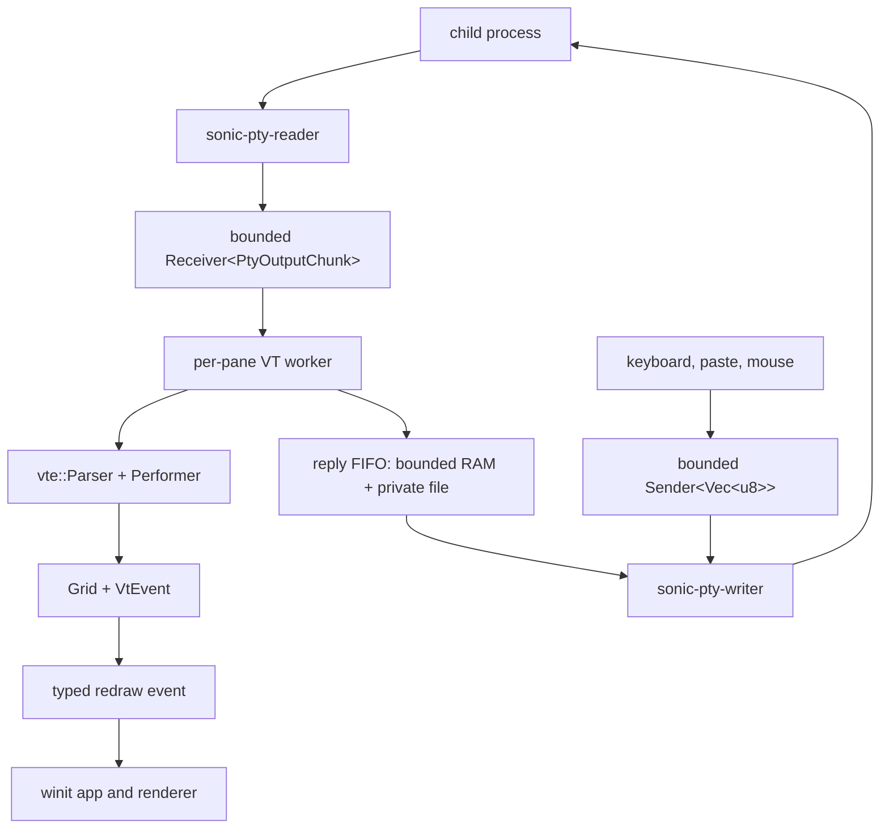
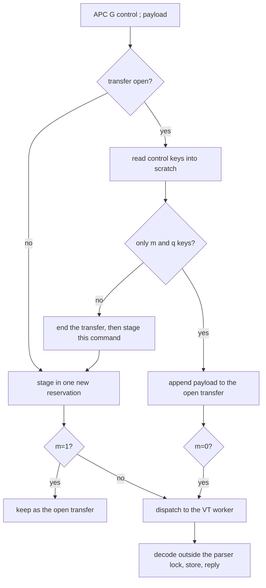

# Terminal IO and VT

[简体中文](Terminal-IO-and-VT-zh-CN)

A PTY (pseudo-terminal) carries bytes between SonicTerm and a child program.
The parser turns returned bytes into grid cells and terminal events. This page
explains that path and supported protocols; drawing is in
[Rendering and Fonts](Rendering-and-Fonts), limits in [Memory](Memory).

### Scope

The local PTY, parser, grid, keyboard, paste, mouse-tracking, selection, and copy
paths are cross-platform application behavior. SonicTerm has no built-in
remote-session transport: a remote shell such as `ssh` runs as an ordinary
program inside a local PTY.

### Byte and thread flow



The reader splits a reusable 64 KiB `BytesMut` ring into reference-counted
`bytes::Bytes` views. The output channel holds at most 64 chunks. A full channel
blocks the reader and lets the OS PTY apply backpressure; it does not grow.
Queued views can pin at most 64 distinct rings, or 4 MiB, although measured
shell workloads pin one 64 KiB ring.

Terminal input is non-blocking. Its channel holds four `Vec<u8>` messages, each
at most 16 MiB. Oversize, full-queue, and disconnected-writer failures return a
typed `PtyInputError` that carries the rejected bytes only so the caller can
report their length; refused input is never retried.

Each accepted user-input message gets an ordinal (modulo 2^20) under a short
admission lock around the non-blocking send, so ordinal order is channel order.
The writer counts a user-input message complete only after its flush succeeds
(a no-op on both platforms: the Unix writer is a plain file, and the pinned Windows
writer's `flush` returns at once, so flushing each message adds no system call);
parser replies never touch the ordinals. Each ordinal's admission time sits in
one of eight slots. `PtyHandle::input_progress()` reads these atomics, with no
lock, and returns `Idle`, the oldest outstanding write (`Oldest`, with its
admission time and whether a reply is ahead of it), `Raced` when a completion
raced the read, or `Terminal` once the writer has stopped. On every exit the
writer records why under the admission lock, so no later admission succeeds
unrecorded: a native `write_all` or `flush` error is `Failed`, and every write
admitted after the last completion is reported lost; cancellation and an
intentional close are `Stopped`. The status line's `input` segment reads this
progress.

While a shown status line lists `out`, the VT worker adds each received chunk's
length to the pane's output byte counter, one `Relaxed` add beside the flush
bookkeeping; otherwise it does one `Relaxed` load and nothing more. The counter
travels with the pane across windows.

Production parsing yields after a reply-producing dispatch. Outside
parser and side-effect locks, the VT worker submits replies to a separate FIFO:
64 KiB of RAM followed by a private, automatically deleted temporary spill file.
One dispatch stages less than 32 KiB: a color request is bounded at 4 KiB, and OSC 21 at 16 KiB
and 526 answering fields, which answer in under 28.2 KB.
Complete dispatches are batched up to 32 KiB and flushed at each output-batch end;
small replies do not require a file write per query. Admission may perform synchronous file I/O but never waits for native input
capacity, so a finite output-before-input query burst can continue draining.

The existing native writer selects between UI input and complete reply submissions
fitting a 32 KiB turn; length framing prevents keyboard bytes from splitting a reply.
Ready UI input gets a turn after each reply turn. Each stream preserves its own
byte order; no ordering between the two producers is promised. Live spilled
bytes are capped at 16 MiB per pane (`SPILL_BUDGET_BYTES`): a reply past the cap
is refused alone with a `ReplyBudgetExceeded` error, counted, and dropped, and the spool stays
usable for later replies. This is the case of a program that keeps querying and
never reads its input; a finite burst, such as 512 full-size replies before the
program reads, fits. Once the consumed prefix is at least 1 MiB and at least half
the file, the live records move to the front, so the file stays below twice the
budget plus one record and each admission costs one record write plus an amortised
copy. Admission stays on the VT worker: the budget bounds the bytes one admission can
write or copy, not its elapsed time, so a stalled filesystem still stalls that
pane's VT worker; a separate I/O thread would add a thread per pane and reorder
failure reporting. A native filesystem quota error is a storage failure, not a
budget refusal.
Drain and writer exit remove the file. Pane teardown rejects admissions immediately;
the native writer owns final cleanup and waits for any in-flight storage operation
off the event-loop thread. Storage exhaustion, spool
read/write failures, and native write/flush errors are explicit failures—not
lossless-delivery guarantees. A reply failure does not stop output parsing, redraw
coalescing, or child-exit observation. UI sends retain their non-blocking refusal
behavior. The standalone parser's channel-based `advance` API remains non-blocking;
production uses `advance_with_replies` and consumes its returned suffix.

The VT worker coalesces output before requesting a frame. A quiet interval of
3 ms flushes a trailing batch; a batch also flushes after 128 KiB or 8 ms. Every
pane constructor uses the same host-event processor. Parser advancement and mode
snapshots run under the pane's parser lock; clipboard and command dispatch,
inline-media decode or resize, and retained-store updates run after that lock is
released. The worker copies the current `WindowId` under a short guard, releases
the guard, and posts `UserEvent::PaneOutput` unless the pane already has one
outstanding. Worker threads do not call
AppKit, Win32, or winit window methods.

### Local PTY contract

`PtyHandle` owns the child, PTY master, reader and writer threads, bounded
channels, selected shell path, and a resize callback.

The callback returns `anyhow::Result<()>`. It holds the native call and the last
applied `(cols, rows)` behind one lock, so native resizes are serialized and the
cache records the last successful native call:

- A zero column or row count is refused as an `InvalidInput` error before the
  native call runs and before the cache changes.
- A request equal to the last *applied* size is skipped, avoiding an unnecessary
  SIGWINCH or ConPTY reflow.
- Only a successful native call caches the size. A failed request is therefore
  not deduplicated away: the next identical request reaches the native call
  again, and the last successful size stays cached.
- The first request always reaches the native call. The cache starts empty
  rather than seeded from the spawn dimensions, so nothing can match it.

The GUI resizes the grid first and does not roll it back when the native call
fails: the pane keeps the geometry the user asked for, and only the child's view
of it lags. `sonicterm-app` reports the failure through `PaneState::resize_pty`,
which warns once per failing run — the first failure is logged with the pane id,
requested columns and rows, and the error, and further failures stay silent
until a resize succeeds and clears the latch. Warning suppression never
suppresses a resize attempt: an invalid size and a successful duplicate are the
only requests that do not reach the native call, and the IO boundary decides
both, not the warning latch. A prompt row kept by `Parser::resize_terminal` (below)
stays kept when the native call then fails; nothing is undone.

If `[terminal].shell` is absent:

- Windows tries PowerShell 7 (`pwsh.exe`, including registered and Microsoft
  Store installations), Windows PowerShell, then `cmd.exe`.
- Unix uses an executable `$SHELL`, then the current user’s executable passwd
  shell, then `/bin/sh`.
- Normal macOS launches zsh/tcsh/csh with `-l` and bash/fish with `--login`.
  Clean end-to-end mode instead suppresses profiles and banners.

Normal Windows PowerShell startup also loads embedded, process-local directory
links on supported PowerShell 7 hosts. It preserves custom formatting and explicit
commands; clean end-to-end startup does not install it. See [Usage](Usage#powershell-directory-links).

The child starts in an explicit valid working directory when supplied,
otherwise in `HOME` when available. SonicTerm sets:

```text
TERM=xterm-256color
COLORTERM=truecolor
TERM_PROGRAM=<configured term_program>
TERM_PROGRAM_VERSION=<matching terminal version>
```

For `TERM_PROGRAM=SonicTerm`, the version is the workspace package version. For
`TERM_PROGRAM=WezTerm`, SonicTerm advertises `20230712-072601`, the fixed
capability-compatible WezTerm version.

Production pane removal uses `App::retire_pane`. `PtyHandle::into_teardown`
publishes closing and transfers native custody without native waits. A reserved
pane is queued to the App's single reaper driver; a pane without a reservation
retries admission once, then uses a logged, counted synchronous fallback. Direct
fixture drops also perform bounded inline cleanup. Moving a live pane between
windows transfers its PTY and reservation without retiring either.

The owned payload cancels native IO, terminates the child, closes the PTY,
and attempts bounded reaping. Reader and writer shutdown and child reaping use
a 500 ms deadline. Unix kills the child session and rechecks descendants before
reaping the leader, so a reused process or session id is not signalled. The
membership check skips zombies, which need no signal: Linux reads `/proc` state
and macOS reads the kernel process state; an unreadable macOS state keeps the
member. After the last bounded signal/wait attempt, a fresh membership check
confirms completion; a remaining-member error includes the observed process
IDs. On macOS it also gives each member's parent pid, process group, kernel
state, in-exit flag, and command, read when the error is built rather than
proof of ancestry, and the kill result of the latest pass that listed it: `ok`
when the kernel accepted SIGKILL, the errno (such as `EPERM`) when it refused,
`skipped-recheck` when the pre-signal recheck skipped the member, or
`unlisted` when only the final check found it. A last `group_kill` field gives
the session's process-group SIGKILL result in the same form.
Windows first waits for reader/writer exit, then drains a cloned ConPTY reader
concurrently with master close. Close and drain each retain a 2 s wait budget.
Cancellation workers share a 500 ms deadline. Native values remain in recovery
slots until their workers actually start; drain spawn refusal leaves the master
owned and retryable. A retry does not start duplicate cancellation or drain work.
Every join first checks actual thread exit, not just a done message or channel
disconnection. An unfinished worker retains its handle and permits.

Whole settlement requires every native phase to succeed and every started worker
to be joined. Failed termination leaves the leader unreaped. An incomplete final
payload keeps its transport owner and charge in the process sink. Reserved close
moves these waits off the App thread; synchronous fallback does not. Windows
cleanup covers still-attached clients, not detached descendants or custom clients
that refuse close notification. `ClosePseudoConsole` returning does not itself
prove every external client exited. Cleanup of a client still starting when close
begins is not proven; incomplete native custody stays retained and prevents a
clean-session marker. [Runtime Lifecycle](Runtime-Lifecycle) describes exit
settlement and the clean-session marker.

The master-side input writer is built by one internal seam, so the bytes a child
receives when a pane closes are decided in a single place. On Unix SonicTerm
writes through a close-on-exec duplicate of the master descriptor, whose close
is silent: destroying the writer adds no synthetic input. Ordinary terminal
input and parser-generated replies are unchanged — the narrowing matters,
because replies are legitimate input the terminal itself produces.
`portable-pty`'s own Unix writer instead ends its life by writing a newline and
`VEOF` whenever the line discipline reports one, so teardown delivered an
unsolicited newline and Ctrl+D to the child. A Unix master that exposes no
descriptor is an error rather than a fall back to that writer. Windows keeps
`portable-pty`'s writer, whose ConPTY destructor writes nothing to the child.

The duplicate shares the master's open file description, so file-status flags
such as `O_NONBLOCK` remain shared and are not altered here. `FD_CLOEXEC` is a
per-descriptor flag instead, set on the duplicate alone. The duplicate's
lifetime is independent: it keeps delivering after the master is dropped, and
closing it leaves any other duplicate usable. Explicit user input is untouched:
a typed Ctrl+D still ends a canonical shell.

### VT parser and protocols

`sonicterm-vt::Parser` wraps `vte::Parser` and a SonicTerm `Performer`. The
performer owns the `Grid` and terminal attributes. In ground state, printable
ASCII runs are inserted in bulk until an escape or control byte appears.

Current protocol support includes:

- cursor movement, save/restore, insert/delete character and line, erase,
  DECSTBM, reverse index, autowrap, cursor visibility, and DECSCUSR cursor shape and
  steadiness (`CSI Ps SP q`: 1/2 block, 3/4 underline, 5/6 bar, odd blinking and even steady;
  0 or RIS restore the configured cursor; the active pane's request is drawn);
- SGR styles, indexed and true color, underline style and color, and
  background-color erase semantics;
- primary and alternate screens, application cursor keys, bracketed paste,
  focus reporting, and kitty keyboard flag set/push/pop/query;
- OSC 0/2 titles, the OSC 1 tab name, the host-aware working directory from OSC 7, OSC 9;9 and OSC
  1337 `CurrentDir`, OSC 8 hyperlinks, OSC 52
  and OSC 1337 `Copy=:` clipboard writes, OSC 4/10/11/12/17/19 color queries and sets, the OSC 21 kitty color
  protocol, OSC 22 pointer shapes, OSC 104/110/111/112/117/119 color resets, OSC 133 prompt markers, OSC 9;4
  progress, OSC 1337 `SetUserVar` user variables, OSC 7501 program status, and OSC 9 / OSC 777 / OSC 99 notifications. OSC 99 follows kitty's protocol: a
  title and body sent at once or in chunks under one `i` id, plain or base64 (`e=1`, split anywhere,
  the final padding optional), at most eight open at once and 16 KiB in all, and all of them dropped
  when a chunk is refused or cancelled, so none completes cut; a later notification with the same id from the same
  pane replaces the shown one; `o=unfocused` shows only while the pane is not the focused window's
  active pane, `o=invisible` only while it is not drawn (another tab, zoomed away, or the window
  covered or minimized); a `p=?` query is answered with `p=title,body:o=always,unfocused,invisible`, and other
  parts (close, icons, buttons) are ignored;
- DSR, DA, XTVERSION, DECRQSS SGR, DECRQM, color-scheme (DSR 996, mode 2031), cell-size
  (`CSI 16 t`), palette, and kitty keyboard replies (see [Host reports](#host-reports));
- iTerm2 and Sixel media events, and a kitty graphics subset with Unicode placeholders;
- synchronized output (DEC 2026).

Synchronized output: `CSI ? 2026 h` opens an update and `CSI ? 2026 l` ends it.
RIS also ends it; leaving the alternate screen does not. A repeated `h` keeps the
update it opened, so it cannot extend its own bound. While an update is open, the
pane's worker keeps parsing but sends no output event, and a window that shows the
pane presents no frame, until the update ends or 150 ms pass. Two limits apply. A
reset that no successful frame has shown yet releases the pane even if a new update
opens before that frame. And a window holds for at most 150 ms from the first frame
it held in a stretch, whichever panes hold it. The first frame, a
visibility change, device recovery, a changed surface size and surface recovery
still present the live grid. DECRQM `CSI ? 2026 $ p` is answered with
`CSI ? 2026 ; Ps $ y`, where `Ps` is 1 while an update is open and 2 otherwise. On Windows, ConPTY may move or drop the brackets, and the
hold acts only on brackets that reach the parser.

### Clipboard writes (OSC 52, OSC 1337 `Copy=:`)

The raw collector owns `52;` and `1337;Copy=:` (key in any ASCII case). The kinds field is
at most 16 bytes; a longer one is swallowed to its terminator. Encoded payload bytes move in
chunks of at most 64 KiB through the parser's `ClipboardInbox`, which is not `Clone` and whose
`Debug` prints only lengths, and the parser raises only payload-free
`VtEvent::ClipboardStream { stream, phase }` events (`Data`, `End { kinds, query }`, `Abort`).
A write commits only after BEL or ST. CAN, SUB, an unrelated ESC, or 60 s without a
terminator abort the stream, release its queued chunks and swallow the rest of the OSC. A stream
also ends when `osc52` or `osc52_read` changes after it opened, even back to the same policy. The
VT worker applies both before it parses the next ready output, so a terminator read at or after
the expiry, or after a policy change, never commits.

The pane's VT worker decodes outside the parser lock: a strict Base64 alphabet, optional final
padding, at most 3 characters carried between chunks, and the
`[terminal] clipboard_write_limit_bytes` limit read when the stream opens. Every buffer is
reserved from the process clipboard staging budget before it is allocated (see
[Memory](Memory)), and a program slot (8 at most) is taken before the write is posted to the
event loop, even for a clear. Under `[terminal] osc52 = "ask"` the VT worker instead gives the
complete write a consent ticket on the same gate as reads (one asked write per pane, 8 tickets per
process, else refused busy); the ticket holds the write, its lease and its program slot, follows
the read ticket's revalidation rules below, and its page is titled `Let tab N, pane M write to
the clipboard?`. Apply hands the write to the clipboard worker's ordering domain; Deny, Escape,
an outside click or expiry drop it, and nothing is ever sent back to the program. The event loop
refuses a write under `"deny"`, and under `"ask"` any write that was not approved. Every write
carries what it was admitted under to its commit point: the policy generation, and for an
approved write also its pane, PTY, window owner, command and the window's READONLY state at
Apply. A change to `osc52` or `osc52_read` drops every program write not yet committed; an
approved write is also dropped when its pane closes or moves, its PTY or command changes, or its
window enters READONLY. A dropped write changes nothing and answers nothing. On Linux and Windows
the event loop posts the write to one clipboard worker thread, which checks that binding
immediately before the native call (on Windows inside the same clipboard acquisition, after
reading the value it replaces and before `EmptyClipboard`); that call is the commit point, and
the write's lease is released when it returns. Program writes and user copies share the worker's queue and run
strictly in the order the event loop handled them, so a later user copy always wins. The event
loop writes a user copy itself only when nothing is queued and the copy is at most 512 KiB; at
most 4 user copies wait on the worker, and one more is refused with the copy-failure notice and
keeps its selection; a refused copy-mode copy returns to copy mode with its selection while
the same pane is still active. A batch's status-line summary waits for the worker's result. macOS has no
worker, because off-thread `NSPasteboard` use is not proven: its program writes over 512 KiB
are refused, and user copies of any size stay on the event-loop thread, because a cap would
refuse the large selections users copy.

| Form | SonicTerm |
| --- | --- |
| `c`, `s`, `0`–`9`, empty kinds | standard clipboard |
| `p` | Linux PRIMARY; dropped on macOS and Windows |
| `cp` | every destination the platform has |
| unknown letter | ignored; a kinds field with no known letter is dropped |
| `52;c` (no data), `52;c;` | clears the clipboard |
| Base64 padding | optional; any other byte discards the write |
| non-UTF-8 payload | invalid sequences become U+FFFD |
| `?` (any kinds) | read: under `osc52_read = "allow"` answered with the clipboard's text as `ESC ] 52 ; <label> ; <b64> ESC \`; see below for `ask`, `deny` and the bounds |
| `1337;Copy=:<b64>` | `c` write; an empty or `?` value writes nothing |
| `1337;Copy=;<b64>` | not supported |

Intentional differences from the reference terminals: `p` is dropped where there is no
PRIMARY (kitty); non-UTF-8 payloads become U+FFFD (Ghostty and kitty keep raw bytes, WezTerm
rejects them); the limit defaults to 64 MiB and is at most 512 MiB, held in memory and never
on disk (kitty: 512 MB with disk spill); Windows reasserts only writes of at most 512 KiB of
UTF-16; WezTerm's `Copy=;` spelling is not supported (WezTerm parses it but never acts on it).
OSC 5522 is described [below](#kitty-clipboard-protocol-osc-5522).

Every read reply is ST-terminated whatever ended the request. One letter is echoed when it is
`c`, `s` or `p` and any other single letter answers `c` (Ghostty; kitty answers `s` with `c`);
a longer field answers once per destination it names, `c` before `p` (kitty), and `c` when it
names neither. `p` reads PRIMARY on Linux and is answered empty elsewhere. `osc52_read = "deny"`
drops the read silently (Ghostty and WezTerm; kitty sends an empty reply). WezTerm ignores
reads under every policy.

Otherwise the pane's VT worker gives the read a ticket before posting anything: one per pane
and 8 per process. A read past either bound is answered empty at once on the ordinary
parser-reply path; an empty reply carries no clipboard bytes. A ticket records the pane, its PTY,
the window it is in, the last prompt or command boundary, and the policy generation. Closing the
pane, moving it to another window (or away and back), any change to its tab's position in its
window (a reorder, or a tab closed or inserted before it; the consent page names the tab by
position), a prompt start, command start or end, a
reset (RIS), a different PTY, READONLY, and any change to `osc52` or `osc52_read` each cancel the
ticket silently. It is checked again before the native read starts and before every attempt to
deliver the reply.

Under `"ask"` the ticket waits for a consent page, the command palette's confirm page, titled
`Let tab N, pane M read the clipboard?` with Allow and Deny rows. It names the tab and pane by
position, never by a title a program set, and highlights Deny first. It opens only in the window
that holds the pane, only while that window is frontmost and the palette is closed: it never
raises a window, moves focus, or reuses or replaces an open palette, and until then the ticket
keeps waiting. One page is open at a time; other panes' reads wait in order. Allow approves only
that page's ticket, and only on that page's own palette session in the window that showed it;
closing the palette afterwards keeps the approval. Deny, Escape, a click outside the page, or
120 s without an answer close the page and send an empty reply, as a declined prompt is. A page
closed or replaced by another palette page, moved to another window, or any cancellation above
ends the ticket silently, except an OSC 5522 write's (below). An approved or `"allow"` read runs on a
disposable reader thread, one read at a time, never on the event loop. A read returns at most
8 MiB of UTF-8 text (4 MiB per destination for `cp`); a larger value, a failed read, or no
clipboard owner is answered empty. Text that is not valid UTF-8 becomes U+FFFD. Each destination
has 2 s on macOS and Windows and 7 s on Linux. A read past its deadline is answered empty, but its
ticket and its share of the reply budget stay held until the native call returns, and other
reads are answered empty without reading meanwhile. A read whose native call returned at or after
its deadline is also answered empty, however soon the event loop picks up its result.

| Platform | Bound |
| --- | --- |
| Windows | `OpenClipboard` retried 10 times 10 ms apart; `GlobalSize` decides a too-large `CF_UNICODETEXT` before `GlobalLock` |
| Linux (X11, XWayland) | `ConvertSelection` to `UTF8_STRING`, 2 s for the owner's answer; a format-8 `UTF8_STRING`, `STRING` or `text/plain;charset=utf-8` value within the cap; an `INCR` transfer whose format-32 size is within the cap, checked before the announcement is deleted (deleting it asks for the first chunk), 2 s per chunk and 5 s in all, the deadline checked before every event so a busy owner cannot extend it; no X server answers empty |
| macOS | `NSPasteboardTypeString`; AppKit holds the whole value before SonicTerm can measure it, as any paste does, and the copy into SonicTerm is refused past the cap |

The reply for one request, all destinations together, is one message of at most about 10.7 MiB.
It goes only to the requesting pane's PTY, through the writer's one-slot sensitive channel: never
the reply spool or its disk spill, a broadcast pane, or a log, which records only lengths and
outcomes. When the writer's admission lock is busy, delivery is retried on the next three
event-loop turns, each checking the ticket again; a full slot, a stopped writer, or the last
failed retry drops the reply, and the program gets none, as in WezTerm. Read replies are not
ordered against the pane's other replies.

### Kitty clipboard protocol (OSC 5522)

The raw collector owns `5522;` and holds the whole packet until BEL or ST, at most 1 MiB of wire
bytes after the prefix; CAN, SUB or an unrelated ESC drop it whole. Metadata with no `;` within
4 KiB is truncated and the packet is dropped. A valid packet's encoded payload waits in the
parser's kitty inbox, and the parser raises one payload-free `VtEvent::KittyClipboard` per
packet. An over-cap packet is classified only from complete, valid metadata, using its last
`type`: `wdata` or `walias` finishes an open write with `EFBIG`; anything else is dropped.

Each pane's VT worker keeps at most one open write (`kitty_clipboard_tx.rs`), outside the parser
lock:

| Packet | SonicTerm |
| --- | --- |
| record without `=`, missing or unknown `type` | dropped, no reply, even while a write is open |
| bad `mime`/`name`/`pw` Base64, `mime`/`name` over 256 bytes | `wdata`/`walias` with a write open: `EINVAL`; otherwise dropped |
| `type=write` | replaces any open write silently; under `osc52 = "deny"` answers `EPERM` at once |
| `type=wdata:mime=…` | one strict Base64 stream per type; a packet ending on padding restarts it; a type switch ends the previous stream; a repeated type restarts its region |
| `type=walias:mime=…` | records the aliases in order; an empty `mime` answers `EINVAL` |
| `type=wdata` without `mime` | commits |
| `type=read` | served as below; a payload that is not strict Base64 of UTF-8 is dropped with no reply |
| DECSET/DECRST `?5522`, DECRQM `?5522` | the mode is stored per pane and reset by DECRST and RIS; DECRQM answers `1` or `2`; while it is set, a paste sends a paste event (below) instead of the text |

Every buffer is reserved from the clipboard staging budget before it grows, and the transaction
limit is `clipboard_write_limit_bytes`, read when the write opens: past it the write ends
`EFBIG` before allocating; a budget that cannot cover it ends `EBUSY`. At most 64 MIME types and
64 aliases are kept; later ones are ignored. After any error, packets are ignored until the next
`write`. Statuses echo the opening `write`'s sanitized id and `loc=primary`, and end with the
answered packet's terminator.

At commit the aliases are applied in order over every staged representation, then every name is
mapped to a native format (see [Platform Integration](Platform-Integration)): `text/plain`,
`text/plain;…`, `UTF8_STRING`, `TEXT` and `STRING` are text; `text/html`, `image/png` and
`text/uri-list` are well known; any other RFC 6838 `type/subtype` name of at most 255 bytes is a
custom type. A name that is not a MIME name, or that the platform cannot hold, is omitted, as
Ghostty does. Each format is kept once and its first name wins, so an alias that names
`text/plain` for another type still yields text. A commit with nothing staged clears the
clipboard. When every name is omitted, or for `loc=primary` off Linux (PRIMARY holds text only),
it answers `ENOSYS`. Text alone takes the text path below. Any other kept type forms one offer
with the rest: its buffers and one native copy of each are reserved from the staging budget
before it is posted (`EBUSY` when they do not fit), every native buffer is staged before the
clipboard is touched, and all are published in one operation. A staging or publish failure
answers `EIO` and a staging failure keeps the previous clipboard; `DONE` means every kept
representation was published. The `osc52` policy is checked again: `deny`
answers `EPERM`, `ask` opens the same consent page as an OSC 52 write, and a refusal there
answers `EPERM`. The write then follows the OSC 52 write path to the clipboard worker, and the
event loop answers `DONE`, `EIO` (native failure) or `EPERM` on the source pane's PTY. A write
the clipboard worker held when it stopped answers `EIO`. An asked write whose consent ends without
an answer (its page lost, its pane moved, the policy changed) answers `EPERM`. Every status is
sent only while the PTY and command that sent the write still own the pane; after a PTY or
command change, or once the pane closed, nothing is sent, because another program would read it
as input. A write dropped at its commit point because its binding changed answers nothing.
Omitted representations are released at the commit.

An open write ends `EBUSY` 30 s after its last packet or 10 min after it opened, and `EPERM`
when the policy becomes `deny` or `osc52`/`osc52_read` changes at all after it opened (a quick
`deny` then `allow` still ends it). The VT worker checks both before it parses each ready output
chunk, so a commit read at or after a deadline never commits, and it also wakes for them while
the child prints nothing, because a config reload wakes every worker. RIS and pane retirement release it
silently.

A read's payload is a Base64 list of MIME types; `.` asks for the type listing. At most 16 data
types are accepted. Reads follow `osc52_read` and take the same consent ticket as an OSC 52 read:
`deny`, a read while the same pane already reads, or a refused or expired page answer `EPERM`; a
full process gate, queue pressure or a full reply budget answers `EBUSY`. A listing-only request
reads no content, so it skips the page under `ask`. An approved read runs on the disposable
reader thread and is delivered as one message through the sensitive reply channel, never the
reply spool: `OK`, the listing as one `DATA` packet with `mime=Lg==` (types space-joined plus a
newline, at most 64 names and 4096 bytes so it fits one packet, payload omitted when empty),
`DATA` chunks of at most 4096 raw bytes per served type with the id and MIME repeated in every
packet, then `DONE`. `text/plain` types are read as text; any other type is read through the
native layer (see [Platform Integration](Platform-Integration)): HTML stripped to its fragment on
Windows, PNG and custom types byte for byte, `text/uri-list` from file and URL items. A type the
clipboard does not hold is omitted, which the protocol reads as unavailable. Each type is read
with an 8 MiB cap and served only while the whole reply stays within 12 MiB, checked before
anything grows; otherwise it is omitted. Another type is read only while the reply built so far
leaves the job's 21 MiB reservation room for that type's worst case (8 MiB of raw bytes plus
their conversion or the reply regrown to 12 MiB), so once the reply passes about 1 MiB every
later type is omitted unread. An unavailable location
(`loc=primary` off Linux) or a platform that cannot list types answers `ENOSYS`; a failed or
overdue native read, or a listing whose enumeration failed, answers `EIO`; an empty clipboard is
`OK` then `DONE`. When a reply's writer admission stays contended through every retry, or the
writer refuses it, the reply is dropped and the program hears one `EBUSY` packet if that can be
admitted, never a partial `OK` sequence.

The listing names types without reading any content: `EnumClipboardFormats` on Windows, the
general pasteboard's `types` on macOS and the owner's `TARGETS` on X11 (within the 2 s selection
wait). At most 64 native names are inspected; platform text, HTML, RTF, file and image types map
to their MIME names, MIME-shaped names pass without parameters (so a Windows format registered
under a MIME name lists as that name), and on macOS a type whose uniform type has a preferred MIME
name lists as that name, so a dynamic type SonicTerm published lists as its MIME name. Private
and protocol types with no MIME name (other `dyn.*` types, `TARGETS`, unnamed formats) are never
listed.

Under `ask`, a read or write whose program names itself with a nonempty `name` and a `pw` gets
Always and Ban rows after Deny, and the name on a separate "Program-supplied name" line (at most
64 characters, control characters replaced). Always allows the request and later ones; Ban
refuses it `EPERM` and later ones, both without a page. A grant is keyed by the pane, its PTY
incarnation, owner epoch and RIS count, the operation, the location and the `pw`, never the
name; a `pw` without a `name` counts as no password, so no grant is looked up or created. A pane
keeps at most 16 grants, evicting its oldest. RIS, closing the pane, moving it to another window
or its tab to another position, a new PTY and any `osc52`/`osc52_read` change revoke its grants,
and `deny` never consults them.
A read a grant approved is still revalidated at delivery, so a later `deny` or a transfer sends
nothing. Grants, names and passwords never reach logs or `Debug` output.

Paste events (DECSET 5522). A paste chooses its panes before it reads the clipboard: the source
pane and the broadcast receivers the existing admission accepts. A pane whose program set mode
5522 gets a paste event instead of its paste, unless `osc52_read = "deny"`, under which every pane
gets the text. The VT worker publishes the mode with its reset count, so a paste never takes the
parser lock. Only the other panes read the clipboard, so an offer holding only an image still
reaches a mode pane, and an open search and copied files route as before, for those panes only.
Each mode pane gets its own event through the sensitive reply channel: `OK`, the type listing as
one `DATA` packet with `mime=Lg==`, then `DONE`, each ST-terminated with no `id` and the same
`pw`, the Base64 of a one-time password made from 16 bytes of the OS CSPRNG. The listing follows
the rules above and is empty when the platform cannot list types. A writer that refuses the event
drops it, and that pane's paste, with no retry.

The event's grant is created only after the pane's writer admitted the event, and a pane holds
the grant of its last paste. It is bound to the pane, its PTY incarnation, owner epoch and RIS
count, its mode 5522 state and reset count, the policy generation, the location, and the
clipboard offer version, read before and after the listing:

| Platform | Offer version |
| --- | --- |
| macOS | the general pasteboard's `changeCount` |
| Windows | `GetClipboardSequenceNumber`; 0 (no clipboard access) is no version |
| Linux (X11, XWayland) | the selection owner's window and its `TIMESTAMP` answer, within the 2 s selection wait; the owner is read before the conversion and again after the answer and must not change; no owner, a changed owner, no answer, or an answer that is not one nonzero format-32 item is no version |

With no version, a version that moved during the listing, or no password, the event is still sent
but issues no grant. The first OSC 5522 read from that pane at that location carrying the
password and a nonempty `name` consumes the grant atomically on the event loop. It is approved
without a page only while the recipient is unchanged and within 60 s; otherwise it takes normal
consent. The approval stays bound to the recipient and the offer until delivery: the reader
thread compares the offer version before its native read and again after it, and the recipient
is checked before the read starts and before delivery. A changed offer, DECRST 5522 or RIS after
the read was accepted, or any other change to the recipient drops whatever was read, so nothing
from a later offer is delivered on the grant; while the pane and its command are unchanged, the
read then waits for an ordinary answer (a consent page under `ask`). A session grant's Always or
Ban still decides first. A replay, a read without a `name`, and a read from another pane find no grant.
DECRST 5522, RIS, a move to another window or tab position, a new PTY, any
`osc52`/`osc52_read` change and 60 s revoke it; an idle grant is purged when its 60 s end. The
event's listing and version reads run on a disposable capture thread, never on the event loop:
the paste fixes its recipients and their identities at the gesture, and each event goes out when
the capture settles, only to a recipient that still has that identity (the same PTY, window, tab
position, mode 5522 state and policy) and still accepts input. One capture runs at a time within
the reader's deadline (2 s, or 7 s on Linux) and at most 4 pastes wait; past the deadline, while a
capture is past its deadline, or with 4 waiting, the event goes out at once with an empty listing
and no grant. One-time passwords never reach logs or `Debug` output.

Intentional differences: at most 1 MiB per packet (Ghostty 8 MiB; kitty 256 KiB unless the
packet is complete); a commit with nothing the platform can hold answers `ENOSYS`; Ghostty's
metadata, MIME and alias bounds apply (kitty has none); the idle and absolute timeouts exist
(neither reference times out); RIS aborts an open write (both references clear only grants);
reads accept at most 16 data types (Ghostty 4, kitty all), serve at most 8 MiB per type and a
12 MiB reply (kitty has no limit), and a read while the same pane already reads answers `EPERM`
(as kitty) while a full process gate answers `EBUSY`. Under `osc52_read = "deny"` a paste with
mode 5522 set stays plain text (Ghostty and kitty send the event and then refuse the read, which
loses the paste). The one-time grant is also bound to the clipboard offer version and expires
after 60 s (neither reference binds it to the offer). WezTerm does not implement paste events.

### Host reports

Programs such as herdr ask the terminal about itself at startup and wait for each answer.
SonicTerm answers:

| Request | Reply |
| --- | --- |
| DECRQM `CSI ? Ps $ p` | `CSI ? Ps ; Pm $ y`: `Pm` 1 set, 2 reset, for modes 1, 7, 47, 67, 1000, 1002, 1003, 1004, 1005, 1006, 1015, 1016, 1047, 1049, 2004, 2026, 2031, 5522 and 9001 (each of 1000/1002/1003 reads set only while it is the selected tracking mode, and each of 1005/1006/1015/1016 only while it is the selected report format); 0 (not recognized) for every other mode, including 25, so a program that probes them falls back at once. A request naming several modes gets no reply. |
| DSR 996 `CSI ? 996 n` | `CSI ? 997 ; 1 n` for a dark theme, `; 2 n` for a light one, from the theme's `appearance`. |
| DEC mode 2031 | While a program has set it, every theme change that alters a readable color (foreground, background, cursor, selection background and foreground, cursor text, the 16 theme colors) or the scheme sends the same `CSI ? 997 ; Ps n` report, also when the scheme stays the same, so a program that re-reads colors on the report picks up the new palette. A reload, the theme picker's preview and its choice all count; the report goes through the pane's reply path. It fingerprints the theme defaults, so it fires even when a program's override hides the changed default from a query. SonicTerm does not follow the system's light or dark appearance, so the report fires only when the theme changes. |
| `OSC 4 ; N ; ?` | `OSC 4 ; N ; rgb:rrrr/gggg/bbbb` with the request's terminator: the color the program set, else 0..=15 from the theme and 16..=255 from the xterm 6×6×6 cube and gray ramp, the same table the renderer draws with. |
| `OSC 10/11/12/17/19 ; ?` | `OSC 1x ; rgb:rrrr/gggg/bbbb` with the request's terminator: the foreground, background, cursor, selection background or selection foreground the program set, else the theme's; a cursor with neither reads as the foreground. Each further `?` asks for the next color, so `OSC 10 ; ? ; ?` answers 10 and 11; 13-16 and 18 are not answered. |
| `OSC 21 ; key=? ; …` | `OSC 21 ; key=rgb:rr/gg/bb ; …` in request order with the request's terminator; see the kitty color protocol below. |
| `OSC 22 ; ? name , …` | `OSC 22 ; answer , …` in request order with the request's terminator; see pointer shapes below. |
| `CSI 16 t` | `CSI 6 ; height ; width t`, the cell size in whole physical pixels; no reply until the window reports a cell size. Other window operations are ignored. |

Programs can set and reset the colors of their own pane:

- `OSC 4 ; N ; spec` sets palette entry N (0..=255), and one message can carry many pairs.
  `OSC 10`, `11` and `12` set the default foreground, background and cursor; each further
  value targets the next dynamic color, so `OSC 10 ; #fff ; ?` sets the foreground and asks
  for the background, and an empty value only moves on (`OSC 10 ; ; ?` asks for the
  background). `OSC 17` and `19` set the selection background and foreground; OSC 13-16 and
  18 are accepted and ignored.
- A spec is `rgb:r/g/b` with 1 to 4 hex digits per channel, `rgbi:` intensities from 0 to 1,
  `#rgb`, `#rrggbb`, `#rrrgggbbb`, `#rrrrggggbbbb`, 3 or 6 hex digits without `#`, or an X11
  color name in any case.
- Requests in one message apply in order. An invalid OSC 4 pair, OSC 104 index or dynamic
  value is skipped and the rest still apply; an empty OSC 4 field keeps its place, so
  `OSC 4 ; 1 ; ; 2 ; #fff` skips the pair (1, empty) and sets entry 2. An OSC 4 or 104 index is
  read as kitty reads it: blanks around it, a `+` sign, leading zeros and single underscores
  between digits are accepted, and the value must be 0..=255. The OSC number itself may be
  zero-padded or carry a `+` (`OSC 010 ; ?`), and replies use the plain number. The number is
  read in at most nine characters before its `;`, padding and sign included; a longer spelling
  is ignored whole.
- `OSC 104 ; N ; …` resets the listed palette entries; a bare `OSC 104`, or one that lists
  only blanks, resets every entry, and a list of only invalid indices changes nothing.
  `OSC 110`, `111`, `112`, `117` and `119` reset the foreground, background, cursor and
  selection background and foreground with no argument or a first argument other than `?`;
  later arguments are ignored, so `OSC 110 ; x ; ?` resets. A first argument of `?` asks for
  that color instead, answered under the request's own number as kitty does (`OSC 110 ; ?`
  answers `OSC 110 ; rgb:…`). kitty's chaining of further arguments is not copied. OSC 113-116
  and 118 are accepted and ignored.
- A program's colors sit over the theme: a reload, the theme picker's preview, cancel and
  choice change only the theme defaults underneath, and a color the program set equal to
  today's default still hides a later theme change. RIS clears the palette colors and keeps
  the foreground, background, cursor, selection and cursor-text colors.
- A program's own sets and resets send no mode 2031 report, so a program that re-sets colors
  when it gets the report cannot loop; RIS turns mode 2031 off, so it sends none either.
  DSR 996 keeps answering the theme's appearance.
- The colors apply to the pane that set them: its cells, blank area, inverse and dim text,
  underlines, strikethroughs and cursor. The tab bar, window padding outside panes, splitters and the macOS
  titlebar band keep the theme, so split panes can differ. This is an intentional difference
  from Ghostty, which retints its single-surface window. OSC 4 and 10-12 replies are always
  the 16-bit `rgb:rrrr/gggg/bbbb` form, Ghostty's default; there is no 8-bit reply option.
- Below a background opacity of 1, a program's background replaces the theme background over
  its pane at the same opacity, on full and partial frames, on GDI and wgpu, so the pane shows
  the program's color at the configured opacity.
- A set equal to the color already drawn is still kept, so it hides a later theme change, but it
  does not repaint the window; only a change of a drawn color repaints it once per message.
- On Windows, the parser sees only what ConPTY forwards; whether ConPTY forwards these color
  sequences and their replies unchanged has not been verified.
- In the active pane, the selection highlight and copy mode's selection use the pane's
  selection background at the theme highlight's 50% opacity. Glyph ink in a selection, from the
  mouse or from copy mode, takes the selection foreground only once a program set one; until then
  it keeps its own colors, so existing themes look unchanged, and color glyphs and images always
  keep theirs. Only the ink inside the selected cells changes: a ligature, wide glyph or
  overhanging glyph that crosses the selection's edge is cut there, on the pixel row or column
  where the highlight begins, and its unselected part keeps its color and its place in the
  drawing order, under any later glyph that overlaps it. The ink inside a block cursor's cell takes the cursor-text color, which wins over the
  selection foreground; a glyph crossing the cell's edge is cut there the same way, so the selected
  half of a ligature under the cursor keeps the selection foreground. A selection is clipped to its pane and never recolors a neighbour's
  glyphs, even where they overhang into it, and the palette and search fields always keep the
  theme's selection colors. A
  change repaints the whole window. Intentional difference: WezTerm and kitty draw selected text
  in their configured selection foreground, while the theme's `selection_fg` colors only those
  fields here, and `OSC 19 ; ?` still answers it. Ghostty parses OSC 17/19/117/119 and does not
  act on them.

`OSC 21 ; key=value ; …`, the kitty color protocol, reads every `;`-separated field in order and
answers in one `OSC 21 ; key=value ; …` reply with the request's terminator, sent only when the
packet queries a color or names an unknown key in any form:

| Key | `key=?` | `key=spec` | `key=` or bare `key` |
| --- | --- | --- | --- |
| Palette `0`-`255` (digits, leading zeros allowed as in kitty) | the effective entry | sets it | resets it to the theme |
| `foreground`, `background`, `cursor` | the effective color; `cursor` answers what OSC 12 reports | sets it | resets it to the theme |
| `selection_background`, `selection_foreground`, `cursor_text` | the effective color, the same state as OSC 17 and 19 | sets it | resets it to the theme |
| `visual_bell`, `transparent_background_color1`-`8` | `key=` (not held) | ignored | ignored |
| any other key, including `256` and `second_transparent_background` | `unknown=` and the key in unpadded base64 | the same | the same |

- Colors are answered in 8-bit `rgb:rr/gg/bb`, and a color with no value as `key=`. A set drops
  an `@opacity` suffix and accepts every spec form above; an invalid spec or an empty field is
  skipped. Bytes outside printable ASCII are removed before reading, and values, not keys, are
  trimmed of spaces.
- A color request other than OSC 21 is limited to 4 KiB of bytes on the wire, C0 controls
  included. A longer message is discarded whole through its own terminator (BEL, `ESC \` or an
  ESC that starts another sequence), so no part of it is applied or printed. CAN or SUB aborts
  it. C1 OSC and ST bytes are not color-request framing.
- A packet is limited to 16 KiB and 526 counted fields: queries, sets and resets (including the
  ones a not-held key ignores) and fields naming an unknown key;
  a longer packet, or one with a 527th such field, changes and answers nothing. The largest
  reply stays under 28.2 KB, so it is one reply-path submission.
- Intentional differences: kitty accepts 256 KiB and any number of fields, while 16 KiB keeps
  every reply within one 32 KiB submission. An empty value resets a color, as in Ghostty, where
  kitty sets "none" or its null color. Unknown keys are answered as kitty does, where Ghostty
  skips them, and Ghostty's `second_transparent_background` is unknown here, as in kitty. Values
  are trimmed, as in Ghostty. The `selection_*` and `cursor_text` keys are kitty-only extras
  that share their state with OSC 17 and 19; `cursor_text` is set only here, as in kitty. The
  visual-bell and transparent-background colors are recognized but not held. WezTerm does not
  implement OSC 21.

#### Pointer shapes (OSC 22)

`OSC 22 ; [op] name , name , …` sets the pointer shape shown over the pane, following kitty's
protocol:

- Each screen, main and alternate, keeps its own stack of at most 16 entries; an entry is a
  shape or unset. RIS empties both stacks.
- No operator, or `=`, writes each name in turn into the top entry, pushing one when the stack
  is empty; an empty name (`OSC 22 ;` or a bare `OSC 22`) stores unset. `>` pushes each known
  name, evicting the bottom entry when the stack is full; empty and unknown names are skipped.
  `<` pops one entry and ignores any names. An unknown name, or one longer than 32 bytes,
  changes nothing.
- The pane's shape is its active screen's top entry. With an empty stack or an unset top it is
  `default` while mouse tracking (1000, 1002 or 1003) is on and `text` otherwise. Tracking
  changes only that fallback, so an explicit shape survives it; switching screens changes the
  shape to the other screen's.
- `?` asks, answering each name in order: `1` for an accepted name, `__current__` the top
  entry's CSS name or `0` when it is unset or the stack is empty, `__default__` `text`,
  `__grabbed__` `default`, and `0` for anything else. A query changes nothing.
- A packet is at most 4 KiB and reads its first 64 names; a longer packet, or one cut by CAN,
  SUB or an ESC that does not start ST, is dropped whole. The longest reply is 903 bytes, one
  reply-path submission.

The 34 W3C names are accepted (`default`, `context-menu`, `help`, `pointer`, `progress`,
`wait`, `cell`, `crosshair`, `text`, `vertical-text`, `alias`, `copy`, `move`, `no-drop`,
`not-allowed`, `grab`, `grabbing`, `all-scroll`, `col-resize`, `row-resize`, `n-resize`,
`e-resize`, `s-resize`, `w-resize`, `ne-resize`, `nw-resize`, `se-resize`, `sw-resize`,
`ew-resize`, `ns-resize`, `nesw-resize`, `nwse-resize`, `zoom-in`, `zoom-out`), each shown as
the window system's cursor of that name; a platform without one draws winit's fallback. These
aliases are accepted too:

| Shape | Aliases |
| --- | --- |
| `default` | `left_ptr`, `arrow` |
| `help` | `question_arrow`, `whats_this` |
| `pointer` | `hand`, `hand2`, `pointing_hand` |
| `progress` | `left_ptr_watch`, `half-busy` |
| `wait` | `watch`, `clock` |
| `cell` | `plus` |
| `crosshair` | `cross`, `tcross` |
| `text` | `xterm`, `ibeam`, `beam` |
| `alias` | `dnd-link` |
| `copy` | `dnd-copy` |
| `move` | `fleur`, `dnd-move`, `pointer-move` |
| `no-drop` | `dnd-no-drop` |
| `not-allowed` | `crossed_circle`, `forbidden` |
| `grab` | `hand1`, `openhand` |
| `grabbing` | `closedhand`, `dnd-none` |
| `n-resize`, `e-resize`, `s-resize`, `w-resize` | `top_side`, `right_side`, `bottom_side`, `left_side` |
| `ne-resize`, `nw-resize`, `se-resize`, `sw-resize` | `top_right_corner`, `top_left_corner`, `bottom_right_corner`, `bottom_left_corner` |
| `ew-resize` | `sb_h_double_arrow`, `split_h` |
| `ns-resize` | `sb_v_double_arrow`, `split_v` |
| `nesw-resize` | `size_bdiag`, `size-bdiag` |
| `nwse-resize` | `size_fdiag`, `size-fdiag` |
| `zoom-in`, `zoom-out` | `zoom_in`, `zoom_out` |

The window under the pointer decides its native cursor in one place, once per event-loop turn,
and writes it only when it changed; no other window writes, because Windows sets one cursor for
the whole thread and a departing or unrelated window would replace the icon of the window the
pointer is over. A window becomes the pointer's window when the pointer enters it or moves inside
its client area; a captured drag keeps reporting moves to its source window from outside the
client area after the pointer left, and those moves keep routing the drag without taking the
cursor. A window whose owners may have gone stale (its palette closed, the pointer left, a
scrollbar drag ended, a resize, a scale or focus change) first reclassifies its splitter,
scrollbar and titlebar-band edge from the pointer's current position. SonicTerm's own owners come first: an open command palette (the arrow), a
splitter hovered or dragged (column or row resize), the scrollbar, a pressed or dragged tab (the
arrow), a titlebar-band resize edge, a modifier link hover (the hand) and a local selection drag
(the I-beam). Otherwise the terminal pane under the pointer shows its shape, and anywhere outside
a pane, and over the pane of a report window (About, Memory Usage), shows the arrow. The pane's shape is read without the parser lock, so a program's change shows
with the pointer stationary, and releasing an owner returns the pane's shape without motion.

Intentional differences:

- Tracking modes never overwrite an explicit shape, as in kitty; Ghostty replaces it on every
  tracking change. With an empty stack or an unset top the result is Ghostty's.
- kitty and Ghostty disagree on two aliases; SonicTerm follows the X11 cursor glyph each names:
  `cross` is `crosshair` (Ghostty; kitty reads `cell`) and `fleur` is `move` (kitty; Ghostty reads
  `all-scroll`).
- `__default__` is always `text` and `__grabbed__` always `default`: SonicTerm has no
  pointer-shape settings.
- A packet reads at most 64 names; kitty has no limit. Replies end with the request's
  terminator; kitty always uses ST.
- WezTerm does not implement OSC 22.
- On Windows, whether ConPTY forwards OSC 22 and its replies is not yet verified.

Mouse reports can use any of the five xterm encodings, including SGR pixels (mode 1016); see
[Mouse tracking and selection](#mouse-tracking-and-selection).

On Windows, a pane's program writes to a ConPTY pseudoconsole. ConPTY
interprets that output and passes its own rendition to SonicTerm, so the
parser receives only what ConPTY forwards.

The Windows release ships Microsoft's `Microsoft.Windows.Console.ConPTY`
1.25.260930003 package runtime, `conpty.dll` and `OpenConsole.exe`, in a
`conpty` folder next to `sonicterm-windows.exe`, with its `LICENSE` and
`NOTICE.md`. Before the first pane opens, SonicTerm checks both files' sizes and
SHA-256 digests against pinned values, keeps the folder and both files open so
they cannot be replaced or removed while the process runs, and loads
`conpty.dll` from that absolute path. A `conpty` folder that is present but
invalid fails pane startup; it never falls back to the system ConPTY. When the
folder is absent, as in a source build, portable-pty uses the system ConPTY
unless a `conpty.dll` is on the DLL search path. The log records the choice as
`Windows console runtime selected` with `kind="packaged"` and the version, or
`kind="development-discovery"`. `SONICTERM_REQUIRE_CONPTY=1` makes an absent
folder an error; the Windows CI and release smokes set it, enable the record with
`RUST_LOG=warn,sonicterm_io::conpty_runtime=info` (the default `warn` level hides
it), and then require the `packaged` record. A source build stages the same files with
`python scripts/setup-windows-conpty.py --destination target/debug`.

Forwarding is evidenced by a real-ConPTY protocol fixture that the `windows-conpty-forms`
gate step runs on Windows. Two `#[ignore]` test binaries, `windows_conpty_protocol_forms`
(transport rows, in `sonicterm-io`) and `windows_conpty_app_smoke` (app rows, in
`sonicterm-app`), each copy their executable into a `packaged` folder with the staged runtime
beside it and a `system` folder without one, and run each copy as a host inside a job object
that kills its processes when closed. The packaged host runs with
`SONICTERM_REQUIRE_CONPTY=1`; the system host runs without it and must show no loaded
`conpty.dll` and the `development-discovery` record. Each host spawns the same executable as
a child through a pseudoconsole; the child prints every case between `@@BEGIN` and `@@END`
sentinels and reports the input it received as hex. The host hashes each section as it
streams, keeps only its first and last 256 bytes, and prints one JSON line per row on its own
stdout, never through the PTY: `exact` (the digest equals the expected form), `transformed`
(other bytes, including a changed prefix), `dropped` (nothing but CR/LF) or `inconclusive`
(no end sentinel, a failed runtime check or positive control, or a failed launch). Transport
rows answer only the console's own cursor and device-attribute queries and inject canned
replies, so they prove forwarding, not behavior; app rows answer through a pane that runs the
production VT publisher. The positive control must be `exact` on both runtimes and every
required row on the packaged runtime; the other rows are printed as evidence. A host stops
scanning after 5 s without a sentinel and is bounded at 60 s, a run at 150 s, a child's input
read at 2 s and 64 KiB, and the job must hold no process 5 s after teardown.
`SONICTERM_CONPTY_FIXTURE_RUNTIME_DIR` names a directory that
`setup-windows-conpty.py --destination` already staged; without it each binary stages its own.
The required clipboard transport rows are `52;c;<b64>`, `52;cp;<b64>`, `52;c`,
`1337;Copy=:<b64>` and the read `52;c;?` with its injected reply; a 4 MiB `52;c;` payload is
recorded. The app smoke requires the exact empty replies to `52;cp;?`.

Which image sequences reach the parser therefore depends on the console
runtime. The system ConPTY in Windows 11 build 26300.9457 (`conhost.exe`
10.0.26100.9444) forwards iTerm2 `OSC 1337;File=` sequences unchanged (checked
with 4-byte, 48 KiB and 1 MiB payloads) and drops Sixel DCS and kitty APC
sequences. The packaged runtime also forwards Sixel DCS sequences, single and
chunked kitty APC sequences, and kitty Unicode placeholder cells (U+10EEEE with
their combining row and column marks and the truecolor foreground that names the
image) unchanged, so a kitty PNG image that a program writes in a Windows pane
displays with GDI and with wgpu on its software adapter, and a virtual placement
drawn through placeholder cells displays with GDI. Resizing the pseudoconsole
wider or narrower makes the runtime send no repaint, so placeholder cells already
on screen are not rewritten. The `windows_kitty_images` test feeds each form, as
the runtime forwards it, through a pane and checks, in the presented GDI frame,
that each image is drawn on its cells, that the text after it lands below it,
and that it moves up with its text when the screen scrolls. Other
Windows builds and payloads, and output relayed through programs such as
`ssh.exe` or `wsl.exe`, have not been checked.

XTVERSION (`CSI > q`) replies `DCS > | kitty SonicTerm <version> ST`, where
`<version>` is the running release, the same value `TERM_PROGRAM_VERSION`
advertises by default. The leading `kitty` word is what Claude Code and similar
clients test before sending kitty graphics; it claims no kitty version, and the
reply still names SonicTerm. It does not change with `term_program`, which sets
only the child environment. A tool that reads `kitty` as full kitty support may
try graphics features outside the subset below; those are refused or ignored,
never printed.

DECRQSS `DCS $ q m ST` reports the current SGR rendition through the terminal
reply queue. The response preserves extended underline subparameters, including
`4:3` for undercurl, and indexed/RGB foreground, background, and underline colors.
This lets Neovim discover extended underlines when terminfo lacks `Smulx`;
ordinary underline remains distinct. Extended colors accept semicolon parameters
and colon subparameters, including Neovim's `58:2::r:g:b`, without consuming the
following SGR attribute. Invalid colon color components leave the current color
unchanged. The fixed-size request recognizer is separate
from Sixel capture. Unsupported complete selectors return a failure reply;
cancelled, interrupted, and oversized requests produce no status reply.

`CSI 3 J` erases only the active primary screen's saved history. It preserves
live cells, cursor, rendition, margins, and the configured future history limit.
Empty history and an active alternate screen are no-ops; alternate-screen ED3
never touches the saved primary. ED0/1/2 keep their visible-screen erase ranges.

Cursor-position DSR (`CSI 6 n`) reports a physical column in `1..=cols`, even
when the insertion cursor carries the delayed-wrap sentinel. Repeated queries
do not consume that wrap. LF, VT, FF, IND, and NEL share a margin-aware hard
advance: scroll at the active region's bottom, otherwise advance within physical
bounds without scrolling protected rows. LF/VT/FF use the current erase fill;
IND/NEL use default fill, and only NEL returns to column zero. Hard advances
cancel delayed wrap and clear the destination's automatic-wrap provenance.

Hosts resize through `Parser::resize`, which reuses grid bounds and resets
scrolling margins when the effective row or column count changes. This includes
margins set by bare `CSI r`. Duplicate-size requests preserve a valid partial
region. Resize does not home the cursor or reset rendition, keyboard protocols,
existing history, or an incomplete escape sequence; primary-screen scrolling
still adds history, while proper subregions and the alternate screen do not.

Window and pane size changes go through `Parser::resize_terminal`. It differs from
`Parser::resize` only when the bounded row count shrinks under a live prompt on the
primary screen: the semantic mode is a prompt or input with an anchor (OSC 133, above),
`redraw` is not `0`, and the cursor would fall at or past the new height. The rows above
the cursor then scroll through the ordinary scroll path, into history, or discarded when
scrollback is off, so the cursor's row keeps its cells and column on the new bottom row.
Prompt regions and the semantic anchor move up with their rows on either path, so
`run_command` reads the prompt's `B` where its row now is.
Only that row is promised: input rows below the cursor are cut as before, and the shell
redraws its own buffer on SIGWINCH. Nothing is blanked, so a shell that does not redraw
loses nothing `resize` would keep. `redraw=1` and `redraw=last` act alike, since
SonicTerm never reflows; `redraw=0` keeps the plain clip, as kitty does. Windows keeps the
plain clip until a ConPTY check shows its repaint after a resize does not duplicate the
scrolled rows.

OSC handling has a bounded shell-integration scope, not full WezTerm parity.
OSC 0/1/2/7/8 use a raw collector capped at 16 KiB for the whole payload, avoiding
vte's 16-parameter truncation. Input must be valid UTF-8 without control characters
and end with BEL or a complete `ESC \`. Cancellation or rejection clears link/CWD
trust but preserves the prior displayed title. A nonempty OSC 1 sets the tab name
and an empty or bare one clears it; OSC 0 also clears it, OSC 2 leaves it, and RIS
clears it. Only the collector applies OSC 1, in every numeric spelling short enough for
its 10-byte prefix probe (`1`, `01`, `+1`), so a bare OSC 1 cut by CAN, SUB or an ESC that
does not complete ST changes nothing. A longer selector, such as `0000000000001`, is
ignored rather than applied. OSC 8 still limits each retained
URI to 8 KiB and client id to 1 KiB.


- **Working directory (OSC 7, OSC 9;9, OSC 1337 `CurrentDir`):** every source reads through one
  rule. The displayed path names the tab; the host-aware snapshot, its decoded path and host kept
  apart, is what relative links and an inherited launch directory may use. Every report, a
  revocation included, moves the pane's CWD revision, which invalidates the relative-path cache.

  | Payload | OSC 7 | OSC 9;9 | OSC 1337 `CurrentDir` |
  | --- | --- | --- | --- |
  | empty | clears path and snapshot (a bare OSC 7 with no `;` too, as kitty reads it) | clears path and snapshot (`9;9;""` too) | ignored |
  | `file://host/path` (percent-decoded) | path; snapshot `{host, path}` | as OSC 7 | as OSC 7 |
  | `kitty-shell-cwd://host/path` (raw, `%` kept) | path; snapshot `{host, path}` | as OSC 7 | as OSC 7 |
  | `file:///path` (empty host) | snapshot with an empty host, which is local | as OSC 7 | as OSC 7 |
  | malformed URI with a known scheme | path from the permissive read; snapshot revoked | as OSC 7 | as OSC 7 |
  | bare path | percent-decoded path; snapshot `{"", path}` | literal path after one pair of surrounding `"`; snapshot `{"", path}` | path shown; snapshot revoked |

  Local use requires an empty host, `localhost` or the exact local hostname (any ASCII case), a
  native absolute path (`/…`; on Windows `C:\…` or `C:/…`, and `/C:/…` or `\C:\…` only for a URI
  path, which is any OSC 7 or a URI from any source; a bare 9;9 path is read as sent) and at most
  4,096 decoded UTF-8 bytes as reported, before `/` and `..` collapse it. The launch directory and
  every relative and bare-name link base apply the same rules. A remote host stays in the
  snapshot, so every consumer rejects it. Drive-relative (`C:foo`), bare-drive (`C:`), UNC
  (`\\host\share`, `//host`), relative and other-OS paths are stored and shown but never used.
  Each of these, a payload that is not UTF-8 or holds a control character (in a 9;9 report its
  subcommand included: a report is classified on the bytes it arrived with, so removing a control
  never makes it a directory), and a report from any source cut by CAN, SUB, an ESC that does not
  complete ST, its byte cap or host cancellation replace an earlier trusted directory. Ordinary tabs and splits in
  main and child windows may inherit the source pane's validated CWD; an explicit CWD wins; new
  windows do not inherit it. Clearing the directory never clears an explicit OSC 0/2 title.
  WezTerm's Windows forms `file://localhost/C:\Users\x` and `file://HOST/C:/Users/x` resolve to
  `C:\Users\x`. The raw collector owns OSC 7 in any numeric spelling its 10-byte probe reads
  (`7`, `07`, `+7`, bare or with `;`), `9;` (16 KiB after `9;`) and `1337;CurrentDir=` with its key
  in any ASCII case (64 KiB after `1337;`), and applies a report only once its BEL or ST arrived;
  an OSC 7 it does not read (a C1 introducer, a longer digit run) sets and trusts nothing.
  Intentional differences: a bare native-absolute 9;9 path is trusted, as in kitty, where Ghostty
  requires a URI; a bare OSC 7 clears, as in kitty, where Ghostty ignores it; Windows drive-rooted
  9;9 paths are a SonicTerm extension, since kitty accepts only `/…`; a bare `CurrentDir` is
  display-only and revokes trust, because iTerm2 pairs it with a `RemoteHost` SonicTerm does not
  read, where Ghostty ignores it;
  `file:///path` is local for every source, where Ghostty rejects an empty host; reports apply
  on Windows, where Ghostty skips them; WezTerm parses `CurrentDir` and ignores it.
- **OSC 8:** preserve the full URI, including semicolons. Only `id=` is extracted
  from the parameter field; other parameters are not treated as the client id.
- **OSC 9 and OSC 777:** the parser validates and bounds these; the host applies its policy.
  - `9;<n>;…` whose `n` is all digits with a value in `1..=12`, leading zeros included
    (`001`), is a ConEmu subcommand and never a notification. Only `4` (progress), `9`
    (working directory, above) and `12` (a prompt mark, under OSC 133 below) are
    implemented; the others are ignored. A bare `9;<n>`, with no `;` after it, follows
    Ghostty: `5` and `10` are ignored, `12` is a prompt mark, and every other `n` is
    notification text, so a bare `9;9` notifies while `9;9;` is an empty directory report.
    WezTerm notifies for every bare form and kitty ignores them all (an intentional
    difference).
  - `9;4;<st>[;<pr>]` (Ghostty): `st` is one digit, `0` clear, `1` normal, `2` error, `3`
    indeterminate, `4` paused; any other `st` is ignored. A digit `pr` is clamped to 100. A
    normal report with no `pr` is at 0; error and paused with no `pr`, and any state whose
    `pr` is empty, not digits (a fraction, a sign) or overflows, keep their state with no
    percent. Clear and indeterminate ignore `pr`, and parameters after `pr` are ignored. A
    report with no percent never reads as 0 or a clear: the host keeps the pane's last
    percent, and a backend with none shows 0.
  - Progress clears on RIS, on OSC 133 `D`, and on its own when stale (kitty): 60 s after
    the pane's last report, or 5 s after a normal report at 100 %. Each report arms one
    deadline for its pane that clears only that report, so a newer report, or another pane's,
    is never cleared by it; expiry runs before the surfaces are chosen, so an expired report
    never shows over another pane's live one. Ghostty and WezTerm keep a stale bar (an
    intentional difference).
  - Any other `9;<text>` is a notification whose body is the text, its parameters rejoined
    with `;`. `777;notify;<title>;<body>` is a notification with a title; further parameters
    rejoin the body, and an empty body after the `;` is allowed. `777;notify;T`, with no
    body, is body `T` with no title, as WezTerm shows it (kitty makes `T` the title, Ghostty
    refuses it; an intentional difference). `777;notify;`, a bare `777;notify`, other OSC 777
    subcommands, and an empty title with an empty body are ignored.
  - Every other form the reference terminals ignore leaves nothing: no glyph of its payload,
    no host event, no reply and no state change. This covers OSC 3, 5, 6, 13-16, 18, 46, 50,
    51, 60, 61, 66, 72, 105, 106, 113-116, 118, 176, 440, 441, 633, 666, 697, 701, 3008,
    5113, 7704, 7721, 7750, 7770, 7771, 7777, 9001, 30001, 30101, 77119, unknown numbers,
    Sun's `OSC l` and `OSC L`, ConEmu `9;1`, `9;2`, `9;3`, `9;5`-`9;8`, `9;10` and `9;11`,
    and the OSC 1337 keys `SetMark`, `RemoteHost`, `StealFocus`, `ClearScrollback`,
    `SetProfile`, `SetBadgeFormat`, `RequestAttention`, `CopyToClipboard`, `EndCopy`,
    `HighlightCursorLine`, `MultipartFile`, `SetColors`, `SetKeyLabel`, `ReportCellSize`,
    `UnicodeVersion` and unknown keys. An OSC past the escape cap is swallowed to its
    terminator.
  - SonicTerm captures the `9;` and `777;` payloads itself, so a body with more parts than
    vte's 16-parameter limit arrives whole. This capture is the only parser of OSC 9 and 777.
    It accepts the number in up to 9 digits, zero-padded ones such as `09;` and `0777;`
    included; a longer spelling, or an OSC opened by the 8-bit C1 introducer, is ignored. The parser never cuts this text: a payload over
    16 KiB is refused whole, and the host sanitizes the complete text before its own caps.
  - The VT worker sends one progress change per batch, a clear only when the pane showed
    progress, and one notification event per batch carrying the first notification and a
    count of the rest. Display and rate rules are under [Platform Integration](Platform-Integration).
- **OSC 133:** `B` emits `PromptEnd` and does not start command timing; `C` marks
  execution start. `A`/`D` retain their existing prompt-region behavior. Each pane
  keeps its own command state, applied in parse order on the event loop: a phase
  (`Unknown`, `Prompt` after `A`, `B` or `D`, `Running` from `C`) and its last
  command's end instant and duration (`D`, or an `A` that arrives while running,
  which marks the command abandoned). No exit code is kept. A queue that dropped
  events resets the state before its retained tail, a pane whose process exited is
  `Unknown`, and the state moves with the pane to another tab or window.
  - **Annotations.** `L`, `N`, `P` and `I`, the options on `A`, and ConEmu's `9;12` change only
    a per-screen semantic state: a mode (output, prompt of a kind, input), an anchor row, a
    generation, the prompt options and the newest command text. They never open or close a
    prompt region, end a pinned run or change exit trust; those depend on `A`, `B`, `C` and
    `D` alone. The one exception is physical: a fresh line at a full bottom margin scrolls like
    any line feed, and the scroll moves the regions with their rows and evicts the newest
    prompt's `A` when its row is discarded or leaves history. `run_command` then refuses that
    prompt (`no_shell_integration`) rather than reading the rows that replaced it. The primary
    and alternate screens keep separate states.
  - `A`, `N` and `9;12` start a fresh line (CR then index when the cursor is off column 0; at
    the bottom margin the index scrolls and can evict the oldest history row), start a new
    generation anchored at the cursor row, and reset the options before reading their own.
    `L` is the fresh line alone, accepted bare or with a single `sonicterm_token=`; any other
    parameter makes it invalid. `P` with `k=c` or `k=s` joins the current anchor (as `k=i`
    without one); `P` with `k=i`, `k=r` or no `k` starts a generation without a fresh line
    and keeps the options. `B` starts input, `I` starts input that ends at the next LF, IND or
    NEL, and `C` and `D` return to output, keeping the anchor until the next prompt. RIS
    resets both screens, and an anchor whose row leaves history is dropped; each also starts
    a new generation.
  - Framing. The raw collector owns every `133;` marker and applies it only once BEL or a
    complete `ESC \` ends it; one cut by CAN, SUB or an ESC that does not complete ST applies
    nothing, and a spelling it misses (`0133`, a C1 introducer, a bare `133`) is dropped. The
    kind must be exactly one of `A`-`D`, `L`, `N`, `P` or `I`, checked before admission, so any
    other kind never latches the pane or changes the observed state. Parameters split only at a
    `;` no backslash escapes, so `%q`'s `\;` stays inside a `cmdline=` value; a `;` inside a
    quoted `'…'` or `$'…'` still splits, and that text is then dropped as malformed.
  - Annotations pass the token check without latching: with no pane token, or with the right
    one, they are admitted; a wrong token is refused; a tokenless one is refused once the pane
    latched. Only `A`, `B`, `C` and `D` latch. The right token leaves the observed shell state
    as it was; a tokenless or refused annotation marks it unverified. A refused annotation
    changes nothing, not even the cursor.
  - Options are read from their first occurrence; a malformed value is unset. `k` takes `i`,
    `r`, `c` or `s`; `redraw` takes `0`, `1` or `last`; `click_events` `1` or `2`; `cl`
    `line`, `m`, `v` or `w`; `special_key` `0` or `1`. `redraw` decides the resize below; the
    click options drive prompt click-to-move ([Usage](Usage)). `aid` and
    `err` are ignored, and WezTerm's `D;<code>;aid=…` keeps its positional exit code.
  - Command text is taken only from an authenticated `C`. `cmdline=` (bash `printf %q`
    quoting: `\x`, `'…'` and `$'…'` escapes) wins over `cmdline_url=` (percent-encoded) in
    any position. A value over 4 KiB raw or 1 KiB decoded, malformed or not UTF-8 is dropped.
    One text is kept per screen, on its newest region, until the next prompt; it is charged to
    the grid's retained bytes and its `Debug` shows only its length. It is never evaluated and
    is shown only in the long-command notification with `long_command_cmdline` on; for that the
    pane's command-event queue holds one copy from `C` until the drain after a `D` that ended a
    run of a second or more, counted in its class. Only the last `C` of a parse section holds
    text, its own, from the primary screen; a section with an alternate-screen `C` or `D` holds
    none and drops an unstamped one, so text is omitted rather than shown for another command.
    SonicTerm's
    shell integration sends `cmdline_url=` on every `C` (bash only for a line history
    recorded) and `redraw=last` on bash's `A`.
  - Reference behavior, Ghostty (G), kitty (K) and WezTerm (W):

    | Form | G | K | W | SonicTerm |
    | --- | --- | --- | --- | --- |
    | `L` fresh line | bare only | no | yes | bare or with only the token |
    | `N` | as `A` | no | fresh line and prompt | as `A`, no region |
    | `P` `k=` | yes | no | yes | yes, no region |
    | `I` input to end of line | yes | no | yes | yes |
    | options when absent on `A` | kept | reset | not read | reset |
    | `click_events`, `cl`, `special_key` | read | read | `cl` parsed | read; see below |
    | `redraw` on a rows shrink | reflows, then blanks the prompt (`1`) or its last line (`last`) | saves and restores the prompt rows; `0` turns it off | no | keeps the cursor row, blanks nothing; `0` turns it off; not on Windows |
    | `C` `cmdline`, `cmdline_url` | parsed | shown | no | authenticated `C` only, shown when opted in |
    | `9;12` | as `A` | no | no | as `A` without options, no region |
  - Prompt click-to-move, set by `[terminal] click_to_move` ([Configuration](Configuration)):
    a cell printed while the shell is in input (after `B`, or `I` until the line ends) carries
    an input mark that no renderer, row cache or line hash reads.

    | Behavior | G | K | W | SonicTerm |
    | --- | --- | --- | --- | --- |
    | `click_events=1` | SGR press only, row = viewport row + 1 | same | no | same |
    | `click_events=2` | row = click − prompt + 1 | same, anchored on a secondary prompt at or above the click | no | as K |
    | cursor keys | only with `cl`; counts input cells; left/right using DECCKM | at any marked prompt; counts text cells; full key encoder | `cl` parsed, unused | `"any-prompt"` (default, as K), `"declared"` (as G) or `"off"`; input cells when the prompt marked input, else text cells; SonicTerm's key encoder |
    | `special_key=1` | no | `CSI 1u` right, `CSI 1;1u` left | no | as K |
    | `cl=v`, `cl=w` | left and right | no | no | left and right (G) |

    Intentional differences: a click with Ctrl, Alt or Super never moves the cursor, and
    neither does a click over an open palette, search, copy mode or READONLY, or while the
    pane's parser is busy. In `"any-prompt"` mode any admitted prompt enables cursor keys, as
    in kitty, but only a user's click sends them. Under the kitty keyboard protocol's
    report-events flag each key is followed by its release. A click is sent whole or not at
    all: at most 16,384 cells are read, and at most 4,096 keys and 12 KiB are written.
- **OSC 1337 `SetUserVar`:** per-pane user variables, as WezTerm's shell integration sends
  them (`ESC ] 1337 ; SetUserVar=NAME=<base64> BEL`). The raw collector owns the whole payload,
  at most 64 KiB after `1337;`, and applies it only once its BEL or ST arrived; a longer one, or
  one cut by CAN, SUB or an ESC that does not complete ST, changes nothing. Only the canonical
  `1337;SetUserVar=` spelling is owned; any other spelling, a C1 introducer included, sets
  nothing. Every `SetUserVar=` record of one payload applies in order, as kitty does:
  `NAME=<base64>` sets, `NAME=` sets an empty value, and `NAME` alone deletes; other records,
  such as `CurrentDir=`, are skipped (a payload that starts with `CurrentDir=` is a working
  directory report instead). A name is 1 to 128 bytes; a value is standard base64,
  padding optional, decoding to at most 4 KiB. Names and values must be valid UTF-8, and their
  C0, DEL and C1 controls are shown as spaces. A record that breaks any rule is dropped alone.
  A pane holds at most 64 variables and 16 KiB of name and value bytes; setting a name makes
  it the newest, and an insert past either cap evicts the oldest first. RIS keeps the
  variables. They are untrusted display metadata: never logged (a dropped record logs only a
  reason code and counts) and never evaluated. Agents read them through `list_panes` on
  [MCP Server](MCP-Server). Intentional differences: names and values are strict UTF-8, as
  WezTerm requires, where kitty replaces invalid bytes; the 64-entry cap is exact and paired
  with the 16 KiB budget, where kitty can hold 65 entries and has no byte budget; neither
  reference bounds a name or a value; WezTerm accepts one record per payload and no delete form.
- **OSC 7501 program status:** kitty's Program Status Protocol, which Claude Code emits and
  Herdr reads (`ESC ] 7501 ; app=claude-code:state=blocked:kind=permission BEL`). The raw
  collector owns the canonical `7501;` spelling and applies a report only once its BEL or ST
  arrived; the body after `7501;` is at most 4087 wire bytes under either terminator, counted
  before any filtering, and a longer one, or one cut by CAN, SUB or an ESC that does not
  complete ST, changes nothing and prints nothing. Any other spelling stores nothing.
  `7501;?` is answered, with the request's terminator, by the fixed
  `ESC ] 7501;?:states=idle,working,done,blocked,error:kinds=permission,question,auth`, which
  discloses no stored record. A report is `:`-separated `key=value` pairs, each trimmed: a pair
  without `=`, a key outside `[a-z]+` or a value outside `[A-Za-z0-9_.,+/=-]` is skipped, and
  the last pair for a key wins. The report is discarded when a key is over 16 characters, an
  `id` is empty or malformed (`/`-separated `[A-Za-z0-9_.+-]+` segments, at most 32 bytes each
  and 8 deep; an omitted `id` is the root record), `app` is over 32 bytes, `title` is over 256
  encoded or 192 decoded bytes, `msg` is over 2732 encoded or 2048 decoded bytes, either text is
  not base64 (unpadded, or with exactly its canonical padding; an extra `=` or padding alone is
invalid) of strict UTF-8 without control characters, or the state is not
  `idle`, `working`, `done`, `blocked`, `error` or `clear`. `kind` (`permission`, `question`,
  `auth`) is kept only for `blocked`, `progress` (0-100) only for `working` and `blocked`, and
  an `app` outside `[A-Za-z0-9_.+-]` reads as empty. `state=clear` removes the `id` and its
  descendants, or every record without one. A pane holds at most 32 records; past that the
  least recently reported goes first, and an identical report refreshes only that recency.
  `working`, `blocked` and `idle` records end at an admitted OSC 133 `A` prompt start, in stream
  order, so a report after it in the same output survives, and when the pane's process exits;
  `done` and `error` end when the pane gains focus (its window becomes frontmost, or its tab or
  split becomes active there) or the user types a key into it, checked against the pane's own
  records, so one the tab marker does not show yet ends too. A window focus change applies on
  its native focus event, so a blur and refocus between two frames still counts; a tab or split
  switch applies at the window's next frame. The key releases SonicTerm sends for keys still held when a
  window loses focus are not the user typing and end nothing. RIS ends every record. The most
  urgent record of a tab's panes is the tab marker described in [Usage](Usage). A discarded
  report logs a fixed reason code, rate-limited, never its text; ids, apps, titles and messages
  are untrusted display data, never evaluated. Status is advisory: it never focuses, types or
  notifies. Agents read it through `list_panes` on [MCP Server](MCP-Server). Intentional
  differences from kitty: 32 records per pane instead of 256; an ASCII tab marker instead of
  symbol glyphs, without a pane count or a title template; a record without `app` does not
  inherit its ancestor's; kitty's private `process-exited` body is an invalid report; focus and
  a typed key stand for kitty's "seen by the user". Ghostty's library parses the protocol and its
  app ignores it; WezTerm has none.

The raw color collector owns OSC 4, 10-19, 21, 22, 104 and 110-119 whole, beyond vte's
parameter count and up to 4 KiB (16 KiB for OSC 21). It applies a message only once its ST or BEL arrived, and
drops a longer one, or one cut by CAN, SUB or an ESC that does not start ST, without applying
any part; vte never dispatches the same message. Parser-owned sequence
state recognizes kitty APC after completed escapes, including C1 APC and chunk-split
`ESC` / `_`. A bounded prefix probe takes only confirmed `OSC 1337;File=` media,
`OSC 1337;SetUserVar=` payloads, `OSC 1337;CurrentDir=` reports (the key in any ASCII case) and
`OSC 7501;` reports out of vte's private OSC buffer; other OSC 1337 commands reach vte and change
nothing.

An escape sequence may retain at most 1 MiB. After that, the parser discards
through the sequence terminator instead of treating the payload as printable
text. Kitty APC, Sixel DCS, and iTerm2 OSC 1337 instead share one media contract:
each payload is limited to 16 MiB, and in-flight captures share a 64 MiB process
staging pool with a 4 MiB floor and 13 simultaneous captures guaranteed at that
floor. A capture that cannot reserve staging is refused and renders nothing.
Oversized, cancelled, or truncated media is not partially rendered; after
cancellation the parser continues swallowing that payload until its terminator.
Two unchanged 30 s progress samples cancel a stalled capture, so the stated
stall interval is one minute.

#### Kitty graphics

SonicTerm implements the part of the
[kitty graphics protocol](https://sw.kovidgoyal.net/kitty/graphics-protocol/)
that Claude Code uses to draw inline images, on macOS, Linux and Windows (Windows needs the
packaged console runtime; see [Local PTY contract](#local-pty-contract)):

| Feature | Supported |
| --- | --- |
| Actions | `a=t` store, `a=T` store and show, `a=q` query, `a=p` place, `a=d` delete |
| Medium | `t=d` direct data only; `t=f`, `t=t` and `t=s` reply `ENOTSUPPORTED` and nothing is read |
| Formats | `f=100` PNG; `f=24` RGB and `f=32` RGBA (the default) with `s`/`v` matching the data; nothing else is guessed |
| Chunking | `m=1` … `m=0`; text between chunks prints normally |
| Placement | at the cursor, or virtual (`U=1`) through U+10EEEE placeholder cells, in a `c` x `r` cell box; at most 1,024 placements per pane (`ENOSPC` past it) |
| Cursor | moves past a direct placement, as in kitty; `C=1` keeps it still |
| Deletion | `d=i` removes placements and keeps the data; `d=I` also frees the data once nothing places it |
| Replies | `ESC _ G i=<id>[,p=<p>];OK ESC \`, or an `ECODE:…` error in place of `OK`, only when `i` is set; `q=1` drops `OK`, `q=2` drops all |

Image numbers (`I=`), compression (`o=`), animation and composition actions, and
every other delete selector (including the visibility-based `a`/`A`) are not
supported. A control section that does not parse, or a key outside its domain
(`m=2`, `q=3`, `U=2`), is refused with `EINVAL` when it names an image and is
never drawn. Refusing `t=f`, `t=t` and `t=s` is deliberate: a program in a pane,
including one on a remote host, must never make the terminal read a local file
or shared-memory object.

A chunked transfer holds one staging reservation from its first chunk to its
last. A later chunk reads its control keys into bounded scratch and streams its
payload into that reservation, so the open transfer counts as the parser's one
live capture, and its progress advances with every chunk. Every APC reads its
control section (at most 512 bytes) before reserving anything, and only a new
transmit or query then reserves staging, for its payload: open headers cannot
exhaust the pools, and a delete or placement still runs, and a refused transfer
is still tracked, when the pools have no room. A longer control section is
refused, never cut and run. A Sixel or iTerm2 capture that starts between
chunks ends the upload before it reserves. A transfer that passes the payload cap releases
its staging at once and is refused with one error; a refused or cancelled
transfer reports one error in all, and its later chunks are swallowed. A later
chunk's `q` (including `q=0`) applies to the rest of the transfer. A delete ends an open
upload silently; any other command ends it with `EINVAL`; CAN/SUB, a stall
cancellation, a refused first chunk, or a Sixel or iTerm2 capture starting
between chunks aborts it, and its remaining chunks are swallowed through `m=0`.
Text between chunks still prints. An event that needs a decode result ends the
parser's reply prefix, so the worker decodes outside the parser lock and sends
that reply before any reply to later input.



Kitty images live in the pane's inline-image store under the same lock, budget
and trim as Sixel and iTerm2 images, so the 256 MiB process target and the
memory report cover them. Each pixel buffer is counted once however many
placements share it. A virtual placement is drawn only where placeholder cells
name it: each run of cells shows its slice of the image, fitted into the box
with its aspect ratio kept and centred, so the picture scrolls, clears and
enters scrollback with the text. A cell naming a placement that does not exist
draws nothing; a cell naming placement 0 uses any virtual placement of its
image. Without `c` and `r`, the box is the transmitted image size rounded up to
whole cells, and the image is drawn 1:1 from its corner, even when it was
downscaled for retention. Placeholder cells are never shaped as text, and text
on either side of them is shaped separately, so no ligature forms across an
image. Eviction can remove an
image whose placeholders are still in scrollback; they then show as blank
cells, as in kitty.

A direct placement (`a=T`, or `a=p` without `U=1`) is drawn at the cursor cell
where its APC ended. With both `c` and `r` the image is stretched to that box;
with one of them, that side comes from the cells and the other keeps the image's
aspect ratio; with neither, the image is drawn at its transmitted pixel size.
The cursor then moves `c` columns right and `r - 1` rows down, as in kitty, so
the next line of text starts below the image. Past the right edge it wraps to
the next row, and past the bottom margin the region scrolls. `C=1` keeps the
cursor still, and a virtual placement, a store (`a=t`) and a query never move
it. A placement without `c` or `r` takes its cells from the image's pixel size
and the pane's cell size, and before the pane has been laid out the cursor
stays; one side of a box is at most 65,535 cells. The parser stops after a
command that moves the cursor, and the pane's worker moves it only once the
image is stored or placed, before the text after it is parsed, so an image that
fails to decode and a refused placement (`ENOENT`, `ENOSPC`) leave the cursor
still.

Every inline image drawn at its anchor (kitty, Sixel or iTerm2) moves up with
the text as the full screen scrolls, and down when the viewport is scrolled
back. A scroll inside DECSTBM margins does not move it. An image is shown only
on the screen it was drawn on: the primary screen's images are hidden while the
alternate screen is active, and the alternate screen's images are not shown after
leaving it.

A Sixel or iTerm2 image is drawn at its decoded pixel size and covers the cells
those pixels span on the pane's cell size. After a Sixel image the cursor stays
in the image's left column and moves to the image's last cell row, as in xterm
with sixel scrolling and in WezTerm, so the line feed that usually follows the
image starts the next text below it. After an iTerm2 image the cursor moves to
just right of the image's bottom-right cell, or to the last column when that
is past the right edge, as in iTerm2 and WezTerm; WezTerm's `doNotMoveCursor=1`
keeps it where the image started. Both moves scroll the region at the bottom
margin, as a kitty placement's move does. The parser stops after the image, and the pane's worker moves the
cursor only once the image has decoded, so an image that fails to decode, or
one that arrives before the pane has been laid out, leaves the cursor still.

Claude Code sends images when XTVERSION starts with `kitty`. It may first probe
with a file-path query (`t=f`), which is refused, and then sends the image
directly (`t=d`). Inside tmux or
screen it does not ask, because tmux answers XTVERSION itself; set
`CLAUDE_CODE_FORCE_TERMINAL_IMAGES=1` there, and enable `allow-passthrough on`
(tmux 3.3 or later) so the graphics reach SonicTerm. On Windows, images need
the packaged console runtime: the system ConPTY, which a source build uses
without a staged `conpty` folder, drops kitty APC sequences.

### Keyboard protocol reference

Other keys and modifiers follow these rules:

- **Control and keymap precedence:** a configured keymap may consume a chord
  before PTY encoding. Otherwise Control is checked before Alt: Control+A
  becomes `0x01`, and Control+Alt+A adds an `ESC` prefix to that control byte.
  The legacy aliases cover Space/@/2, `[ /3`, `\ /4`, `] /5`, `^/~/6`,
  `_/ /7`, and `?/8`.
- **Text and BackTab:** Alt prefixes `ESC` to default legacy text. The OS supplies
  shifted and layout-specific text. Tab emits HT. At `modifyOtherKeys` level 1,
  plain Shift+Tab remains `CSI Z`, while other modified Tab forms and modified
  Enter use `CSI 27 ; modifier ; code ~`; level 2 also makes Shift+Tab
  `CSI 27 ; 2 ; 9 ~`. Level 1 keeps its ordinary Shift/Control aliases and
  Backspace exception. MOK reports the layout-selected character, not Kitty's
  unshifted key identity. At level 2, US Shift+3 remains `#`, while Shift+a and
  Shift+Space report `CSI 27 ; 2 ; 65 ~` and `CSI 27 ; 2 ; 32 ~`. Shifted `{`, `|`,
  and `~` also retain modified-key reporting. Ctrl+Shift+3 reports character35
  at levels 1 and 2. Composed multi-codepoint text remains intact.
- **Negotiated legacy modes:** the pane snapshot includes DECCKM cursor keys,
  DECKPAM keypad identity, DECBKM Backspace, ANSI newline mode, and xterm
  `modifyOtherKeys` levels 1 and 2. Modified cursor and function keys preserve
  Shift, Alt, Control, and Super in the xterm modifier parameter. Function-key
  coverage extends through F35.
- **Kitty protocol:** each main or alternate screen has an independent bounded
  progressive-enhancement stack. Unsupported set modes do nothing, and stored
  flags retain the protocol's seven data bits. SonicTerm supports
  disambiguation, event types, alternate keys, all-keys reporting, associated
  text, functional and keypad identities, and modifier-key identities.
  Alternate-key reporting alone enriches only keys already represented as
  CSI-u; it does not change raw text, DECKPAM, or terminfo encodings. Shift+Tab
  is `CSI 9 ; 2 u` when disambiguated. Repeats and releases carry Kitty event
  types when requested.
- **Keypad:** default `keypad_mode = "auto"` preserves negotiated DECKPAM
  identities for operators/Enter/navigation, with the existing OS-resolved digit
  text exception. Opt-in `numeric` overrides only legacy DECKPAM in the encoder's
  copied snapshot: normal text/Return rules apply, including modifiers and
  newline mode, and navigation uses its logical key. Stored terminal modes and
  Kitty encoding are unchanged; this preference does not measure hardware NumLock.

### Windows native keyboard input

Windows ConPTY can request native key records with `CSI ? 9001 h` and disable
that request with `CSI ? 9001 l`. The request is pane-wide, not part of either
screen's Kitty stack. Nonzero active Kitty flags take precedence; an explicit
Kitty flag value of zero permits Win32 input. Without the request, existing
keyboard encoding is unchanged. RIS clears the request.

The encoder emits `ESC[Vk;Sc;Uc;Kd;Cs;Rc_` with every parameter present in decimal.
`Sc` is the native scan-code byte; the enhanced-key flag belongs in `Cs`.
Each raw UTF-16 unit produces one record with the same native repeat count;
there is no conversion to a single Unicode scalar. Keys without character data
produce one record with `Uc=0`. Releases also use `Uc=0`: a Windows key-up
message contains no accompanying character, and SonicTerm does not reuse the
previous press's text. This is not a claim of nonzero key-up character parity
with other terminals.

The pinned Windows winit extension keeps native key metadata with the event
through character aggregation and deferred delivery. Synthetic focus events
carry no native metadata. Unavailable native metadata refuses native-key input
with a diagnostic instead of guessing a layout or silently sending legacy bytes.
IME commits and clipboard paste retain their separate text paths; mouse and
focus reports are not encoded as Win32 keyboard records.

Accepted native presses retain their pane targets and protocol epoch. A change
in effective Win32 eligibility, including screen-local Kitty changes, or RIS
cancels older native holds. A held key must be released and pressed again after
such a transition; SonicTerm does not emit old-protocol cleanup into a newly
selected protocol. An application disabling the protocol mid-hold owns its
remaining key-state cleanup. While Win32 remains active, focus loss emits one
synthetic release for each accepted native hold, grouped into one queue admission
per pane, then retires those holds. Cleanup clears held modifier bits and retains
the accepted press's last-known lock and enhanced-key bits; it does not sample
new key state. Synthetic focus-in presses do not create new terminal ownership.
The protocol epoch saturates at its 48-bit maximum and then refuses native input
rather than reusing an old generation. Local shortcuts, READONLY, and per-target
broadcast protocol selection still apply.

### Mouse tracking and selection

`MouseTracking` has one current value; modes do not form a stack:

| DEC mode | `MouseTracking` | Reports |
| --- | --- | --- |
| reset/default | `Off` | SonicTerm owns pointer gestures |
| `DECSET ?1000` | `Button` | button press and release |
| `DECSET ?1002` | `ButtonMotion` | button events and motion while a button is held |
| `DECSET ?1003` | `AnyMotion` | button events, held motion, and no-button motion |

The last `DECSET` among `?1000`, `?1002`, and `?1003` wins. `DECRST` for the
active mode sets `Off`; reset of an inactive mode is a no-op. It does not
restore an older mode. RIS also restores `Off`.

A TUI is a terminal user interface: a full-screen text application running
inside the terminal.

The report encoding is chosen independently of tracking; setting an encoding does not enable
tracking. `DECSET ?1005`, `?1006`, `?1015` and `?1016` each select one encoding, the last one set
wins (crossterm's `?1015h` then `?1006h` ends in SGR), and resetting any of the four, or RIS,
returns to X10. Application-owned clicks, releases, wheel input, and eligible motion use the
selected encoding, where `Cb` is the button code with its modifier (Shift 4, Alt or Super 8,
Control 16) and motion (32) bits:

| Mode | Report |
| --- | --- |
| none (X10) | `CSI M` and three bytes, each value + 32; one-based coordinates clamped to 223; a release is button 3. |
| `?1005` UTF-8 | `CSI M`, the byte `Cb + 32`, then the column and the row each as the UTF-8 encoding of the zero-based index + 33; each index is clamped to 2014, so a coordinate is at most two bytes; a release is button 3. |
| `?1006` SGR | `CSI < Cb ; Cx ; Cy M` with one-based cells; a release keeps its button and ends in lowercase `m`. |
| `?1015` urxvt | `CSI Cb+32 ; Cx ; Cy M` in decimal with one-based cells and no cap; a release is button 3 and still ends in `M`. |
| `?1016` SGR pixels | `CSI < Cb ; Px ; Py M`, `m` on release, where `Px ; Py` are zero-based physical pixels from the pane's cell area: signed and unclamped, so a drag out of the pane reports negative or past-edge pixels. |

In 1016 every motion is reported, also within one cell; only a report identical to the last 1016
motion that pane admitted under the same tracking mode, screen and held button is dropped (a
refused motion is not recorded), so the same pixel with a new modifier or button, or the first
one on the other screen, is still sent. The cell encodings report motion as before. A motion is
queued under the modes it was encoded with and is never retagged; it is dropped when the pane's
tracking, encoding or screen changes before it is sent, so it is never sent in another encoding
or to the other screen.

Intentional differences: 1016 is zero-based (Ghostty, kitty; WezTerm adds 1). 1005 clamps each
coordinate to index 2014 (two UTF-8 bytes), where Ghostty and kitty send longer sequences and
WezTerm a 0 byte. A 1015 release is legacy button 3 (Ghostty), where kitty keeps the button;
WezTerm has no 1015. An identical 1016 motion is dropped (WezTerm drops an unmoved pixel motion);
Ghostty reports it. On Windows, whether ConPTY forwards the 1005, 1015 and 1016 mode sequences and
their reports is not yet verified.

Wheel reports use button codes 64 for up and 65 for down and have no release
report. Any active tracking mode receives wheel reports on both the primary and
alternate screens; primary-screen tracking therefore prevents the same wheel
event from moving SonicTerm's local scrollback. With tracking off, wheel input
scrolls local history on the primary screen and sends cursor keys on the
alternate screen. SGR encoding alone does not change that fallback. Main and
child windows use the same routing rule.

Right and middle buttons reach a pane only while its program tracks the mouse:
button codes 2 and 1, `32 +` the code for motion while held under `?1002` and
`?1003`, and SGR `m` or the legacy release 3 on release. A right press on the
status strip stays the strip's. The first button pressed owns the pointer
until its own release: a right or middle press while another button is held,
or a left press while a right or middle one is held, does nothing. READONLY, Shift and tracking off keep them local,
where they do nothing. Losing focus releases a held press. The report goes only to
the pane under the pointer, never to broadcast receivers. Programs such as herdr
use this for right-click menus.

A press chooses and latches one gesture owner:

- an unmodified press while tracking is active belongs to the TUI;
- a Shift-press belongs to SonicTerm’s local selection, even while tracking is
  active;
- a press while tracking is `Off` is local;
- a press consumed by tabs, splitters, scrollbars, or other chrome creates no
  terminal gesture.

The gesture owner, press pane, tracking mode, report encoding and screen are latched
until release, read together from one snapshot of the pane's published modes. Later modifier,
pane-focus, mode, or encoding changes do not steal the gesture; its motion and release use the
press-time encoding, and in 1016 its pixels are measured from the press pane's cell area. Held
motion, of the left button or a right or middle press, is stamped with the press-time tracking,
encoding and screen and is dropped once the pane publishes different ones, so a drag begun on
the primary screen never reaches the alternate screen. A terminal release uses the press pane/profile and the last valid
cell seen in that pane. `Button` suppresses held motion; `ButtonMotion` and
`AnyMotion` report it. With no button held, only the current `AnyMotion` mode
reports motion, using the current pane and encoding profile.

Selections are bound to their pane, a monotonic primary/alternate screen epoch,
content sequence, and scrollback-eviction baseline. Primary-screen scrolling
carries selected text into history and rebases both surviving endpoints and the
active drag anchor. A screen epoch or pane change, an evicted selected row, or a
changed row intersecting the selection clears it; unrelated row changes and
same-value repaints do not. A changed row is compared by its selected cells and,
after the first selected row, by its automatic-wrap mark, which decides whether
copy joins it to the row above. The epoch rejects a primary-to-alternate-to-primary
ABA transition even when the restored cells match. The check runs before
rendering and immediately before copy.

Pressing a modifier by itself (Ctrl, Shift, Alt/AltGr, Win/Super, Hyper, or Meta)
does not clear the local selection, even when Win32 or Kitty sends that key as
a protocol record. Other accepted terminal key presses still clear it. A
character produced with AltGr is text input, not a modifier-only press. Main
and child windows apply the same rule; copy shortcuts retain their existing
clipboard-success policy. Lock keys such as CapsLock, NumLock, ScrollLock, and
FnLock are not part of this modifier-only exception.

For an explicit alternate-screen copy, a successful clipboard write clears the
selection. Clipboard failure preserves it so the user can retry. If content has
become stale, SonicTerm clears the selection without copying and leaves the
clipboard unchanged. Operational rmux/tmux mouse ownership and OSC 52 setup are
documented in [Terminal Multiplexers](Terminal-Multiplexers).

### Grid storage and invariants

A `Grid` owns visible rows, bounded scrollback, cursor/default-cell state, dirty
rows, content sequence numbers, an optional boxed saved primary screen, and up
to 256 OSC 133 prompt regions per screen in scrollback-absolute coordinates.
Primary prompts stay with the saved primary while alternate mode is active, so
alternate prompt navigation cannot reuse hidden primary markers. Any history
prefix removal rebases surviving coordinates. It drops a prompt whose start was removed,
unless that prompt's command is still running (`C` seen, no `D`): such a region keeps
`start_row = None` until its `D`, and prompt jumping and the gutter caret skip it.

Each region also records where input began (`B`, row and column), where output began
(`C`), and an identity `seq` that only grows, kept on the outer grid so it continues
across the alternate-screen swap. A repeated `B` or `C` keeps the first position. One
run per grid can be pinned (`Grid::pin_run`): its progress, including `C` and `D` as
row tokens, is kept apart from the 256-region deque, so a long command's completion and
exact output span survive eviction and an alternate-screen round trip. A newer prompt
on the pinned screen before `D` marks the run evicted. Row tokens are
`lines_scrolled - scrollback_len + absolute_row` plus the screen, so they keep growing
with a full history or with scrollback disabled. These records back the agent control
tools on [MCP Server](MCP-Server). Every pane's child environment carries `SONICTERM_PANE_ID`, the
pane's id, so a program inside it can name its own pane.
Nonempty ED3 advances the eviction counter by the exact number removed and
repaints all visible rows without changing their content stamps.

The exact geometry bounds are:

- at most 4,096 columns or rows on either axis;
- at most 524,288 visible cells in one primary or alternate screen;
- at most 1,048,576 cells across visible rows, history, and a saved primary
  screen;
- at most 64 UTF-8 bytes of combining/zero-width extras per cell.

The retained-byte enforcement target is
`MAX_GRID_CELLS × size_of::<Cell>()`, about 24 MiB on the current build. It is a
shared grid budget, not a second 24 MiB scrollback allowance. The configured
`[terminal].scrollback` row count can bind first. Every 512 scrolled rows, the
grid checks retained capacity; if compaction cannot bring it under the target,
it drops oldest history in 64-row blocks. Lowering the configured row limit
drops old rows immediately.

Width-two characters use a `WIDE` lead cell and `WIDE_CONT` continuation. Range
mutations expand or repair around them so half a glyph cannot remain. Combining
characters attach to the previous lead cell. `Line` stores arbitrary rows as
`Flat(Vec<Cell>)` and materially smaller repetitive rows as run-length
`Cluster(Vec<Cluster>)`; both representations iterate and hash identically.
A column shrink checks only the new rightmost cell and replaces a clipped
`WIDE` lead with the resize fill in either storage form. Complete pairs remain
intact across visible, history, and saved-primary rows. This is not reflow:
regrowth cannot resurrect clipped text or invent its continuation.

Every content mutation advances the grid revision, marks affected rows, and
stamps changed content. Cursor-only and presentation-only changes do not advance
the content sequence. Primary full-screen scroll moves row identity into
history. Alternate-screen, zero-history, and partial-region scroll restamp the
fixed screen positions that changed.

### Code locations

| Topic | Primary paths |
| --- | --- |
| PTY, shell, queues, teardown | `crates/sonicterm-io/src/pty.rs` |
| Pane worker and redraw coalescing | `crates/sonicterm-app/src/app/spawn_pane.rs` |
| Main/child input routing | `crates/sonicterm-app/src/app/{window_event,window_keyboard,window_pointer,child_window,child_window_pointer}.rs` |
| Native pointer cursor decision | `crates/sonicterm-app/src/app/pointer_cursor.rs` |
| Mouse report encodings | `crates/sonicterm-app/src/app/mouse_report.rs` |
| OSC 22 pointer shapes | `crates/sonicterm-vt/src/vt_pointer_shape.rs` |
| VT parser and modes | `crates/sonicterm-vt/src/vt.rs` |
| Seeded fuzz tests | `crates/sonicterm-vt/src/vt_fuzz_tests.rs` (parser; `SONICTERM_FUZZ_ITERS` raises its 20,000 iterations), `crates/sonicterm-io/src/reply_spool_tests.rs` (reply spool), `crates/sonicterm-app/src/app/spawn_pane_vt_fuzz_tests.rs` (image fragments through the batch publisher) |
| Grid and line storage | `crates/sonicterm-grid/src/{grid,line,hyperlink}.rs` |
| Selection and copy | `crates/sonicterm-ui/src/selection.rs`, `crates/sonicterm-app/src/app/misc.rs` |
